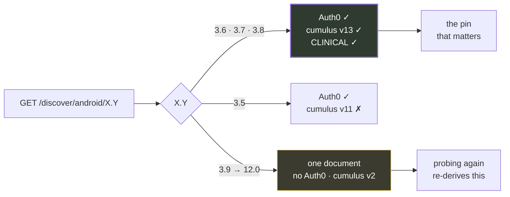
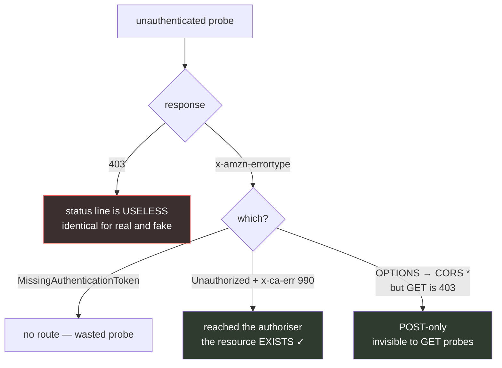
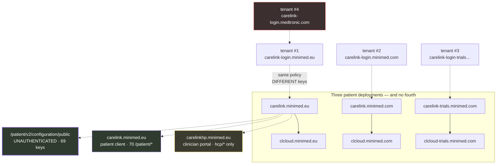
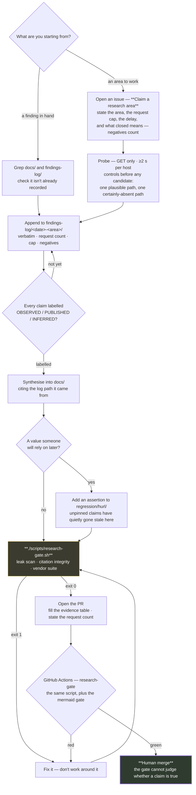

<div align="center">

# CareLink API research

**Medtronic publishes no API documentation. This is what their API looks like from the outside.**

[](LICENSE)
[](https://github.com/NovaLux12/carelink-api-research/blob/main/docs/09-methodology-and-oracles.md)
[](https://github.com/NovaLux12/carelink-api-research/actions/workflows/research-gate.yml)
[](https://github.com/NovaLux12/carelink-api-research/blob/counts/counts.json)
[](https://loopwise.uk)

[**Start with the map →**](docs/00-summary-the-map.md) · [**Help out →**](#contribute)

</div>

---

## Try it — ten seconds, no credential

The strongest fact in this repo is the one you can check yourself. This
endpoint hands over sixty-nine configuration keys — including the vendor's
complete sixteen-family device vocabulary — with no token, no cookie, no API
key:

```bash
curl -s --compressed \
     'https://carelink.minimed.eu/patient/v2/configuration/public' \
  | jq '[(keys | length), (.["personal.device.family.to.model.mapping"] | keys | length)]'
```

```
69
16
```

Drop `--compressed` and the same URL hands back raw gzip: the host sends
`Content-Encoding: gzip` unconditionally, ignoring `Accept-Encoding` entirely —
an RFC 9110 §8.4 violation, and it breaks any client that doesn't opt in. Here
`--compressed` isn't a nicety, it's the only way to read the body. **[OBSERVED]**
— `regression/hurl/05-public-config.check.sh` header;
`docs/09-methodology-and-oracles.md`.

---

## What this is, and what it isn't

Every third-party CareLink client — including
[the one that feeds Nightscout](https://github.com/NovaLux12/carelink-bridge) —
reverse-engineers this surface independently, because there's nothing to read.
This repo is that work, done once and cited.

The surprise is how much answers **without a credential at all**: the config
file above, an endpoint that answers for 117 countries, and a third that lets
you map which routes exist without ever holding a token.

**It is** a map of Medtronic's public CareLink surface, assembled read-only and
unauthenticated. Every claim carries an evidence label and a path to the file it
came from. Where two sources disagree, both are given.

**It isn't** an exploit, a client, or a working integration — no patient data is
reachable without a valid token, and nothing here touches one
(`docs/08-security-findings.md`). **It isn't** Medtronic's documentation, because
there isn't any: eleven conventional OpenAPI paths × three hosts, all negative
(`docs/10-open-questions.md`).

Gathered **read-only and unauthenticated**, under per-pass caps never exceeded:
≥1.2 s on probe rounds, ≥2 s per host enforced in-harness, 2.5 s measured floor
on the gateway sweep, ≥3 s on archive calls. One credential-adjacent act is on
the record — the published bundle key was sent once to the reports host to test
validity, and got 403. Both that and the read-only discipline are stated rather
than the tidy one. **[OBSERVED]** — `docs/09-methodology-and-oracles.md` §1.

---

## Three things that change how you'd approach it

### One dial, two documents

The app-version axis looks like a knob. It isn't — it resolves to one of exactly
two documents, so probing a new version number usually re-derives something you
already have.

> **⚠ And there are two of these dials, not one (2026-10-13).** Everything below is
> the **discovery-path** dial, and it is observed. A **second, independent** dial
> rides on the request **body**: `POST {baseUrlCumulus}/display/message` is reported
> to reject `appVersion ≤ 3.6.9` with `206 {"message":"Upgrade application"}` and to
> accept `≥ 3.7` with **no upper bound** — so the path has a ceiling and the body
> does not. **That half is a client's report, not this repo's observation**, and it
> cannot be settled from outside the project (settling a body field needs a POST, and
> `AGENTS.md` §11 permits no vendor POST beyond the two already-pinned ones). For the
> `X.Y` forms the discovery axis has been probed at, the two constraints intersect in
> exactly **`{3.7, 3.8}`** — `3.7.0` and `3.8.0` clear the body gate, but their
> discovery-path status is **unobserved**, since no `X.Y.Z` cell was ever probed. One
> shipped client feeds a
> **single constant** into both — correct only because `3.8` is in that window, so
> raising it to `3.9` breaks the discovery path **silently**. Full treatment, with
> both evidence labels and the reasoning:
> [`docs/03`](03-discovery-and-versions.md) §3a.



### You can map an API without a token

The most reusable thing here. The 403 status line is uniform and carries no
signal — the error *type* does, and an `OPTIONS` preflight finds routes a
GET-only probe calls dead.



### The estate

Three patient deployments, a shadow deployment nobody documented, and one file
that needs no credential at all. There is **no fourth patient deployment** —
every recorded `*trials*` host is a `.com`.



---

## Findings that surprised us

<details>
<summary><b>Nine findings, ordered by how much they change what you'd assume</b></summary>

<br>

**1. An unauthenticated configuration file with 69 keys.**
`GET /patient/v2/configuration/public` — gzip, no auth, on all three deployments.
The complete device-family vocabulary, the logbook schema, four undisclosed AWS
services, a per-country feature matrix. The closest thing to API documentation
Medtronic publishes.

**2. You can map which routes exist without ever holding a token.** (the oracle
above) — which found `v12/display/message`, live, in no prior note.

**3. The estate lies about what's missing.**
One host returns **HTTP 200 with 5518 bytes of HTML for every path that doesn't
exist**. Another returns a CloudFront **502 "could not resolve the origin domain
name"** that reads as "not deployed". And `*.carelink.eu` is **wildcard parking
DNS** where a random unregistered string resolves. Three near-misses in one
session came from trusting a status code.

**4. `?countryCode=` is accepted and ignored** — echoed back as a 70th key,
changing nothing. The real country axis is a different endpoint, and it disagrees
with itself: **in BE and CH, `bgUnits` says `MG_DL` while `glucoseUnitsDefault`
says `MMOL_L`.** That's roughly 18×, on a diabetes bridge.

**5. `Content-Encoding: gzip` is sent unconditionally**, ignoring
`Accept-Encoding` entirely. An RFC 9110 violation, and it breaks any client that
doesn't opt in.

**6. Five auth tenants, ten completely disjoint signing keys.** A shadow-domain
tenant nobody had enumerated shares OAuth *policy* — in fact its discovery
document is byte-identical to the patient's once the hostname is substituted
out — but shares no keys with any of them.

**7. The vendor's own patient app can't match its own newest pump.** Its matcher is
five tokens via `startsWith()`; the new device's family isn't among them. The six
model prefixes *do* agree across every source — which is why model-matching is
reliable and family-matching is a guess.

**8. When a device isn't matched, the API answers 200 with the past.** A real user
log shows `[Fetch] Success!` and `Stale CareLink data: 47510.42 minutes old`. Not
empty — a 33-day-old payload, on a successful status code.

**9. Their published configuration has a typo that rejects 2,000,000 valid values.**
`lhpro`/`lghpro` max is `4292967295`; the correct 32-bit maximum is `4294967295`.
Wrong in both ranges — and the clinician-side config carries the right one.

> **Newest, 2026-10-11 — the same oracle, run on two unexamined namespaces.**
> `pde/v3` is dead on both GET and OPTIONS, and two further live POST-only routes
> turned up: `connect/csr/v2/display/message` and `connect/v2/display/message`,
> each confirmed three times. 30 of a 30 request cap, GET and OPTIONS only.
> **[OBSERVED]** — `findings-log/2026-10-11-pde-csr-oracle/FINDINGS.md`; pinned in
> `regression/hurl/04-deep-surface.hurl`.

</details>

---

## How a contribution travels



Automation owns everything up to the merge: the citation paths, the scrub scan,
the assertion suite, the mermaid gate, the numbers in this README, and — every
Monday — a full re-probe of the pinned surface that files its own drift issue if
anything moved. The gate deliberately does **not** check whether a claim is
*true*; that needs a human or a second pass, which is why the last arrow is the
only one that isn't automatic. **[OBSERVED]** —
`scripts/research-gate.sh` header; `CONTRIBUTING-research.md`;
`.github/workflows/drift-sweep.yml`; `AGENTS.md` §11.

---

## Contribute

Three genuinely different situations. One gate: `./scripts/research-gate.sh`
must exit 0.

### 1 · You're a human reader

Copy this into your agent's chat and hit go. It tells the agent to read the
instructions and follow them:

```
I want to help with https://github.com/NovaLux12/carelink-api-research

Read the instructions here and follow them:
https://github.com/NovaLux12/carelink-api-research/blob/main/CONTRIBUTING-research.md
```

Already holding a finding? The prompt is different on purpose — it skips the
session and helps you write up what you have, with the evidence class and source
cite it needs. Both prompts live in [`.github/prompts/`](.github/prompts/), and
four more sit beside them (loop, refill, verify, sweep).

### 2 · You're a coding agent, one session

`CONTRIBUTING-research.md` is the whole instruction set, written to be fetched
over HTTPS rather than assumed present on disk:

```bash
gh api repos/NovaLux12/carelink-api-research/contents/AGENTS.md --jq .content | base64 -d
# or, to get the whole repo:
git clone https://github.com/NovaLux12/carelink-api-research
```

Claim the area first — claiming is what stops two agents probing the same
afternoon. One session lands one log entry, and leaves `docs/11` fuller than it
found it (step 7 of the session protocol).

### 3 · You're running an agent loop

Run the lifecycle above once per iteration — **claim → probe → log → label →
refill → pin** — and stop when the open areas run out or your request budget
does. The full loop is spelled out in
[`CONTRIBUTING-research.md`](CONTRIBUTING-research.md) §*Looping an agent*, with a
reference controller in `scripts/research-loop.sh` that works with opencode,
Claude Code and Codex. Two things the loop may not do: assign its own evidence
label (OBSERVED needs a response head, and a loop can't see one), and merge its
own PR.

### Before you open the PR

```bash
git clone https://github.com/NovaLux12/carelink-api-research
cd carelink-api-research
./scripts/research-gate.sh        # must exit 0 — CI runs the same script
```

> **A negative result counts.** Issue #84 was closed by proving something does
> *not* exist — 73 paths, 28 key names, four corpora. Proving an absence is one of
> the most useful things you can do here. **[OBSERVED]** —
> `CONTRIBUTING-research.md`; `docs/11-suggested-research-areas.md`.

| Looking for | Go to |
|---|---|
| What's already known | [`docs/00-summary-the-map.md`](docs/00-summary-the-map.md) |
| Something to work on | [`docs/11-suggested-research-areas.md`](docs/11-suggested-research-areas.md) |
| A loop or an agent prompt | [`CONTRIBUTING-research.md`](CONTRIBUTING-research.md) §Looping an agent |
| The rules before probing | [`AGENTS.md`](AGENTS.md) §7 · [`docs/09`](docs/09-methodology-and-oracles.md) |
| Submit a finding, or run a session | [`CONTRIBUTING-research.md`](CONTRIBUTING-research.md) |

---

## Who builds on this

Medtronic publishes no API, so every third-party CareLink client — Nightscout
bridges, xDrip, Home Assistant integrations, Python and Java libraries —
reverse-engineers the same surface independently, and each one is only as
correct as the assumptions its author happened to test. This repo is that work
done once and cited.

Projects known to be built on findings here:

| Project | Depends on this for |
|---|---|
| **[NovaLux12/carelink-bridge](https://github.com/NovaLux12/carelink-bridge)** | the discovery version pin, the host/namespace split, the unauthenticated status-code oracles, and the error taxonomy behind `login-errors.ts`. Its [architecture doc](https://github.com/NovaLux12/carelink-bridge/blob/main/docs/ARCHITECTURE.md) carries a dated snapshot of the parts this bridge depends on — and explicitly says it is **not** the estate map, pointing here as canonical; its [vendor-api index](https://github.com/NovaLux12/carelink-bridge/blob/main/docs/vendor-api/README.md) is a short "what you probably want → page here" table with run instructions for the suite below. |
| **[NovaLux12/carelink-bridge](https://github.com/NovaLux12/carelink-bridge) — releases** | runs `regression/hurl/run.sh` before a release (`npm run drift:check`, which needs this repo cloned alongside it). A red sweep here reaches their release checklist. |

If you maintain a CareLink client and something in it stops working, the first
check worth making is whether this repo has moved: a route that was live may be
gone, a country may have rolled out a new one, or the config may have drifted.
**Report what you find here** — a negative or a correction is as useful as a
positive, and the regression suite is what stops a fix from quietly reverting.

> **Which repo does my report belong in?**
> Observations about **Medtronic's surface** — a route added or removed, a version
> list changed, a country rolled out, a field renamed — belong **here**.
> Problems with **a client implementation** — login fails, upload fails, a crash,
> or wrong Nightscout data from a route that is still live — belong in the client,
> e.g. [carelink-bridge's bug form](https://github.com/NovaLux12/carelink-bridge/issues/new?template=bug.yml).
> A Nightscout outage or a bad profile belongs to Nightscout, not to either repo.
>
> **And if it moves a value the bridge pins** — the discovery pin, `BLE_API_VERSIONS`,
> the family vocabulary, an error taxonomy — the finding is *incomplete* until the
> consumer knows: label it `downstream-bridge`, name the constant, link the bridge
> issue. The bridge runs this suite before a release, so drift here can reach their
> release checklist.

---

## Why trust this

**Every claim is labelled.** **OBSERVED** — seen in a live response.
**PUBLISHED** — in a vendor document served without a login. **INFERRED** —
reasoned, not seen. An INFERRED claim that reads as OBSERVED is the worst thing
you can do here, because it destroys the one property that makes this repo
useful: a stranger can tell which claims are still guesses. **[OBSERVED]** —
`AGENTS.md` §2.

**The history of being wrong is kept, and counted.** We have been wrong here
fourteen times on the record — seven while writing, seven more found by an
independent audit of all twelve pages — and the recurring shapes are worth
naming, because each one produced a mechanism rather than an apology:

- a claim stated **without evidence** — nothing to point at
- a grep that **hit without proving** what it was said to prove
- a hash comparison over a lookup that **silently returned null**, manufacturing
  agreement between two different values
- a verification that **read back the wrong target**
- derived prose that **contradicted its own source table**, then propagated
  faithfully into five pages — including one claiming MG_DL vs MMOL_L
  mis-scales glucose in the wrong countries
- a citation pointing at a **file that doesn't exist**
- a count generalised from a **subset** (44 published as 93), with no counting
  rule recorded

Every correction stays in `findings-log/` rather than being quietly fixed — a
research note that only records its successes isn't one. **[OBSERVED]** —
`AGENTS.md` §6; `docs/09-methodology-and-oracles.md`.

**The assertion is the arbiter, not the prose.** `regression/hurl/` holds **210
pinned assertions** — 424 execute per run, once the 16-family loop in the config
suite is expanded and hurl's status-line checks are counted. Exit 0 = the vendor
surface hasn't drifted past the pinned values. The suite has caught a page
asserting a hash its own log had already retracted. **[OBSERVED]** —
`docs/09-methodology-and-oracles.md`; `scripts/measure_assertions.py`.

**The numbers on this page are CI-enforced.** The assertion count isn't typed by
a hand — a weekly job re-measures it and the badge reads the result, and the
gate fails any PR whose prose count disagrees with the measurement. That
machinery exists because the badge used to say 93 long after the suite had grown
past it, twice, and because a count generalised from a subset is how that
happened.

**What the gate does not do.** It stops the irreversible mistakes — credential
material, internal hostnames, machine paths, live session values from archive
captures, any citation that doesn't resolve, any count that doesn't match its
measurement. It deliberately does not check whether a claim is *true*. That
needs a human or a second pass. **[OBSERVED]** — `CONTRIBUTING-research.md`
§What the gate checks.

---

## The rules this repo obeys

> [!IMPORTANT]
> These aren't stylistic. Each exists because breaking it leaked something.

> [!CAUTION]
> **Never commit a credential.** Record *that* one is published and *where* — never
> the value. A vendor `x-api-key` and a reCAPTCHA site key are known-published and
> are redacted throughout, findings left intact. A **live** secret is not a
> finding — report it privately per [`SECURITY.md`](SECURITY.md), never through
> a public issue.

> [!WARNING]
> **`*.carelink.eu`, `*.carelink.com`, `*.clcloud.eu` are wildcard DNS on a parking
> operator.** A random unregistered string resolves. 49 names in the collection are
> false positives. Never report one as a vendor asset — that's how a false
> positive reaches a disclosure.

> [!NOTE]
> **Raw archive captures are never published.** Common Crawl and Wayback records
> contain live `jsessionid_*` values and pre-Auth0 authorize URLs whose
> `sessionData` is a plaintext-base64 JWS. Facts only.

Full list: [`AGENTS.md`](AGENTS.md) §7.

---

## What's here

| | |
|---|---|
| **[`docs/`](docs/)** | 12 canonical pages. Synthesised, dated, every claim cites the log it came from. |
| **[`findings-log/`](findings-log/)** | Append-only research logs, verbatim. Kept because conclusions were retracted and re-derived — that history is the evidence. |
| **[`regression/hurl/`](regression/hurl/)** | 210 pinned assertions across 5 suites. **Exit 0 = the vendor surface hasn't drifted past the pinned values.** |
| **[`CONTRIBUTING-research.md`](CONTRIBUTING-research.md)** | How to contribute — the gate, the standard, the traps, the loop prompts. |
| **[`AGENTS.md`](AGENTS.md)** | The operating rules — evidence classes, the scrub list, the four ways this project has been wrong, what automation may do. |
| **[`scripts/research-gate.sh`](scripts/research-gate.sh)** | The gate. CI runs the identical script on every PR. |
| **[`.github/`](.github/)** | 4 issue forms, a PR template, 6 agent prompts, 1 PR gate plus 3 scheduled workflows (research-gate; drift sweep, priorities alarm, stale-claim reaper). |

---

<div align="center">

**MIT · a research artefact by [loopwise.uk](https://loopwise.uk) · read-only, no credentials used**

*Derived from the notes of [`NovaLux12/carelink-bridge`](https://github.com/NovaLux12/carelink-bridge).*

</div>
