<div align="center">

# CareLink API research

**A read-only map of one of the least-documented medical APIs in production — and of the surprising amount Medtronic publishes without a login.**

`research` `read-only` `no credentials used` `diabetes data · defensive only`

[]()
[]()
[]()
[]()
[](LICENSE)

*Start here → [**`docs/00-summary-the-map.md`**](docs/00-summary-the-map.md)*

</div>

---

## Why this exists

Third-party clients for CareLink — the bridge that feeds Nightscout, and several
others — are **guesswork**. There is no public API documentation, and Medtronic
publishes nothing for developers. Every client in this space reverse-engineers the
same surface independently.

The surprise is how much is available **without a credential at all**. One
unauthenticated file names every device family Medtronic makes. Another answers
unauthenticated for 117 countries. A third means you can map which API routes
exist without ever holding a token.

**Everything here was gathered read-only, unauthenticated, one request per second.
No credentials. No login. No authentication attempted.**

---

## Three things worth diagramming

### One dial, two documents

The app-version axis looks like a knob. It isn't — it resolves to exactly one of
two documents, which means probing a new version number usually re-derives
something already known. That single insight closes off an entire class of wasted
probing.

```mermaid
flowchart LR
    A["GET /connect/carepartner/v13/discover/android/X.Y"] --> B{X.Y}
    B -->|"3.6 · 3.7 · 3.8"| C["Auth0 ✓<br/>cumulus v13 ✓<br/>CLINICAL ✓"]
    B -->|"3.5"| D["Auth0 ✓<br/>cumulus v11 ✗"]
    B -->|"3.9 → 12.0"| E["one document<br/>no Auth0 · cumulus v2 · no CLINICAL"]
    C --> F["THE pin<br/>that matters"]
    E --> G["probing a new version<br/>re-derives this same doc"]
    style C fill:#2f3b2f,stroke:#6f6,stroke-width:2px
    style E fill:#3b3b2f,stroke:#fd6
```



### How to map an API without a token

This is the most reusable thing in the repo. The 403 status line is uniform and
carries no signal — but the error *type* does, and an `OPTIONS` preflight finds
routes a GET-only probe calls dead.

```mermaid
flowchart TD
    P["unauthenticated probe of clcloud.*"] --> Q{what did it return?}
    Q -->|"403"| X["status line is USELESS<br/>identical for real and fabricated"]
    Q -->|"x-amzn-errortype"| T{which one?}
    T -->|"MissingAuthenticationTokenException"| N["NO ROUTE<br/>wasted probe"]
    T -->|"UnauthorizedException<br/>+ x-ca-err: 990"| L["REACHED the Layer7 authoriser<br/>the resource EXISTS ✓"]
    T -->|"OPTIONS → CORS: *<br/>but GET is 403"| Q2["Resource exists, POST-only<br/>invisible to a GET-only probe"]
    L --> V["this is what found v12/display/message<br/>live, and in no prior note"]
    Q2 --> V2["this is what found v6/display/message<br/>POST-only"]
    style X fill:#3b2f2f,stroke:#f66
    style L fill:#2f3b2f,stroke:#6f6
    style Q2 fill:#2f3b2f,stroke:#6f6
```



### The estate

Four deployments, four auth tenants, and a shadow domain nobody documented.

```mermaid
flowchart TB
    subgraph P[" "]
        direction LR
        E1["carelink.minimed.eu"] --> E2["clcloud.minimed.eu"]
        U1["carelink.minimed.com"] --> U2["clcloud.minimed.com"]
        T1["carelink-trials.minimed.com"] --> T2["clcloud-trials.minimed.com"]
    end
    A1["carelink-login.minimed.eu<br/>tenant #1"] -. "same policy<br/>DIFFERENT keys" .-> E1
    A2["carelink-login.minimed.com<br/>tenant #2"] -.-> U1
    A3["carelink-login-trials.minimed.com<br/>tenant #3"] -.-> T1
    S["carelink-login.medtronic.com<br/>⚠ tenant #4 · shadow domain"]
    G["carelinkhp.minimed.eu<br/>clinician portal<br/>⚠ hcp/* only, not /patient/*"]
    P2["carelink.minimed.eu<br/>patient-facing client<br/>70 /patient/* endpoints"]
    CFG["carelink.minimed.{eu,com}<br/>/patient/v2/configuration/public<br/>UNAUTHENTICATED · 69 keys"]
    style S fill:#3b2f2f,stroke:#f66,stroke-width:2px
    style CFG fill:#2f3b2f,stroke:#6f6,stroke-width:2px
    style P2 fill:#2f3b2f,stroke:#6f6,stroke-width:2px
```



---

## Nine findings that surprised us

<details open>
<summary><b>Ordered by how much they change what you'd assume</b></summary>

<br>

**1. An unauthenticated configuration file with 69 keys.**
`GET /patient/v2/configuration/public` — gzip, no auth, on all three deployments. It
contains the complete device-family vocabulary, the logbook schema, four
undisclosed AWS service hosts, and a per-country feature matrix. It is the closest
thing to an API document Medtronic publishes.

**2. You can map which routes exist without ever holding a token.**
The 403 line is uniform; `x-amzn-errortype` is not. `MissingAuthenticationTokenException`
means **no route**; `UnauthorizedException` + `x-ca-err: 990` means the request
**reached Medtronic's authoriser** — so the resource exists. That distinction turned
every dead end into evidence and found `v12/display/message`, live and previously
unrecorded.

**3. The estate lies about what's missing.**
`carelinkhp` returns **HTTP 200 with 5518 bytes of HTML for every path that does not
exist**, `commoncore` returns a CloudFront **502 "could not resolve the origin domain
name"** that reads as "not deployed" rather than a misconfiguration, and
`*.carelink.eu` is **wildcard parking DNS** where a random unregistered string
resolves. Three near-misses in one session came from trusting a status code.

**4. `?countryCode=` is accepted and ignored.**
The public config echoes the parameter back as a 70th key and changes nothing — it
is region-parameterised by **host**, not parameter. The real country axis is a
different endpoint, and it disagrees with itself: **in BE and CH, `bgUnits`
says `MG_DL` while `glucoseUnitsDefault` says `MMOL_L`.** Read the one and not the
other and you mis-scale every glucose value. That class of bug affects any client,
not one device.

**5. `Content-Encoding: gzip` is sent unconditionally**, ignoring `Accept-Encoding`
entirely — verified against `identity`, `gzip` and `deflate`. An RFC 9110 §8.4
violation, and it breaks any client that doesn't opt in.

**6. Four auth tenants, four completely disjoint signing keys.** The shadow domain
carries a fourth tenant nobody had enumerated, and its keys share nothing with the
other three. So a shadow token is a *verifier* question, not a key leak.

**7. The vendor's own patient app can't match its own newest pump.** Its matcher is
five tokens — `BLE, BLE_X, SIMPLERA, SIMPLERA_X, GUARDIAN` — via `startsWith()`. The
new device's family is `CC880`, which is not in that list. Either their app lags
their hardware, or there is a value nobody has found. Meanwhile the **six model
prefixes agree across every source**, which is why model-matching is the reliable
path and family-matching is a guess.

**8. When a device isn't matched, the API answers 200 with the past.** The legacy
endpoint returns the last records it ever held — **frozen at the day the pump was
paired**. A real user log shows `[Fetch] Success!` and `Stale CareLink data: 47510.42
minutes old`. Not an empty response, a 33-day-old one, on a successful status code.
Our fork's code comment predicted this months before anyone reported it.

**9. Their published configuration has a typo that rejects 2,000,000 valid values.**
`lhpro`/`lghpro` max is `4292967295`; the correct 32-bit maximum is `4294967295`.
Wrong in both ranges, and the clinician-side config carries the right one.

</details>

---

## Contribute a finding

Two paths in. Both end at the same gate.

```bash
git clone https://github.com/NovaLux12/carelink-api-research
cd carelink-api-research

# working on an area? read this, it is written to be pasted into any agent
cat docs/RESEARCH-SESSION.md

# already have a finding? this is the standard
cat CONTRIBUTING-research.md

# before you open a PR — must exit 0
./scripts/research-gate.sh
```

**The standard, in one line:** a reader can tell what you observed, how you know
it's true, where it came from, and how it could be wrong — without re-deriving
anything.

| You want to | Start at |
|---|---|
| Run a research session | [`docs/RESEARCH-SESSION.md`](docs/RESEARCH-SESSION.md) — copy-paste brief for any agent |
| Submit a finding you already have | [`CONTRIBUTING-research.md`](CONTRIBUTING-research.md) |
| Claim an area first | the *Claim a research area* issue form |
| See open areas | [`docs/11-suggested-research-areas.md`](docs/11-suggested-research-areas.md) |

The gate scans your diff for credentials and internal hostnames, validates every
citation path, and re-runs the vendor assertion suite. It runs in CI too, so a
red gate blocks the merge regardless.

**A negative result counts.** Issue #84 was closed by proving something does
*not* exist — across 73 paths, 28 key names and four corpora. Proving an absence
is one of the most useful things you can contribute here.

## What's here

| | |
|---|---|
| **[`docs/`](docs/)** | 12 canonical pages. Synthesised, dated, every claim cites the log it came from. Start at the map. |
| **[`findings-log/`](findings-log/)** | Append-only research logs, verbatim. Kept because conclusions were retracted and re-derived — that history is the evidence. |
| **[`regression/hurl/`](regression/hurl/)** | A pinned assertion suite. **Exit 0 = the vendor surface hasn't drifted.** Run it before quoting any claim from here. |
| **[`AGENTS.md`](AGENTS.md)** | How to contribute — evidence classes, the never-publish rules, and the four ways this project has been wrong. |
| **[`docs/11`](docs/11-suggested-research-areas.md)** | 13 open areas, each with a stated blocker and a definition of done. |

`docs/` supersedes `findings-log/` where they disagree.

---

## The rules this repo obeys

> [!IMPORTANT]
> These are not stylistic. Each exists because breaking it leaked something.

> [!CAUTION]
> **Never commit a credential.** API keys, tokens, site keys, session values. Record
> *that* one is published and *where* — never the value. A vendor `x-api-key` and a
> reCAPTCHA site key are known-published and are redacted throughout
> `findings-log/` with the finding left intact.

> [!WARNING]
> **`*.carelink.eu`, `*.carelink.com`, `*.clcloud.eu` are wildcard DNS on a parking
> operator.** A random unregistered string resolves; every name 302s to a parked
> page. ~50 names in the collection are false positives. Never report one as a vendor
> asset — that is how a false positive reaches a disclosure.

> [!CAUTION]
> **`carelinkhp.minimed.eu` returns 200 + `text/html` (5518 bytes) for every path
> that does not exist.** Discriminate on `Content-Type`, never on status code.

> [!NOTE]
> **Raw archive captures are never published.** Common Crawl and Wayback records
> contain live `jsessionid_*` values and pre-Auth0 authorize URLs whose
> `sessionData` is a plaintext-base64 JWS. Facts only.

---

## Method

Read-only. Unauthenticated. One request every 1–2 seconds, against endpoints the
vendor already publishes. No credentials used, no authentication attempted, no state
created. Hosts that looked internal were recorded and left alone.

Where a conclusion comes from a **published vendor document** rather than a **live
API response**, the docs say so. That distinction matters here more than almost
anything: Medtronic's own configs disagree about how device families are spelled, and
one document's trailing-whitespace padding makes it unusable as a machine contract.

---

## Confidence

Claims are labelled **OBSERVED** (seen in a live response), **PUBLISHED** (in a
vendor document served without a login) or **INFERRED** (reasoned, not seen). Four
repo issues remain blocked *on purpose*, because they need a token.

**We have also been wrong here, on the record.** Four distinct ways — a claim
without evidence, a grep that hit without proving, a hash comparison over a lookup
that silently returned null, and a verification that read back the wrong target.
Every correction is kept in `findings-log/` rather than quietly fixed, because a
research note that only records its successes isn't one. A regression suite caught
the third one, by asserting the right value where the prose was wrong.

---

<div align="center">

**A research artefact by [loopwise.uk](https://loopwise.uk) · read-only · no credentials used**

*Derived from the research notes of [`NovaLux12/carelink-bridge`](https://github.com/NovaLux12/carelink-bridge), scrubbed and synthesised for publication.*

</div>
