# CareLink API research

**A read-only map of Medtronic's CareLink network surface — built by asking it questions it answers without a login.**

`research` `read-only` `no credentials used` `diabetes data · defensive only`

*Start here → [**`docs/00-summary-the-map.md`**](docs/00-summary-the-map.md)*

---

## Why this exists

A nurse-ware-adjacent detail first: the **Minimed Flex pump ships today**, its owner
reported silent zero-data fetch, and **no documentation of the CareLink API exists
anywhere public**. Third-party clients are guessing.

So we stopped guessing. Medtronic publishes a surprising amount without a login —
including a 69-key configuration file that names every device family it makes.

**Everything here was gathered read-only, unauthenticated, one request per second.
No credentials. No login. No authentication attempted. Nothing written back.**

---

## The findings that surprised us

<b>Ten things we did not expect to find</b> (click to expand)

 

**1. There is an unauthenticated configuration file with 69 keys.**
`GET /patient/v2/configuration/public` — gzip, no auth, on all three deployments. It
contains the complete device-family vocabulary, the logbook schema, the report
endpoints, and the names of four undocumented AWS services.

**2. It names the Flex.**
`"CC880": "Minimed™ Flex"` — and `CC880` contains `MMT-8062/8063/8082–8085`. So the
device everyone was guessing about is published.

**3. The vendor's own app can't match the Flex either.**
The patient app's matcher is five tokens — `BLE, BLE_X, SIMPLERA, SIMPLERA_X,
GUARDIAN` — matched with `startsWith()`. `CC880` is not in the list. Either
Medtronic's app is broken for its own shipping device, or there is a family value
nobody has found. **This is why model-prefix matching, not family matching, is the
reliable path.**

**4. The lesson of a 780G→Flex upgrade is a 33-day-old payload, not an empty one.**
`[Fetch] Success!` — `Stale CareLink data: 47510.42 minutes old`. The legacy
endpoint answers 200 with the last records it ever held, frozen the day the pump
was paired. Our fork's code comment predicted this **months** before the report.

**5. Their published configuration has a typo that rejects 2,000,000 valid values.**
`lhpro`/`lghpro` max is `4292967295`. The correct 32-bit maximum is `4294967295` —
exactly 2,000,000 low, wrong in both ranges, and the clinician-side config carries
the right one.

**6. One deployment publishes working API keys where another ships a fake.**
The US and trials configs contain real-looking `x-api-key` values for their reports
brokers. The EU config ships the literal placeholder
`%#$^&#GFFG@#*%&#$` — which is why nobody noticed the other two.

**7. `?countryCode=` is accepted and ignored.**
The public config echoes it back as a 70th key and changes nothing. It is
region-parameterised by *host*, not by parameter. The real country axis is
elsewhere — and it disagrees with itself: **in BE, ES and IT, `bgUnits` says
`MG_DL` while `glucoseUnitsDefault` says `MMOL_L`.** Reading one and not the other
mis-scales every glucose value.

**8. Four tenants, four disjoint signing keys.**
There is a fourth Auth0 tenant on a shadow domain nobody had enumerated. All four
have completely disjoint JWKS kids — so a shadow token is a verifier question, not
a key-leak.

**9. Probing that host family works without a token — but not the way you'd think.**
The 403 status line is uniform and useless. `x-amzn-errortype:
MissingAuthenticationTokenException` means *no route*;
`UnauthorizedException` + `x-ca-err: 990` means *the request reached Medtronic's
authoriser*. That distinction turned every dead end into evidence. It also found
**`v12/display/message`, live, and in no prior note.**

**10. The estate lies about what's missing.**
`carelinkhp` returns HTTP 200 with 5518 bytes of HTML for *every* path that does not
exist. Three near-misses in one session came from trusting a status code.

---

## What's here

| | |
|---|---|
| **[`docs/`](docs/)** | Canonical pages. Synthesised, dated, and every claim cites the log it came from. Read these first. |
| **[`findings-log/`](findings-log/)** | Append-only research logs, dated verbatim. Kept because conclusions were retracted and re-derived — that history is evidence. |
| **[`regression/hurl/`](regression/hurl/)** | A pinned assertion suite. **Exit 0 = the vendor surface hasn't drifted.** Run it before quoting any claim from here. |

`docs/` supersedes `findings-log/` where they disagree.

---

## The estate at a glance

Four deployments, four auth tenants, and a shadow domain nobody documented.

```mermaid
flowchart TB
    subgraph CLIENT["A third-party client"]
        C["isBleDevice(deviceFamily, deviceModel)<br/>+ buildEndpointCandidates(url)"]
    end

    subgraph EU["EU / OUS"]
        P1["carelink.minimed.eu<br/>patient API"]
        K1["clcloud.minimed.eu<br/>cumulus v13"]
        A1["carelink-login.minimed.eu<br/>Auth0 tenant #1"]
    end
    subgraph US["US"]
        P2["carelink.minimed.com"]
        K2["clcloud.minimed.com"]
        A2["carelink-login.minimed.com<br/>tenant #2"]
    end
    subgraph TR["Trials / clinical"]
        P3["carelink-trials.minimed.com"]
        K3["clcloud-trials.minimed.com"]
        A3["carelink-login-trials.minimed.com<br/>tenant #3"]
    end

    P1 -. "same OAuth policy,<br/>DIFFERENT signing keys" .-> A1
    P2 -.-> A2
    P3 -.-> A3

    S["carelink-login.medtronic.com<br/>⚠ tenant #4 · shadow domain"]

    G["carelinkhp.minimed.eu<br/>clinician portal<br/>⚠ hcp/* only, not /patient/*"]
    CFG["carelink.minimed.{eu,com,com}<br/>/patient/v2/configuration/public<br/>UNAUTHENTICATED · 69 keys"]

    C --> CFG
    C --> G
    CFG -. "hands out v6,<br/>app wants v13" .-> K1
    C --> K1

    style S fill:#3b2f2f,stroke:#f66,stroke-width:2px
    style CFG fill:#2f3b2f,stroke:#6f6,stroke-width:2px
    style G fill:#3b3b2f,stroke:#fd6,stroke-width:1px
```

---

## Why the Flex breaks — in one diagram

This is the failure the whole project started from, and the reason model-matching
beats family-matching.

```mermaid
flowchart TD
    A["Flex reports deviceFamily"] --> B{"isBleDevice()?"}
    B -->|"BLE* or SIMPLERA*<br/>✅"| C["BLE periodic endpoint"]
    B -->|"CC880 / 'Minimed™ Flex'<br/>❌ no BLE, no FLEX token"| D["legacy v6 endpoint"]
    B -->|"model MMT-8062/63/8082-85<br/>✅ works either way"| C
    D --> E["HTTP 200, last records it ever held"]
    E --> F["frozen at the day the pump was paired"]
    F --> G["'[Fetch] Success!'<br/>+ 33-day-old payload<br/>+ zero uploads"]
    style B fill:#2b2b3b,stroke:#8be9fd
    style G fill:#3b2f2f,stroke:#f66,stroke-width:2px
```

---

## The rules this repo obeys

> [!IMPORTANT]
> **These are not stylistic.** Each one exists because breaking it leaked something.

 

> [!CAUTION]
> **Never commit a credential.** API keys, tokens, site keys, session values.
> Record *that* a credential is published and *where* — never the value. A vendor
> `x-api-key` and a reCAPTCHA site key are known-published and are redacted
> throughout `findings-log/` with the finding left intact.

> [!WARNING]
> **`*.carelink.eu`, `*.carelink.com`, `*.clcloud.eu` are wildcard DNS on a parking
> operator.** A random unregistered string resolves; every name 302s to a parked
> page. ~50 names in the collection are false positives. **Never report one as a
> vendor asset** — that is how a false positive reaches a disclosure.

> [!CAUTION]
> **`carelinkhp.minimed.eu` returns 200 + `text/html` (5518 bytes) for every path
> that does not exist.** Discriminate on `Content-Type`, never on status code.

> [!NOTE]
> **`carelink.minimed.eu` serves `Content-Encoding: gzip` unconditionally**,
> ignoring `Accept-Encoding` entirely — verified against `identity`, `gzip` and
> `deflate`. An RFC 9110 §8.4 violation, and it breaks any client that doesn't opt
> in. Use `curl --compressed`.

---

## Method

Read-only. Unauthenticated. One request every 1–2 seconds, against endpoints the
vendor already publishes. No credentials used, no authentication attempted, no
state created. Hosts that looked internal were recorded and left alone.

Where a conclusion comes from a **published vendor document** rather than a **live
API response**, the docs say so. That distinction matters more than anything else
here: Medtronic's own configs disagree about how device families are spelled, and
one document's trailing-whitespace padding makes it unusable as a machine contract.

---

## Confidence

Claims are labelled **OBSERVED** (seen in a live response), **PUBLISHED** (in a
vendor document served without a login) or **INFERRED** (reasoned, not seen).
Anything unconfirmed stays open — four repo issues remain blocked *on purpose*
because they need a token, not because they're hard.

**We've also been wrong here, on the record.** Four separate ways — a claim without
evidence, a grep that hit without proving, a hash comparison over a lookup that
silently returned null, and a dead test-file typecheck. The corrections are kept in
`findings-log/` rather than quietly deleted, because a research note that only
records its successes isn't a research note.

---

## Open questions

What we *don't* know, and exactly what would settle it, lives in
[`docs/10-open-questions.md`](docs/10-open-questions.md). The short version: the
wire shape of `deviceFamily`, the NGP alarm vocabulary, report bodies, and
`relativeOffset` semantics — all blocked on an authenticated response, not on
effort.

---

**A research artefact by [loopwise.uk](https://loopwise.uk) · read-only · no credentials used**

*Derived from the research notes of [`NovaLux12/carelink-bridge`](https://github.com/NovaLux12/carelink-bridge),
scrubbed and synthesised for publication.*

