<div align="center">

# CareLink API research

**Medtronic publishes no API documentation. This is what their API looks like from the outside.**

[](LICENSE)
[]()
[]()
[]()

[**Start with the map →**](docs/00-summary-the-map.md) · [**Help out →`](#contribute)

</div>

---

## The short version

Every third-party CareLink client — including the one that feeds Nightscout —
reverse-engineers this surface independently, because there's nothing to read.
This repo is that work, done once and cited.

The surprise is how much answers **without a credential at all**: one
unauthenticated file names every device family Medtronic makes, another answers
for 117 countries, and a third lets you map which routes exist without ever
holding a token.

Gathered **read-only, unauthenticated, one request per second**. No credentials.
No login. No authentication attempted.

---

## Three things that change how you'd approach it

### One dial, two documents

The app-version axis looks like a knob. It isn't — it resolves to one of exactly
two documents, so probing a new version number usually re-derives something you
already have.

```mermaid
flowchart LR
    A["GET /discover/android/X.Y"] --> B{X.Y}
    B -->|"3.6 · 3.7 · 3.8"| C["Auth0 ✓<br/>cumulus v13 ✓<br/>CLINICAL ✓"]
    B -->|"3.5"| D["Auth0 ✓<br/>cumulus v11 ✗"]
    B -->|"3.9 → 12.0"| E["one document<br/>no Auth0 · cumulus v2"]
    C --> F["the pin<br/>that matters"]
    E --> G["probing again<br/>re-derives this"]
    style C fill:#2f3b2f,stroke:#6f6,stroke-width:2px
    style E fill:#3b3b2f,stroke:#fd6
```



### You can map an API without a token

The most reusable thing here. The 403 status line is uniform and carries no
signal — the error *type* does, and an `OPTIONS` preflight finds routes a
GET-only probe calls dead.

```mermaid
flowchart TD
    P["unauthenticated probe"] --> Q{response}
    Q -->|"403"| X["status line is USELESS<br/>identical for real and fake"]
    Q -->|"x-amzn-errortype"| T{which?}
    T -->|"MissingAuthenticationToken"| N["no route — wasted probe"]
    T -->|"Unauthorized + x-ca-err 990"| L["reached the authoriser<br/>the resource EXISTS ✓"]
    T -->|"OPTIONS → CORS *<br/>but GET is 403"| Q2["POST-only<br/>invisible to GET probes"]
    style X fill:#3b2f2f,stroke:#f66
    style L fill:#2f3b2f,stroke:#6f6
    style Q2 fill:#2f3b2f,stroke:#6f6
```



### The estate

Four deployments, four auth tenants, and a shadow domain nobody documented.

```mermaid
flowchart TB
    subgraph E[" "]
        direction LR
        e1["carelink.minimed.eu"] --> e2["clcloud.minimed.eu"]
        u1["carelink.minimed.com"] --> u2["clcloud.minimed.com"]
        t1["carelink-trials.minimed.com"] --> t2["clcloud-trials.minimed.com"]
    end
    a1["tenant #1<br/>carelink-login.minimed.eu"] -. "same policy<br/>DIFFERENT keys" .-> e1
    a2["tenant #2<br/>carelink-login.minimed.com"] -.-> u1
    a3["tenant #3<br/>carelink-login-trials…"] -.-> t1
    s["tenant #4<br/>carelink-login.medtronic.com"]
    s -.-> a1
    g["carelinkhp.minimed.eu<br/>clinician portal · hcp/* only"]
    e1 -.-> g
    p["carelink.minimed.eu<br/>patient client · 70 /patient/*"]
    e1 -.-> p
    cfg["/patient/v2/configuration/public<br/>UNAUTHENTICATED · 69 keys"]
    e1 -.-> cfg
    style s fill:#3b2f2f,stroke:#f66
    style cfg fill:#2f3b2f,stroke:#6f6,stroke-width:2px
    style p fill:#2f3b2f,stroke:#6f6
    style g fill:#3b3b2f,stroke:#fd6
```



---

## Findings that surprised us

<details>
<summary><b>Nine findings, ordered by how much they change what you'd assume</b></summary>

<br>

**1. An unauthenticated configuration file with 69 keys.**
`GET /patient/v2/configuration/public` — gzip, no auth, on all three deployments.
The complete device-family vocabulary, the logbook schema, four undisclosed AWS
services, a per-country feature matrix. The closest thing to API documentation
Medtronic publishes.

**2. You can map which routes exist without ever holding a token.** (the oracle
above) — which found `v12/display/message`, live, in no prior note.

**3. The estate lies about what's missing.**
One host returns **HTTP 200 with 5518 bytes of HTML for every path that doesn't
exist**. Another returns a CloudFront **502 "could not resolve the origin domain
name"** that reads as "not deployed". And `*.carelink.eu` is **wildcard parking
DNS** where a random unregistered string resolves. Three near-misses in one
session came from trusting a status code.

**4. `?countryCode=` is accepted and ignored** — echoed back as a 70th key,
changing nothing. The real country axis is a different endpoint, and it disagrees
with itself: **in BE and CH, `bgUnits` says `MG_DL` while `glucoseUnitsDefault`
says `MMOL_L`.** That's roughly 18×, on a diabetes bridge.

**5. `Content-Encoding: gzip` is sent unconditionally**, ignoring
`Accept-Encoding` entirely. An RFC 9110 violation, and it breaks any client that
doesn't opt in.

**6. Four auth tenants, four completely disjoint signing keys.** A shadow-domain
tenant nobody had enumerated shares OAuth *policy* but no keys with the others.

**7. The vendor's own patient app can't match its own newest pump.** Its matcher is
five tokens via `startsWith()`; the new device's family isn't among them. The six
model prefixes *do* agree across every source — which is why model-matching is
reliable and family-matching is a guess.

**8. When a device isn't matched, the API answers 200 with the past.** A real user
log shows `[Fetch] Success!` and `Stale CareLink data: 47510.42 minutes old`. Not
empty — a 33-day-old payload, on a successful status code.

**9. Their published configuration has a typo that rejects 2,000,000 valid values.**
`lhpro`/`lghpro` max is `4292967295`; the correct 32-bit maximum is `4294967295`.
Wrong in both ranges — and the clinician-side config carries the right one.

</details>

---

## Contribute

Copy one of these into your agent's chat and hit go. Each tells it to read the
instructions and follow them.

<details open>
<summary><b>I want to help reverse-engineer the CareLink API</b> — copy this</summary>

```
I want to help with https://github.com/NovaLux12/carelink-api-research

Read the instructions here and follow them:
https://github.com/NovaLux12/carelink-api-research/blob/main/CONTRIBUTING-research.md
```

</details>

<details>
<summary><b>I already have a finding to submit</b> — copy this</summary>

```
I have a finding for https://github.com/NovaLux12/carelink-api-research

Read the instructions here and follow them:
https://github.com/NovaLux12/carelink-api-research/blob/main/CONTRIBUTING-research.md
```

</details>

The same two live in GitHub's **prompts dropdown** (the `▾` beside *Write a
comment* on any issue or PR) — but that only appears once you're already opening
an issue, which is why they're copied out here.

Before you open a PR:

```bash
git clone https://github.com/NovaLux12/carelink-api-research
cd carelink-api-research
./scripts/research-gate.sh        # must exit 0 — CI runs the same script
```

> **A negative result counts.** Issue #84 was closed by proving something does
> *not* exist — 73 paths, 28 key names, four corpora. Proving an absence is one of
> the most useful things you can do here.

| Looking for | Go to |
|---|---|
| What's already known | [`docs/00-summary-the-map.md`](docs/00-summary-the-map.md) |
| Something to work on | [`docs/11-suggested-research-areas.md`](docs/11-suggested-research-areas.md) |
| The rules before probing | [`AGENTS.md`](AGENTS.md) §7 · [`docs/09`](docs/09-methodology-and-oracles.md) |
| Submit a finding, or run a session | [`CONTRIBUTING-research.md`](CONTRIBUTING-research.md) |

---

## What's here

| | |
|---|---|
| **[`docs/`](docs/)** | 12 canonical pages. Synthesised, dated, every claim cites the log it came from. |
| **[`findings-log/`](findings-log/)** | Append-only research logs, verbatim. Kept because conclusions were retracted and re-derived — that history is the evidence. |
| **[`regression/hurl/`](regression/hurl/)** | 96 pinned assertions across 5 suites. **Exit 0 = the vendor surface hasn't drifted past the pinned values.** |
| **[`CONTRIBUTING-research.md`](CONTRIBUTING-research.md)** | How to contribute — the gate, the standard, the traps. |
| **`.github/`** | 4 structured issue forms, a PR template, and the copy-paste prompts. |

---

## The rules this repo obeys

> [!IMPORTANT]
> These aren't stylistic. Each exists because breaking it leaked something.

> [!CAUTION]
> **Never commit a credential.** Record *that* one is published and *where* — never
> the value. A vendor `x-api-key` and a reCAPTCHA site key are known-published and
> are redacted throughout, findings left intact.

> [!WARNING]
> **`*.carelink.eu`, `*.carelink.com`, `*.clcloud.eu` are wildcard DNS on a parking
> operator.** A random unregistered string resolves. ~50 names in the collection are
> false positives. Never report one as a vendor asset — that's how a false
> positive reaches a disclosure.

> [!NOTE]
> **Raw archive captures are never published.** Common Crawl and Wayback records
> contain live `jsessionid_*` values and pre-Auth0 authorize URLs whose
> `sessionData` is a plaintext-base64 JWS. Facts only.

---

## Confidence, and how we got it wrong

Claims are labelled **OBSERVED** (seen in a live response), **PUBLISHED** (in a
vendor document served without a login) or **INFERRED** (reasoned, not seen). Four
repo issues stay open *on purpose*, because they need a token.

**We have been wrong here fourteen times, on the record.** Seven while writing,
seven more found by an independent audit of all twelve pages. The recurring
shapes:

- a claim stated **without evidence** — nothing to point at
- a grep that **hit without proving** what it was said to prove
- a hash comparison over a lookup that **silently returned null**, manufacturing
  agreement between two different values
- a verification that **read back the wrong target**
- derived prose that **contradicted its own source table**, then propagated
  faithfully into five pages — including one claiming MG_DL vs MMOL_L
  mis-scales glucose in the wrong countries
- a citation pointing at a **file that doesn't exist**
- a count generalised from a **subset** (44 published as 93), with no counting
  rule recorded

Every correction stays in `findings-log/` rather than being quietly fixed. A
research note that only records its successes isn't one. And the assertion suite
exists because prose drifts: it caught a page asserting a hash its own log had
already retracted.

---

<div align="center">

**MIT · a research artefact by [loopwise.uk](https://loopwise.uk) · read-only, no credentials used**

*Derived from the notes of [`NovaLux12/carelink-bridge`](https://github.com/NovaLux12/carelink-bridge).*

</div>