# The map

One page. What exists on Medtronic's CareLink surface, confirmed read-only and
unauthenticated. **Dated 2026-10-10.** Everything here is dated; the full reasoning
lives in `findings-log/`.

Legend — **OBSERVED** = seen in a live response · **PUBLISHED** = in a vendor document
served without a login (live, or recovered from a public web archive) · **INFERRED** =
reasoned, not seen.

> **The set — 11 further pages.** This page is the entry point; every other page links
> back here.
>
> | | |
> |---|---|
> | [`01 hosts & estate`](01-hosts-and-estate.md) | every host, the namespace→host map, DNS/CDN/PKI, the trap list |
> | [`02 auth tenants & flows`](02-auth-tenants-and-flows.md) | the Auth0 tenants, the public client the bridge impersonates, PKCE, the dead Layer7 edge |
> | [`03 discovery & versions`](03-discovery-and-versions.md) | the discovery document and the two-axis version matrix — where `android/3.6` is pinned |
> | [`04 configuration`](04-configuration.md) | the unauthenticated 69-key public config, its per-key form, the real country axis |
> | [`05 devices & vocabulary`](05-devices-and-vocabulary.md) | 16 published families, three partial model tables, spelling traps, why family matching is unreliable |
> | [`06 patient API surface`](06-patient-api-surface.md) | every `/patient/*` route, and how to tell live from dead without a token |
> | [`07 admin portal & reporting`](07-admin-portal-and-reporting.md) | `carelinkhp` is the clinic portal: `hcp/*`, the report brokers, the AWS gateways |
> | [`08 security findings`](08-security-findings.md) | ranked hardening gaps F1–F10, and what was checked clean |
> | [`09 methodology & oracles`](09-methodology-and-oracles.md) | how any of this was probed, and the four ways this project has been wrong |
> | [`10 open questions`](10-open-questions.md) | what is unknown, what is closed, and exactly what would settle each |
> | [`11 suggested research areas`](11-suggested-research-areas.md) | areas to pick up, each with a stated blocker and a definition of done |

---

> **Who builds on this.** [NovaLux12/carelink-bridge](https://github.com/NovaLux12/carelink-bridge)
> consumes this surface — it ships the pinned values recorded here (the discovery
> pin, the BLE version list, the family vocabulary) to Nightscout, and runs this
> repo's regression suites before a release. Bridge bugs (login, upload,
> crashes) belong in **that** repo; anything about the vendor surface itself —
> a route moved, a version list changed, a country list grew — belongs here.
> Bridge-side notes for contributors:
> [vendor-api index](https://github.com/NovaLux12/carelink-bridge/blob/main/docs/vendor-api/README.md)
> · [architecture](https://github.com/NovaLux12/carelink-bridge/blob/main/docs/ARCHITECTURE.md).

## Three deployments, one product

| Deployment | Patient host | Cumulus host | Auth tenant | Country default |
|---|---|---|---|---|
| EU / OUS | `carelink.minimed.eu` | `clcloud.minimed.eu` | `carelink-login.minimed.eu` | `GB` |
| US | `carelink.minimed.com` | `clcloud.minimed.com` | `carelink-login.minimed.com` | `US` |
| Trials / clinical | `carelink-trials.minimed.com` | `clcloud-trials.minimed.com` | `carelink-login-trials.minimed.com` | `US` |

Each host sends a given country to **its own** `clcloud` sibling — `.eu → .eu`,
`.com → .com`. Symmetric, no anomaly. `GB` is `region: OUS` (Outside US), not
`EU`. Host-by-host detail, including the shadow deployment, is in
[`01-hosts-and-estate.md`](01-hosts-and-estate.md).

⚠ **Correction:** `carelink.medtronic.com` serves a byte-identical copy of the
*clinician* portal bundle, but **`carelink.medtronic.eu` does not** — it returns
the same 5518-byte SPA fallback as the `carelinkhp` trap (md5-identical), so it is
a **false positive** on any status-based check. Do not treat the `.medtronic.eu`
shadow as a second portal deployment. There is also **no fourth patient
deployment**: all 16 recorded `*trials*` hosts are `.com`.

A **fourth Auth tenant** exists on the shadow domain: `carelink-login.medtronic.com`
(OIDC live, different JWKS kids). **All four tenants have completely disjoint
signing keys** — the shadow deployment shares OAuth *policy* but not keys, so a
shadow token is not a key-reuse risk. Tenant-by-tenant comparison and the PKCE
posture are in [`02-auth-tenants-and-flows.md`](02-auth-tenants-and-flows.md).

## API namespaces

Route-by-route tables for the patient surface are in
[`06-patient-api-surface.md`](06-patient-api-surface.md); the configuration namespaces in
full are in [`04-configuration.md`](04-configuration.md).

| Namespace | Notes |
|---|---|
| `/patient/*` | What most third-party clients use. `monitor/data`, `countries/settings`, `users/me`, `connect/data`. Unauthenticated → `401 InvalidToken`. |
| `/patient/v2/configuration/public` | **Unauthenticated, 69 keys.** The single best find — see *Configuration*. |
| `/patient/v2/monitor/data` | **405 — POST-only.** *A live route exists here.* Previously unrecorded; the v2 tree is a real data plane, not just a config document. GET is undefined, so 405 rather than 404 is the tell. |
| `/patient/v2/users/me` | **401 — exists, token-gated.** ditto. |
| `/patient/configuration/system/<flat.name>` | **Unauthenticated per-key projection** of the 69-key doc. 21/21 non-null keys returned byte-identical subtrees in a `{"value": "<string>"}` envelope — **booleans arrive as the strings `"true"`/`"false"`**, so a `=== false` check silently never fires. |
| `/api/carepartner/v2/*` | What the app's `baseUrlCareLink` declares, but no client actually uses it. |
| `/connect/carepartner/v{11,12,13}/display/message` | The carepartner data endpoint. GET at v11/v12/v13; **v6 exists but is POST-only**; v1–5, v7–10, v14–16 have no route. |
| `/connect/carepartner/v13/discover/android/{3.6,3.7,3.8}` | The only cells that select Auth0 **and** cumulus v13. **This is the pin that matters.** |
| `/connect/pde/v3/*` | **Closed 2026-10-11 — no route on any tested method.** GET 403 + OPTIONS 403 with `MissingAuthenticationTokenException` across `pde/v{1,2,3}/display/message` and `pde/v3/discover/android/3.6`; the same pass found `csr/v2` and bare `connect/v2` **live, POST-only** [findings-log/2026-10-11-pde-csr-oracle/FINDINGS.md] |
| `/patient/reports/*` **on `carelink.minimed.eu`** | **Live, gated 401/405.** Previously mapped only to `commoncore` and recorded unreachable — this supersedes that. The reports namespace is not where we thought it was. |
| `commoncore.medtronic.{eu,com}/reports-{broker,metadata}/v1/ocl` | Still live at path but **CloudFront 502 "could not resolve the origin domain name"** — an origin-side DNS failure, not an absence. Never archived in any crawl. |

## The version axis serves exactly two documents

The full cell-by-cell matrix is in
[`03-discovery-and-versions.md`](03-discovery-and-versions.md).

Probing an `android/X.Y` cell past 3.8 does not give you a new API — it re-derives
one of two known documents. Every cell from 3.9 upward is byte-identical except
the echoed request string (`"config": "android,12.0"`). **The "enum is
open-ended" note is superseded: there is no undiscovered Auth0+v13 fallback.**

```mermaid
flowchart LR
    A["android/X.Y cell"] --> B{"which app version?"}
    B -->|"3.6 · 3.7 · 3.8"| C["Auth0 + cumulus v13 + CLINICAL"]
    B -->|"3.5"| D["Auth0 + cumulus v11"]
    B -->|"3.9 – 12.0"| E["one document<br/>no Auth0 · cumulus v2 · no CLINICAL"]
    C --> F["the pin the bridge uses"]
    E --> G["probing a new version<br/>re-derives this same document"]
    style C fill:#2f3b2f,stroke:#6f6,stroke-width:2px
    style E fill:#3b3b2f,stroke:#fd6
```



**`v12/display/message` is live** and was in no prior note. The downstream fork's
`BLE_API_VERSIONS = [13, 11, 6, 5]`
([src/carelink/client.ts:741](https://github.com/NovaLux12/carelink-bridge/blob/main/src/carelink/client.ts))
therefore contains a permanently dead `v5` and omits a live `v12` — nothing that
changes behaviour today (v13 answers first), but the list is inaccurate.

**`v11/discover` is host-dependent**, and this **contradicts** an earlier claim
that the discovery document is global: `.com` serves an 18105 B legacy doc
(cumulus v2, no Auth0, no CLINICAL, no `baseUrlCms`); `.eu` and `-trials` serve
the 20345 B Auth0/v13 doc. The claim still holds for v13, re-verified
byte-identical to the on-disk capture.

## Configuration — the unauthenticated find

In depth — the 69 keys by group, the 34 regional keys, the per-key projection and the
country axis — in [`04-configuration.md`](04-configuration.md).

`GET https://carelink.minimed.{eu,com}/patient/v2/configuration/public`
(unauthenticated, gzip, 69 keys) exists on **all three deployments**. 34 of 69
keys are regional. It contains:

| key | what it gives you |
|---|---|
| `personal.device.family.to.model.mapping` | **The complete 16-family device vocabulary.** |
| `system.settings.transfer.feature.config.device.mapping` | `{"BLE780":"780G","CC880":"MiniMed™ Flex"}` — the Flex naming. |
| `logbook.supported.entry.types` | 12 entry types. |
| `system.logbook.entry.validation.config` | **`null` on both patient regions, full schema on trials** — 12 sensor locations, 5 clinical removal reasons, 8 dose units. |
| `csr.control.codes.settings` | Device **control** codes (`dpml`/`tup`/`vex`/`tcc`). **Not** the NGP alarm set. |
| `mmm.data.api.url`, `personal.patient.timeline.config.host` | Undocumented AWS API Gateways. |

Hash-verified **global, not regional**: the family map, the Flex naming, the
logbook entry types and the control codes are byte-identical across all three
deployments.

**`?countryCode=` on the public config is accepted but ignored** — it is echoed
back as a 70th `countryCode` key while `default.country` stays `GB` regardless. The
document is region-parameterised by **host**, not by parameter. The real country
axis is `/patient/countries/settings?countryCode=…` (35 keys, swept across 18
countries), and that sweep found something that matters: **`bgUnits` and
`glucoseUnitsDefault` disagree in BE and CH** — `MG_DL` and `MMOL_L` in the
same response. Reading the one and not the other mis-scales every value.

Also country-dependent: `mfa.status` is `REQUIRED` only in Norway;
`INSULIN_ASSESSMENT` is absent in FR/RU/US; `dateOfBirthRequired` is false only in
RU.

Two caveats that matter for anyone parsing this:

- The endpoint **serves gzip unconditionally**, ignoring `Accept-Encoding`
  (RFC 9110 §8.4 violation).
- The `SIMPLERA` model list contains **trailing-whitespace padding**
  (`"MMT-5100       "`). An exact-match parser silently misses them.

## Device vocabulary

The family→model tables, the three partial sources and the spelling traps are in
[`05-devices-and-vocabulary.md`](05-devices-and-vocabulary.md).

Sixteen families, published by the vendor:

```
GM  BLE700  BLE720  BLE740  BLE770  BLE780  GST  SIMPLERA
SIMPLERACC  SIMPLERACCOLID  NMX7  CC840  CC880  NMX8  INSTINCT  EAGLE
```

**⚠ This section is weaker than it looks.** The vendor's **own patient app**
(matcher module `45559` of the patient-portal bundle, served at the root of
`carelink.minimed.eu`) matches family with:

```js
{ BLE, BLE_X, SIMPLERA, SIMPLERA_X, GUARDIAN }   // deviceFamily.startsWith(...)
```

`CC880` is **not** in that set, and nor is anything containing `FLEX`. So either
the vendor's app is out of date for its own shipping device, or there is a further
family value nobody has found. **The model-prefix path is therefore the reliable
one, not the family path** — the six Flex model numbers agree across every source
held. See `findings-log/probe-2026-10-08/recov/PATIENT-APP-VOCABULARY.md`.

`CC880` is the Minimed Flex and contains `MMT-8062/8063/8082-8085`. Note it
contains **no** `BLE` and **no** `FLEX` token — which is exactly why a matcher
that greps for those two strings misses the device entirely.

Medtronic is not internally consistent about spelling: `SIMPLERA_SYSTEM` is the
enum but `"Simplera™ system"` is the value; `COSMOS` is the enum but `"Cosmos"`
is the value. **Family matching must be case-insensitive and must handle the
display-name spelling.**

`MMT-8600`/`MMT-8601` are absent from the portal bundle's device table but
present in the patient config under `SIMPLERACC`. Two partial tables, both wrong.

## Existence oracles — how to probe without a token

This is the reusable method. Established with positive controls. The probing discipline
behind it, and the four ways this project has been wrong, are in
[`09-methodology-and-oracles.md`](09-methodology-and-oracles.md); the ranked security
posture built on these observations is in
[`08-security-findings.md`](08-security-findings.md).

| Host family | Signal |
|---|---|
| `clcloud.*` | `x-amzn-errortype: MissingAuthenticationTokenException` = **no route** (every fabricated control). `UnauthorizedException` + `x-ca-err: 990` = **request reached Medtronic's Layer7 authorizer**. An `OPTIONS` returning `access-control-allow-origin: *` proves the resource exists even when GET is undefined (this is how POST-only `v6` was found). The plain 403 status line is uniform and carries no signal. |
| `carelinkhp.*` (portal) | `200 JSON` published · `412` precondition (missing client header) · `401` exists but gated · `404` absent · `405` POST-only. Namespace is case-sensitive. |

Latency is not an oracle. `403` on a fabricated path and on a dead version is
byte-identical.

## Frontends

The clinician-portal bundle, the `hcp/*` surface it declares, and the AWS gateways it
names are in [`07-admin-portal-and-reporting.md`](07-admin-portal-and-reporting.md).

`carelinkhp.minimed.eu` is the **clinician portal, not the mobile app** — of 13
host literals in its 3.4 MB bundle, exactly one is Medtronic's, and it contains
zero `/patient/*`, `medicalDeviceFamily` or NGP tokens. Source it for `hcp/*`
and device tables, never for the patient API.

Its `hp-runtime.js` holds a **225-entry lazy-chunk manifest**. All 224 chunks
were fetched and mined: they are view code — 3 hosts, 3 path literals, 0 device
families, 0 NGP codes. Their value is **89 field names** at call-sites, including
the logbook/marker fields (`removalType`, `removalReason`,
`sensorInsertionLocation`, `timecapUnscrewed`) that the deferred work needed.

**No source maps exist** on any bundle (verified for all 224 chunks offline,
plus a stratified `.js.map` sample).

`carelink.medtronic.com` serves a **byte-identical** copy of the portal bundle —
the hardcoded-key finding spans two hosts, not one.

## Traps

Read the full list, with the fix for each, in
[`09-methodology-and-oracles.md`](09-methodology-and-oracles.md).

| Trap | Detail |
|---|---|
| `*.carelink.{eu,com}`, `*.clcloud.eu` | **Wildcard parking DNS.** A random string resolves; all 302 to a parked page. 49 collected names are false positives. |
| Portal 200-for-everything | `carelinkhp.minimed.eu` returns 200 + `text/html` (5518 B) for every unknown path. |
| Unconditional gzip | `carelink.minimed.eu` ignores `Accept-Encoding`. |
| Raw archive captures | Common Crawl/Wayback contain live `jsessionid_*` and plaintext-base64 OAuth `sessionData`. Facts only. |

## What we still do not know

Every open question, with what would settle it, is in
[`10-open-questions.md`](10-open-questions.md); areas to pick up are in
[`11-suggested-research-areas.md`](11-suggested-research-areas.md).

| Question | Blocked on |
|---|---|
| Which field carries `deviceFamily`, and in what casing | an authenticated `monitor/data` response |
| The NGP alarm-code vocabulary | an authenticated `application` config — 73 `hcp/configuration/*` paths probed, all closed |
| `relativeOffset` semantics for pump-offset rounding | a real token |
| Report bodies from `commoncore` | an authenticated request — **never archived in any crawl** |

### Drift, 2026-10-10

The EU reporting-country list went **17 → 29 countries in one day**
(+AU HR CZ EG GE IL PL RO RS SK SI AE), moving in lockstep with the InPen country
list. Now pinned by a drift guard, because a silent rollout is how a bridge ends up
believing a feature is unavailable.

> **Settled 2026-10-11 by live read.** Two derived sources disagreed — one recorded
> 29 countries, the other 26, and `17 + the 11 named additions = 28`, matching
> neither. A direct unauthenticated GET of the config on 2026-10-11 returns **6359 B
> and 29 countries** (`AT DK FI DE IS NO ES SE CH GB BE NL LU IT ZA CL IE AU HR CZ
> EG GE IL PL RO RS SK SI AE`). **29 is correct**; the 26 figure is retired.
> This is the eighth recorded instance of a derived note disagreeing with a
> primary observation — which is why the assertion is pinned rather than the prose.

Also confirmed held: the discovery document is still byte-identical, all four
tenants still carry disjoint keys, and the `lhpro` vendor bug is still unfixed
— finding F6 in [`08-security-findings.md`](08-security-findings.md).

### Frontends — there are two apps, not one

The clinician bundle in detail is in
[`07-admin-portal-and-reporting.md`](07-admin-portal-and-reporting.md).

`carelink.minimed.eu` and `carelink-support.minimed.eu` serve a **patient-facing
client** — 70 `/patient/*` endpoints that appear nowhere in the clinician map. The
clinician bundle replicates across **five** hosts, not two.

`regression/hurl/` pins 96 of these facts so they fail loudly rather than rot.

---

## Pages

| | |
|---|---|
| [`01-hosts-and-estate.md`](01-hosts-and-estate.md) | Host families, deployments, what each is for |
| [`02-auth-tenants-and-flows.md`](02-auth-tenants-and-flows.md) | The four auth tenants, the code+PKCE flow, the redirect single-point-of-failure |
| [`03-discovery-and-versions.md`](03-discovery-and-versions.md) | The app-version axis — why only `android/3.6`–`3.8` matter |
| [`04-configuration.md`](04-configuration.md) | The unauthenticated 69-key config file and the country axis |
| [`05-devices-and-vocabulary.md`](05-devices-and-vocabulary.md) | 16 device families; why model-matching beats family-matching |
| [`06-patient-api-surface.md`](06-patient-api-surface.md) | Patient namespaces and the existence oracles |
| [`07-admin-portal-and-reporting.md`](07-admin-portal-and-reporting.md) | The clinician portal, `hcp/*`, reports, the undisclosed services |
| [`08-security-findings.md`](08-security-findings.md) | Ranked defensive findings, and what was checked and found clean |
| [`09-methodology-and-oracles.md`](09-methodology-and-oracles.md) | How to probe this safely — and the four ways this project got it wrong |
| [`10-open-questions.md`](10-open-questions.md) | What we don't know and exactly what would settle it |
| [`11-suggested-research-areas.md`](11-suggested-research-areas.md) | **Open areas you can pick up** |
