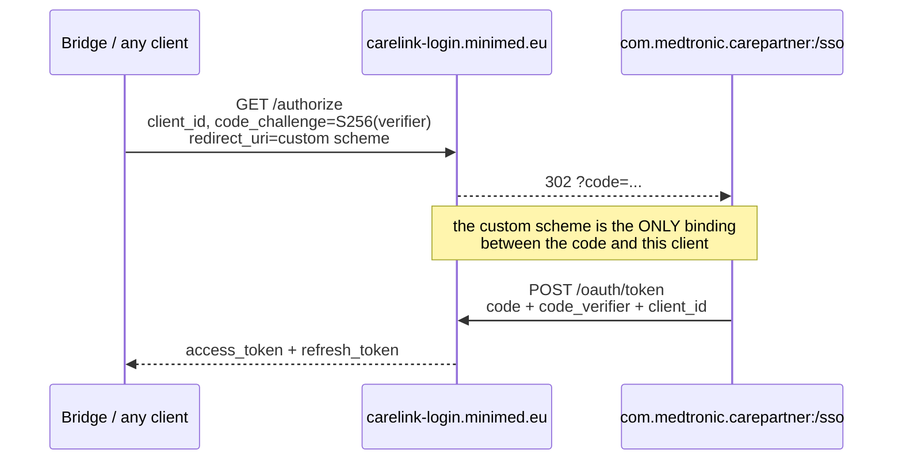

# Auth tenants and flows

The Auth0 tenants on the CareLink estate, the public client the bridge
([NovaLux12/carelink-bridge](https://github.com/NovaLux12/carelink-bridge))
impersonates, PKCE state, and the legacy Layer7 flow that is dead. All of it
read-only and unauthenticated; reasoning and verbatim bodies are in
`findings-log/`.

**Dated 2026-10-10.**

Legend — **OBSERVED** = seen in a live response · **PUBLISHED** = in a vendor document
served without a login (live, or recovered from a public web archive) · **INFERRED** =
reasoned, not seen.

> **Navigation** — the map: [`00-summary-the-map.md`](00-summary-the-map.md) · ← prev:
> [`01-hosts-and-estate.md`](01-hosts-and-estate.md) · → next:
> [`03-discovery-and-versions.md`](03-discovery-and-versions.md) · related:
> [`04-configuration.md`](04-configuration.md) ·
> [`08-security-findings.md`](08-security-findings.md)

Citations are `[source: findings-log/<file> §n]`. Inside tables the bare filename
is the same file: `AUTH-TENANT` = `findings-log/probe-2026-10-08/AUTH-TENANT-FINDINGS.md`;
`PROBE-FINDINGS`, `SECURITY`, `APP-EMULATION`, `PUBLIC-CONFIG` are the other
`findings-log/probe-2026-10-08/*.md` of that name; `VERSION-AXIS`,
`RECON-SUBDOMAINS`, `ARCHIVE-URLS` are `…/probe-2026-10-08/recon/<name>.md`.

---

## 1. Four tenants with completely disjoint key sets

| Issuer host | Role | `client_id` | `audience` | JWKS `kid`s |
|---|---|---|---|---|
| `carelink-login.minimed.eu` | patient, EU | `PeAhkbhQWlQRxJiQxWfcFBiGus1lxfe9` | `carepartner.patient.ous` | `8RqxnMm8vg2Go_y1LAVh9`, `vnTNpK5RvkqVEfQgHRsqv` |
| `carelink-login.minimed.com` | patient, US | `0FGoNwY0SP8ZmESYSfEOgMw03c58c1hk` | `carepartner.patient.us` | `jpv2d2IuydtvKtefd5M8J`, `qjHNmcQOpW_gvHz6zaD8` |
| `carelink-login.medtronic.eu` | shadow | — | — | `jd0EOLxJ8XduYx4lLy3ig`, `gZMBCJcl_t25Es4U_g_ow` |
| `carelink-login.medtronic.com` | shadow | — | — | `cEgK74cyc5LzAVI9VxEz9`, `80YhF8vW25gJ1_rR_lLOJ` — see §8 |
| `carelink-login-trials.minimed.com` | clinical / trials | — | `carepartner.patient.cl` | **Unknown — not in any source** |

```mermaid
flowchart LR
    subgraph POL["OAuth policy compared field-by-field — FOUR of the five tenants below (trials excluded, dashed): identical but for `issuer`, the endpoint hostnames derived from it, and `registration_endpoint`"]
        A["carelink-login.minimed.eu<br/>patient · EU"]
        B["carelink-login.minimed.com<br/>patient · US"]
        C["carelink-login.medtronic.eu<br/>shadow"]
        D["carelink-login.medtronic.com<br/>shadow"]
        E["carelink-login-trials.minimed.com<br/>clinical · trials"]
    end
    A --> Z
    B --> Z
    C --> Z
    D --> Z
    Z["each holds 2 JWKS kids<br/>0 shared by any two of the four"]
    E -. "never fetched —<br/>kids Unknown, not in any source" .-> KE["no kid recorded"]
    style D fill:#3b2f2f,stroke:#f66
    style E fill:#3b3b2f,stroke:#fd6
    style KE fill:#3b3b2f,stroke:#fd6
```


**OBSERVED.** The OAuth *policy* is identical across all of them: comparing
`carelink-login.minimed.eu`, `carelink-login.medtronic.eu` and
`carelink-login-trials.minimed.com` field by field, they differ only in `issuer`,
the endpoint hostnames derived from it, and `registration_endpoint` — same grants,
scopes, claims, PKCE methods, token-auth methods, DPoP algs and response types;
the `.com`/`.eu` documents are likewise identical modulo host
[source: AUTH-TENANT §1; PROBE-FINDINGS §4]. **Consequence:** the clinical/trials
tenant needs no separate auth handling — there is no "clinical login flow" to
implement, only a different issuer [source: AUTH-TENANT §1].

**The four compared key sets are completely disjoint** — no `kid` is shared by any
two tenants, all four JWKS documents fetched and compared. This upgrades the
earlier finding that the shadow deployment had "identical OAuth policy", which had
left open the possibility of shared signing keys. It does not share them: the
shadow deployment shares OAuth policy but not keys, so a shadow token is not a
key-reuse risk [source: AUTH-TENANT §8; docs/00-summary-the-map.md].

**OBSERVED** advertisement-vs-reality [source: PROBE-FINDINGS §4 and deep §1, §5;
AUTH-TENANT §1]:

- `device_code` grant — **DEFINITIVELY REJECTED**, 403 `unauthorized_client`,
  "Grant type 'urn:ietf:params:oauth:grant-type:device_code' not allowed for the
  client", on both patient client_ids. No device code created. The grant is
  advertised but not enabled for this client on either tenant.
- `/.well-known/jwks.json` — 200, two RSA RS256 keys per region, different kids
  for `.com` vs `.eu`. Plain `/jwks.json` is 404 — the wrong path, not drift.
- `/bc-authorize`, `/oidc/register`, `/oauth/global-token-revocation/connection/Auth0`
  — all advertised, all 404, absent.
- `/mfa/challenge` — advertised in the OIDC document; **Unknown — no probe result
  in any source.**

## 2. The public client and the custom-scheme redirect

**PUBLISHED**, from the SSO config the discovery document points at
(`carelink_auth0_ous_sso_config_v1.json`, public, no auth) [source: AUTH-TENANT §3]:

```
client.client_id    = PeAhkbhQWlQRxJiQxWfcFBiGus1lxfe9   (EU)
client.client_secret =                                  (empty — public client)
client.redirect_uri = com.medtronic.carepartner:/sso    (custom scheme)
client.scope        = profile openid offline_access
client.audience     = carepartner.patient.ous
```

Three things fall out of this:

- **The bridge impersonates the shipped Android client.** It uses the app's client
  ID and custom-scheme redirect URI, and works only because Auth0's Allowed
  Callback URLs for that client admit that scheme. There is no bridge-owned
  client. If Medtronic locks that client's callback list — the common hardening
  move of attested app links / package-name binding — the bridge's login breaks
  with an opaque redirect error. **A structural single point of failure, not a
  bug** — worth knowing before a 2 a.m. token failure [source: AUTH-TENANT §3].
- **`offline_access` IS requested**, so refresh tokens are legitimate and
  `grant_type: refresh_token` is the right call [source: AUTH-TENANT §3].
- **`email` is NOT requested**, even though the tenant advertises it in
  `scopes_supported` and `claims_supported`, so `/userinfo` for this client cannot
  return an email address; adding one needs a server-side config change the bridge
  does not control [source: AUTH-TENANT §3].

Supporting posture, **OBSERVED** [source: SECURITY "Checked and clean";
audit/CLAIM-AUDIT-2026-10-09.md]: `redirect_uri` is a **strict allowlist** (an
attacker redirect gets `403 "redirect_uri is not in the list of allowed callback
URLs"`), CORS on `carelink-login` is `*` **with `credentials: false`** (the safe
combination), and HSTS on the login hosts is `max-age=31536000;
includeSubDomains`.

The **legacy track carried a second client** for the same app —
`c19218f2-7157-4c93-8fbe-49636e7f9c74`, `"client_name": "OCL - Care Partner App -
OUS"`, same `redirect_uri`, `client_secret ""` while `client_type:
"confidential"`, the same oddity as the Auth0 public client. **PUBLISHED
(archived)** [source: ARCHIVE-URLS §2c].

**Do not conflate two allowlists.** `personal.integrations.redirect.scheme.whitelist`
(11 entries — `about`, `minimed`, `com.medtronic.wecare`, the Glooko endpoints, …)
and `system.auth0.url.whitelist` (`minimed.com`, `minimed.eu`, `medtronic.com`,
`medtronic.eu`) are **PUBLISHED** server-side *deep-link* lists, and
`com.medtronic.carepartner:/sso` is **not** in them: that redirect is governed by
Auth0's Allowed Callback URLs, a different mechanism [source: PUBLIC-CONFIG;
ARCHIVE-URLS §1]. Both lists are published inside the unauthenticated 69-key
config documented in [`04-configuration.md`](04-configuration.md).


### The flow, and where it breaks



**That custom scheme is the single point of failure.** It is not a URL the bridge
owns — it is the shipped Android app's, and the bridge works only because Auth0
admits that scheme for that client. There is no bridge-owned client to fall back
to. If Medtronic binds the callback to package-name attestation, login fails with
an opaque redirect error and nothing in the bridge's code can prevent it.

## 3. PKCE state

**OBSERVED** [source: SECURITY S2; CLAIM-AUDIT-2026-10-09.md]:

| `code_challenge` sent | Response | Verdict |
|---|---|---|
| `S256` | 302 to the login page | **accepted** |
| `plain` | 302 | **accepted** |
| `none` | 302 with `invalid_request` | **rejected** |
| **omitted entirely** | 302 | **accepted** |

`code_challenge_methods_supported` advertises `S256` **and** `plain`. The bridge
correctly hardcodes `S256`; no change needed — recorded only so nobody
"simplifies" it to the default [source: AUTH-TENANT §2]. The weakness is that PKCE
is **client-enforced only**: the redirect is a custom URI scheme, on Android any
app can register the same scheme, and PKCE is the mitigation for a malicious app
intercepting that redirect. Severity low-moderate [source: SECURITY S2]. The same
finding is F8 in [`08-security-findings.md`](08-security-findings.md).

### The code + PKCE flow the bridge actually runs

```mermaid
sequenceDiagram
    actor U as Patient
    participant B as Bridge
    participant A as carelink-login.minimed.eu
    B->>B: generate code_verifier, derive code_challenge by S256
    B->>A: GET /authorize?client_id=…&redirect_uri=com.medtronic.carepartner:/sso&code_challenge=…
    Note over A: redirect_uri is a STRICT allowlist.<br/>An attacker redirect gets 403 and the<br/>message: redirect_uri is not in the list<br/>of allowed callback URLs.
    A->>U: 302 → login page
    U->>A: user authenticates
    A->>B: 302 com.medtronic.carepartner:/sso?code=…
    Note over B: ⚠ SINGLE POINT OF FAILURE<br/>custom URI scheme; PKCE is client-enforced only.
    B->>A: POST /oauth/token with code and code_verifier
    A->>B: access_token + refresh_token
    Note over B,A: offline_access IS requested, so refresh tokens are<br/>legitimate and grant_type: refresh_token is the right call.<br/>device_code is DEFINITIVELY REJECTED — 403 unauthorized_client.<br/>email is NOT requested, so /userinfo cannot return one.
```

## 4. What a client must actually use

`device_code` is off the table, so a CareLink client must use the
**authorization_code + refresh_token** pair; there is no simpler headless path
[source: PROBE-FINDINGS deep §1]. Method-sensitive endpoints on the login hosts —
a GET-only probe reads several of these as dead [source: PROBE-FINDINGS deep §5;
AUTH-TENANT §5]:

| Path | GET | POST | Verdict |
|---|---|---|---|
| `/oauth/revoke` | 404 | **401 `invalid_client`** | **live, POST-only** |
| `/oidc/logout` | 200 HTML | 200 HTML | live |
| `/userinfo` | 401 `Unauthorized` | — | live |
| `/connect/session/status` | 404 | 404 | **advertised in the SSO config but genuinely absent** — either dead config or it answers only under an authenticated session with a different method or tenant |

## 5. The legacy Layer7 flow — and why it is dead

The edge hosts themselves are enumerated in
[`01-hosts-and-estate.md`](01-hosts-and-estate.md); the closure is logged in
[`10-open-questions.md`](10-open-questions.md).

**PUBLISHED.** All three `oauth20_sso_carepartner_*_v6.json` configs are 200 /
8.2 KB, differing only in `server.hostname` (`mdtlogin` / `mdtlogin-ocl`) and
`client_id`. The flow is **Layer7/CA-gateway OAuth v2 under an `/mmcl` prefix**
with an **opaque token** and a `roles` model — **there is no JWT `audience` at
all** — and scope is `profile openid roles country` with **no `offline_access`**
[source: AUTH-TENANT §6]. Endpoint families, **PUBLISHED** from the archived EU
config [source: ARCHIVE-URLS §2c]: `/mmcl/auth/oauth/v2/{authorize,token,token/revoke}` ·
`/mmcl/openid/connect/v1/userinfo` · `/mmcl/connect/session/{logout,status}` ·
`/mmcl/connect/device/{register,register/client,renew,remove,list,metadata}` ·
`/mmcl/connect/client/initialize` · `/mmcl/connect/enterprise/browser` ·
`/mmcl/auth/generateOTP` · and two **demo paths still shipped in the config**,
`/mmcl/oauth/v2/protectedapi/foo` and `/mmcl/protected/resource/products`.

Identity facts, same source: access token lifetime **10980 s** (3 h 03 m),
refresh and id_token **604800 s** (7 d each); new scopes `msso`, `msso_register`,
`msso_client_register`; a BLE mSSO GATT profile (service `980c2f36-…`,
characteristic `980c34cc-…`, RSSI −80); and weak mobile-SDK flags shipped publicly
— `enable_public_key_pinning: false`, `trusted_public_pki: false`,
`client_cert_rsa_keybits: 1024`.

**Unambiguously dead — the edge itself is gone** [source: AUTH-TENANT §6;
ARCHIVE-URLS §2c, §6]: both `mdtlogin*.medtronic.com` hosts resolve publicly but
**refuse TCP :443** (errno 111); the pinned leaf certs **expired** on **2026-03-06**
(US and CLINICAL) and **2025-11-19** (EU), with the embedded chain's leaf
`mdts-ocl.medtronic.com` expiring 2025-11-19 23:59:59Z; and the config pins a cert
whose CN (`mdtsts.medtronic.com`) does not match its own declared hostname.
Archive corroboration: `mdtlogin.medtronic.com/` root is **500 `text/xml`**
(2025-07-27) and the authorize URL's last capture is 2025-12-09.

Two consequences worth carrying: **(1) the old flow had no refresh token**, so
`grant_type: refresh_token` is an Auth0-family capability and our refresh path
depends on a capability the legacy track never had — a reason the Auth0 pin
matters and not just a preference; and **(2) the legacy config carries no
data-plane base URLs**, so it reveals nothing about the pre-Auth0 API shape —
only the auth primitive differed [source: AUTH-TENANT §6].

A real historical exposure on the dead edge: the pre-Auth0 authorize URL puts the
**whole authorization request in the query string** — `sessionData` is an HS256 JWS
whose payload is plaintext base64url and decodes to the full request
(`sessionID`, `exp`, `current_username`, `consent`, `client_name`, `scope_verified`,
`client_id`, `redirect_uri`, `id_token_hint`, `nonce`, `acr_values`), across 401
archived captures from 2021-09-17 to 2025-12-09. Values are not reproduced here;
the Auth0 track no longer has this exposure [source: ARCHIVE-URLS §7].

## 6. The `configs/v1` namespace — and what `_vN` actually means

The bucket itself is a public-config trap in
[`04-configuration.md`](04-configuration.md).

- **Configs are hostname-scoped.** `carelink.minimed.com` serving the EU config
  → 403; fetching `oauth20_sso_carepartner_us_v6.json` via the `.eu` host → **403
  S3 AccessDenied** [source: PROBE-FINDINGS §4 and deep §4].
- **`_vN` is a CERTIFICATE-ROLLOVER COUNTER, not an API schema version.**
  `oauth20_sso_carepartner_us_v5.json` → 200, **functionally identical to v6 in
  every field**, differing only in the pinned leaf cert, one roll older. Do not
  read a higher `_vN` as a newer API contract [source: AUTH-TENANT §6].
- **Four filename variants at `_v6`** are recorded — `oauth20_sso_carepartner_us_v6.json`,
  `oauth20_sso_carepartner_eu_v6.json`, `sso_cp_us_v6.json`, `eu_sso_cp_eu_v6.json`
  — alongside the `_v5` roll [source: VERSION-AXIS §4; ARCHIVE-URLS §3;
  AUTH-TENANT §6].
- **No credentials in any of the seven configs** — every `client_secret` is empty,
  no internal hostnames, no debug flags, and the vendor `x-api-key` appears
  nowhere in them. One published value *is* a Medtronic directory account name
  (`registered_by`); public for ~4 years, quoted in the source, not reproduced here
  [source: AUTH-TENANT §6; ARCHIVE-URLS §2c].
- Config *filenames* are region-keyed but **client identity is not**: the CLINICAL
  region carries its own distinct legacy `client_id` inside a file named for the
  **US** region [source: AUTH-TENANT §6].
> ⚠ **Correction preserved — 403 is NOT evidence of absence in this bucket.** The
> `configs/v1` namespace returns `AccessDenied`, not `NoSuchKey`, for absent keys,
> so every 403 is indistinguishable from "exists but unreadable". This
> retrospectively undercuts one earlier recorded inference: "EU config fetched
> from the `.com` host → 403 AccessDenied → configs are hostname-scoped". **The
> conclusion holds** — it rests on the 200s from the correct host, which are
> unambiguous — but the 403 was never evidence of *non*-existence, only of
> non-readability, so the reasoning as stated was unsound even though the answer
> was right. Any future sibling-name sweep must be reported as "no evidence of
> existence", never as "confirmed absent"
> [source: AUTH-TENANT §6 "METHODOLOGICAL CORRECTION"].

## 7. The token-confusion question — still open

Carried as an open question in
[`10-open-questions.md`](10-open-questions.md), and as an untested item in
[`08-security-findings.md`](08-security-findings.md).

Original question: would `clcloud.minimed.eu` accept a token minted by a shadow
tenant? Separate issuer + separate keys says it should not; token-audience/`kid`
validation done loosely is exactly the class of bug that would make it critical.
**Needs a valid token** [source: SECURITY; PROBE-FINDINGS deep §7]. The question
as recorded now has **four candidate issuers** — the two patient issuers plus the
two shadow issuers.

Bounded, not answered, by the JWKS comparison. The better-posed question is now:
**does any host validate the `kid` against its own JWKS, or merely decode the
token and trust the claims?** A verifier that fetches the issuer's JWKS is safe
here by construction; one that accepts an arbitrary `kid` and skips
issuer/audience checking is not. The configuration is on the safe side of the
question, and the exposure would be a verifier bug rather than a key leak
[source: AUTH-TENANT §8; SECURITY addendum].

## 8. Unresolved disagreement between sources — the shadow `.com` kid spelling

Two files record the `carelink-login.medtronic.com` JWKS kids differently. The
first kid agrees; the second does not:

- `AUTH-TENANT-FINDINGS.md` §8 — the pass that fetched and compared all four JWKS
  documents: `cEgK74cyc5LzAVI9VxEz9`, **`80YhF8vW25gJ1_rR_lLOJ`**
- `recon/RECON-SUBDOMAINS.md` §4.1: `cEgK74cyc5LzAVI9VxEz9`, **`80YhF8vW25gJ1_rR_lOOJ`**

The last three characters differ (`lLOJ` vs `lOOJ` — `L` against `O`). Every other
kid agrees across files. **Unresolved.** Both are given rather than one silently
picked: the `AUTH-TENANT` form comes from the pairwise four-way JWKS comparison, so
treat it as the better-attested one and confirm against the live
`/.well-known/jwks.json` before relying on either. `PROBE-FINDINGS.md` deep §7 and
`SECURITY-FINDINGS.md` truncate the kid to `80YhF8…` and take no side.

## 9. What we still do not know

The consolidated table — open, closed, and unknown — is in
[`10-open-questions.md`](10-open-questions.md).

| Question | Status |
|---|---|
| Would a patient host accept a shadow-tenant token? | Blocked on a token |
| JWKS kids for `carelink-login-trials.minimed.com` | **Unknown — not in any source.** The four-way comparison never covered the clinical tenant, so "disjoint" is established for the four compared issuers only |
| `/mfa/challenge`, and an email address from `/userinfo` | **Unknown** — advertised but no probe result in any source; and the email scope is not obtainable for this client without a server-side change |

