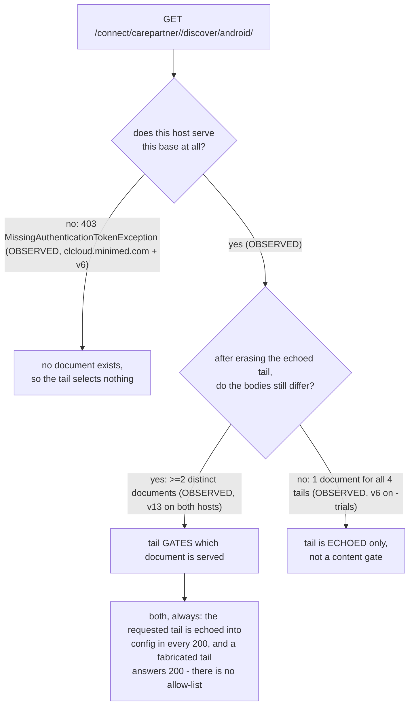

# Discovery and versions

The discovery document, the `carepartner` version axis, and which cells are actually
live. This is the page that pins `android/3.6` —
[the constant `NovaLux12/carelink-bridge`](https://github.com/NovaLux12/carelink-bridge/blob/main/src/discovery.ts)
uses, governed by [its ADR 0002](https://github.com/NovaLux12/carelink-bridge/blob/main/docs/adr/0002-discovery-app-version-pin.md).
Extends
[`00-summary-the-map.md`](00-summary-the-map.md) and agrees with it; the
endpoint-by-endpoint patient-API tables are in
[`06-patient-api-surface.md`](06-patient-api-surface.md), the probing method in
[`09-methodology-and-oracles.md`](09-methodology-and-oracles.md).

**Dated 2026-10-10.**

Legend — **OBSERVED** = seen in a live response · **PUBLISHED** = in a vendor document
served without a login (live, or recovered from a public web archive) · **INFERRED** =
reasoned, not seen.

> **Navigation** — the map: [`00-summary-the-map.md`](00-summary-the-map.md) · ← prev:
> [`02-auth-tenants-and-flows.md`](02-auth-tenants-and-flows.md) · → next:
> [`04-configuration.md`](04-configuration.md) · related:
> [`06-patient-api-surface.md`](06-patient-api-surface.md) ·
> [`09-methodology-and-oracles.md`](09-methodology-and-oracles.md)

Citations are `[source: findings-log/<file> §n]`; `PROBE-FINDINGS` =
`findings-log/probe-2026-10-08/PROBE-FINDINGS.md` and `VERSION-AXIS`, `ARCHIVE-URLS`,
`CONFIG-NAMESPACE`, `CONFIG-NAMESPACE-DEEP` are `…/probe-2026-10-08/recon/<name>.md`.

---

## 1. The discovery document

```
GET https://clcloud.{minimed.eu, minimed.com, clcloud-trials.minimed.com}/connect/carepartner/v13/discover/android/3.6
→ 200 application/json, 20256 B, unauthenticated, no x-api-key required
```

**OBSERVED** and hash-verified. All three hosts return the **same document** — sha256
`f8488626…`, md5 `403220ced1a7837372b777fa97ecbb2b` — re-verified byte-identical to
the on-disk capture `disc-eu.json` [source: PROBE-FINDINGS §3; VERSION-AXIS §3a;
CONFIG-NAMESPACE TARGET 1; audit/CLAIM-AUDIT-2026-10-09.md].

It carries `CP[]` in the order **`US, EU, CLINICAL`** and, per region, the keys
`SSOConfiguration`, `Layer7SSOConfiguration`, `Auth0SSOConfiguration`,
`UseSSOConfiguration`, `baseUrlCms`, `baseUrlCareLink`, `baseUrlCumulus`,
`baseUrlPde`, `baseUrlAem`. The CLINICAL entry, verbatim [source: CONFIG-NAMESPACE]:
`SSOConfiguration`/`Layer7SSOConfiguration` = `…carelink-trials.minimed.com/configs/v1/oauth20_sso_carepartner_us_v6.json`;
`Auth0SSOConfiguration` = `…/configs/v1/carepartner_auth0_cl_sso_config_v1.json`;
`UseSSOConfiguration` = `Auth0SSOConfiguration`; `baseUrlCareLink` = `…carelink-trials.minimed.com/api/carepartner/v2`;
`baseUrlCumulus` = `…clcloud-trials.minimed.com/connect/carepartner/v13`; `baseUrlPde` =
`…clcloud-trials.minimed.com/connect/pde/v3`; `baseUrlCms` = `…carelink-content.medtronic.com/carepartner`.
So the trials deployment **splits planes exactly like US and EU** — `carelink-trials`
for the app/API plane, `clcloud-trials` for cumulus + PDE — an answer obtained from
data already on disk at zero request cost [source: AUTH-TENANT §6].

Signed, and the bridge does not check the signature: every discovery response carries a
deterministic **344-char base64 `x-cum-signature`** (decodes to 256 bytes) **only** on
`/connect/carepartner/*/discover/*` — not on `/patient/*`, not on `countries/settings` —
and it **differs between `.eu` and `.com` even though the documents are byte-identical**,
so the signing key or binding is host/region specific. `git grep x-cum-signature` finds
nothing in `src/` or `test/` [source: SECURITY-FINDINGS S4; CLAIM-AUDIT-2026-10-09.md].

> **⚠ The signature is not per-document, and the within-host control that settles it
> was missing until 2026-10-17.** `VERSION-AXIS §1` infers from 6 documents on 6 hosts
> that this is "a per-document integrity signature". One byte-identical document served
> at **three** hosts carries **three** distinct signature values, so *document* alone does
> not determine it. The converse is now settled too: on `-trials`, the same document
> requested under **two different base paths** (`/v10/discover/android/3.6` and `/v11/…`)
> carries **one** signature, which rules out *per-request*. A function of
> **(document, host)** is consistent with **all 14** signed cells in that pass.
>
> **Counting rule, so "14" is re-derivable rather than typed:** a *signed cell* is a
> response whose captured headers carry an `x-cum-signature` value. Of the 51 cells,
> **32** are the no-route `403` envelope, **3** are the `v12` `401` envelope
> (36 B, one digest `d551247201fc…`) and **2** are the `v10` `204` empties —
> **none of those three groups carries a signature** — leaving **14**, at `seq` **2,
> 14, 19, 31, 36, 38, 39, 40, 41, 42, 44, 45, 46, 48**. All **14** are fresh origin
> responses (`x-cache: Miss from cloudfront`, none an edge replay), which is what makes
> the `/v11/`–`/v10/` pair a genuine origin result rather than a cache hit. The step
> from those two controls to "it is exactly `(document, host)`" is INFERRED, on the
> assumption that no third variable moves with it.
>
> ⚠ **Corrected 2026-10-17 (verifier round 1): this figure read `17`.** The conclusion
> was checked and stands; only the population was wrong, and it is reconstructible from
> the ledger rather than mysterious: grouping the 51 cells by body digest gives **seven**
> groups — 32 no-route `403`, 7 trials-legacy `200`, 3 `v11` `200`, 3 `401`, 3 `v13` `200`,
> 2 empty `204`, 1 `.com` `v11` `200` — and **`17 = 51 − 32 − 2`**, i.e. every cell that
> was neither a no-route `403` nor an empty `204`. **INFERRED, not OBSERVED:** that the
> error was counting the **three `401` cells as signed** — they carry no
> `x-cum-signature` at all. No committed artefact witnesses how the `17` was produced
> (`matrix.py` builds the verdict grid, not a signed-cell tally; `cells.md` records
> signature *presence* only), so this is a claim about a past computation.
> **Assumption:** the original `17` was tallied over a digest- or status-class grouping
> rather than over headers read per cell. Dropping the three `401` cells leaves the four
> signed groups: 7 + 3 + 3 + 1 = **14**. The `17` is **withdrawn**.
> [findings-log/2026-10-17-discover-3host-matrix/FINDINGS.md §Correction (2026-10-17)]
> [findings-log/2026-10-17-discover-3host-matrix/FINDINGS.md §5].

`certificates[]` is always exactly **8 entries** and **identical between the v13 and v11
documents**, so it is **not a tenant discriminator** — only a cert-rotation tripwire
[source: work/METHOD-FACTS.md; VERSION-AXIS §4].

## 2. Two independent axes

The URL `/connect/carepartner/{basePath}/discover/android/{version}` varies on two
orthogonal things [source: PROBE-FINDINGS deep §2]:

- **Base path = which deployment/tenant.** `v13` → the patient API. `v11` → a **trials
  deployment** — all three regions return the trials tenant (`carelink-trials` /
  `clcloud-trials`), so "v11" does not mean "older API", it is a different tenant. `v10`
  → 204 (exists, empty). `v12` → 401. `v14/v15/v16/v20` → 403.
- **App version = which cumulus the returned document references.**

| base version | status | verdict |
|---|---|---|
| v1 – v9, v14 – v16 | 403 | **no route** — dead |
| v10 | 204 | live, empty — exists, returns nothing |
| v11 | 200 | live, public — **trials-tenant** doc (see §7) |
| v12 | 401 | live, token-gated — body unreadable unauthenticated |
| v13 | 200 | live, public — **the patient API** doc |

`v10`'s 204 carries a distinctive `x-amzn-trace-id` with a `Lineage=` field and a
security-header set (`strict-transport-security`, `x-frame-options: sameorigin`,
`content-security-policy: default-src 'self'`, `x-permitted-cross-domain-policies: none`)
that no other cell carries [source: VERSION-AXIS §3a].

## 3. The version axis serves exactly two documents

Probing an `android/X.Y` cell past 3.8 does not give a new API — it re-derives one of two
known documents. Ten further cells (3.11, 3.12, 4.9, 5.1, 6.1, 7.0, 8.0, 9.0, 11.0, 12.0)
all returned 200, all legacy: no `Auth0SSOConfiguration`, `baseUrlCumulus` at
`/connect/carepartner/v2`, `CP[]` with only `US,EU` — no CLINICAL at all. After
normalising, every legacy cell from 3.11 to 12.0 is **byte-identical** except the echoed
request string `"config": "android,3.11"` vs `"config": "android,12.0"`
[source: PROBE-FINDINGS §7].

**⚠ Superseded, stated as such rather than dropped:** the earlier note "the enum is
open-ended (10.0 still 200)" is **superseded**. There is no undiscovered Auth0+v13
fallback; 3.6/3.7/3.8 remain the only cells on the track the bridge uses
[source: PROBE-FINDINGS §7; docs/00-summary-the-map.md].

| Cells | Auth0 | cumulus | CLINICAL | Document |
|---|---|---|---|---|
| 3.6, 3.7, 3.8 | yes | **v13** | yes | auth0 doc — what the bridge uses |
| 3.5 | yes | **v11** | yes | auth0 doc, wrong cumulus |
| 3.9 – 12.0 (and ≤ 3.4) | no | v2 | no | legacy doc |

`android/3.5` is a **near miss**: it selects the Auth0 config but points at cumulus
**v11**, so it is still not a usable fallback. The pin stays `android/3.6`
[source: PROBE-FINDINGS §3 and §7].

**Code finding — the ADR 0002 pin guard no longer holds.** `selectAuth0ConfigUrl()` does
`const key = cpEntry.UseSSOConfiguration ?? 'Auth0SSOConfiguration'`, and the
`Auth0SSOConfiguration` **key now exists on every version 3.4 → 5.0**, including the
cumulus-v2 no-Auth0 cells, even where `UseSSOConfiguration` is absent. So bumping
`DISCOVERY_APP_VERSION` to `android/4.0` would **not** throw
`NoAuth0SSOConfigurationError` — it would resolve the same Auth0 config URL and fail
later at the data call, with no named error. The runtime guard the ADR relies on is
currently inert; the pin is protected only by the ADR text and the discovery test.
Suggested fix, **not applied** (a repo change): gate on `baseUrlCumulus` containing `/v13`
too [source: PROBE-FINDINGS §3].

## 3a. A second version axis — the request body

> **Added 2026-10-13 (area Q).** Everything in this section is **third-party source
> material**, read in public repositories at named commits. **None of it is OBSERVED
> and none of it may be promoted to OBSERVED** — no live vendor response was
> obtained, and none could be. The two evidence labels used here,
> **SOURCE-OBSERVED** (`file:line` at a named commit) and **SOURCE-PUBLISHED** (that
> repository's README / PR / comments), are **not yet `AGENTS.md` §2 classes**;
> adding them is a maintainer decision and **remains open at
> [`docs/11`](11-suggested-research-areas.md) area S**. Until it is decided, treat
> every claim in this section as evidence about **a client**, never about Medtronic
> [source: findings-log/2026-10-13-area-q-appversion-axis/FINDINGS.md §0].

**This page described exactly one version axis until 2026-10-13: the discovery-path
axis of §3. There are two, they are constrained in opposite directions, and a client
can satisfy one while failing the other.**

| axis | where the version travels | constraint | class |
|---|---|---|---|
| **discovery path** (§3, above) | the URL: `/discover/android/<ver>` | `3.6`–`3.8` → cumulus v13; **`3.9`+ → legacy no-Auth0 config** | **OBSERVED** — ours, 70-cell sweep [VERSION-AXIS §3a, §4] |
| **request body** | a JSON field `appVersion` in the body of `POST {baseUrlCumulus}/display/message` | **≥ 3.7, no upper bound** | **SOURCE-PUBLISHED** — author-reported, *unverified here* |

They point opposite ways: **the path has a ceiling and the body does not.** A client
that fixes one has not fixed the other, which is why nobody publishes a compatibility
matrix and every client re-derives it.

### 3a.1 What is verifiable — the *mechanism*, not the boundary

**SOURCE-OBSERVED**, and it is the load-bearing part: `appVersion` is a **body
field, not a header**. In `CarlosJPV/carelink-cumulus-bridge` @ `0180b89`,
`src/carelink/cumulus.ts:143-148` builds the POST body as a JSON object —
`{ username, role, appVersion: APP_VERSION, os: 'android' }` — and `:146` resolves to
exactly `appVersion: APP_VERSION,`. The file's own comment at `:131-135` records the
basis and dates it (*"descubierto por experimentación, 25-08-2026"*). Both pinned
commit and branch head are **byte-identical** (git blob `448c27b19d53cb87d…`), so
this cite resolves identically in either revision
[source: findings-log/2026-10-13-area-q-appversion-axis/FINDINGS.md §4].

The **boundary values** are a different kind of claim and are labelled as such:
`README.md:50-55` tabulates `3.5.0`, `3.6`, `3.6.1`, `3.6.9` → `206 {"message":
"Upgrade application"}` and `3.7`, `3.7.0`, `3.8`, `3.8.0`, `4.0.0`, `10.0.0` →
`200`, giving *"≥ 3.7 accepted, ≤ 3.6.9 rejected"*. **SOURCE-PUBLISHED —
author-reported, and not reproducible from the tree**: the repository commits the
probe *script* but gitignores its *outputs* (`.gitignore:12` resolves exactly, as
`cumulus-response*.json`; `:13` `cumulus-hit.json`, under a comment saying those files
carry personal and health data). The committed script varies only **5 of the 10**
version values the table lists — the table is **two status rows, 4 values on the
`206` row and 6 on the `200` row, not eleven rows** [same source §8.1, where the
counting rule is recorded]. The five it never varies are `3.6`, `3.7.0`, `3.8`,
`3.8.0`, `4.0.0` — and the last two of those are the exact values the client ships
(`3.8`) and the xDrip PR merged (`3.8.0`).

### 3a.2 ⚠ Why this cannot be settled from outside this project

The gate is a **request-body** field. `AGENTS.md` §11 permits no POST to a vendor
host outside the two already-pinned public-`client_id` requests and states no
automation may extend it; a GET cannot carry a body. No vendor-published document
names `appVersion` — checked **offline, zero requests**, against every committed
config, discovery and archive capture in `findings-log/`, where the string appears
nowhere. **So there is no pin for it either, and §3a's numbers cannot rot silently
in the pinned suite** — they are unpinned **by necessity**, and a reader must treat
them as a client's report rather than as this repo's observation
[source: findings-log/2026-10-13-area-q-appversion-axis/FINDINGS.md §6].

The contrast with §3 is the point, and the two halves must not be blurred: **the
discovery axis's upper bound is OBSERVED and ours** — `docs/10` §2 records that the
axis serves exactly two documents past 3.8 — **while the body axis's lower bound is
third-party-reported and unverifiable here.** Same word "axis", different evidence.

### 3a.3 Derived: the two axes share a **two-value window** (in `X.Y` form), and one client uses a single constant for both

**INFERRED, from the two SOURCE-PUBLISHED constraints above; the assumption is that
they hold over the ranges the author reports, which is itself unverified.**

Intersecting them — a version string that is on the Auth0+v13 track **and** clears
the body gate — leaves **`3.7` and `3.8`, and nothing else, among the `X.Y` forms
the discovery axis has been probed at.**

⚠ **That restriction is load-bearing, not a hedge.** The author's table lists
`3.7.0` and `3.8.0` as accepted by the body gate, and its prose says both `X.Y` and
`X.Y.Z` work there — but **nothing establishes what those strings do on the
discovery path**, because that axis is probed in `X.Y` form only. There is **no
`X.Y.Z` cell anywhere** in `ORACLE-PROBE-MATRIX` (which holds only
`discover/android/3.6` and `…/3.8`) and **zero** in `VERSION-AXIS.md`. So `3.7.0`
and `3.8.0` are **unobserved** on the axis that would place them in or out of the
window — not excluded from it. The window is closed at exactly two values **for the
forms anyone has probed**; read it as a statement about every string either client
could send and it over-reaches.

And the one client whose source is readable does not run two axes at all.
`cumulus.ts:31` declares `const APP_VERSION = '3.8';` and uses that **one** constant
in three places: the `.eu` discovery URL (`:34`), the `.com` discovery URL (`:36`) and
the request body (`:146`). **It is correct only because `3.8` happens to lie in the
window.**

The failure mode is specific, silent, and worth stating because this page's §3 is
the reason it bites: bumping that constant to `3.9` to "modernise" satisfies the body
gate forever (no upper bound) and breaks the discovery axis immediately, landing on
the legacy no-Auth0 config of §3. **Nothing errors** — the client keeps receiving
`200`s, from a different and older API. A version knob that is correct on one axis
and wrong on the other is not a knob, it is a coupling
[source: findings-log/2026-10-13-area-q-appversion-axis/FINDINGS.md §5].

### 3a.4 ⚠ Correction — the boundary table is **one source stated twice**

The 2026-10-11 pass recorded this table as *"corroborated independently by a xDrip
maintainer in PR #4711"*, and this page's own area text repeated it. **Read at the
artefact, that is not what the PR contains.** xDrip PR #4711 has **three** comments:
the boundary table (by `CarlosJPV` — also the author of the README that repeats it),
a question from `jamorham`, and an approval from `benceszasz`. **The maintainer
comment approves the PR; it does not restate, retest, or comment on the boundary
values.**

- **Still stands:** the table is SOURCE-PUBLISHED and author-reported; the *mechanism*
  is verifiable in code without relying on that report (§3a.1); and the PR body records
  the value xDrip moved *from* — `3.6.0` → `3.8.0` — with that PR **merged**
  2026-08-29T11:59:05Z. That is upstream corroboration that `3.8.0` works; it is not
  corroboration of where the boundary sits.
- **⚠ Corrected 2026-10-14 (area S independence audit).** This bullet read
  *"is **independently** verifiable in code"* and *"the PR body **independently
  confirms** the value xDrip moved from"*. Both strength words are withdrawn
  under `AGENTS.md` §2.1. **Counts:** §3a.1 rests on one artefact by one author
  (`CarlosJPV/carelink-cumulus-bridge` @ `0180b89`), so **1**, not 2. The PR
  body is authored by **`m0rt4l1n`** — read at the artefact, not the same person
  as the table's author — but the PR body and the PR's own merge record are two
  artefacts from **one** organisation, so for the *version-bump* claim the count
  is **1**, not 2.
- **What that read did miss, and it is the one genuinely new thing here.** The
  PR body is a **second author** on one adjacent claim, and it is not quoting
  the boundary table: *"This has been tested with a Medtronic 780G + Guardian 4
  user and Medtronic InPen + Simplera user."* So **`3.8.0` is accepted by the
  vendor's body gate — independent count 2** (`m0rt4l1n` at
  `NightscoutFoundation/xDrip` PR #4711's body, SOURCE-PUBLISHED; `CarlosJPV`
  at `CarlosJPV/carelink-cumulus-bridge` `README.md:50-55` @ `0180b89`,
  SOURCE-PUBLISHED — different authors, different artefacts).
  **⚠ Corrected 2026-10-15 (area S independence audit, verifier round 1).** The
  third §2.1 condition was argued here from *the absence of an attribution* in
  the body, and that warrant was not labelled, while `docs/10` labelled the same
  claim INFERRED — one claim, two evidence classes, two pages. **Both
  directions are now settled by reading the two artefacts, and neither step is
  an inference.** `bodies/17-xd-pr4711-comments.b` comment `id 5413938350`,
  `user.login: CarlosJPV`, `created_at: 2026-08-25T17:06:27Z` is a **direct
  measurement of `3.8.0`** — *"Varying `appVersion` on `POST
  {baseUrlCumulus}/display/message`"* returning **`| `3.8.0` | **200 OK** |`**,
  and *"**Your PR is correct as written** — `3.8.0` clears the gate"* — naming
  no device, no account, and nothing from the PR body; the body names two
  devices and no status code. The two **share no evidence**. Direction is
  settled by the timestamps: the PR's `created_at` is `2026-08-25T16:16:14Z`,
  **50 minutes before** the comment, so the body cannot have been derived from
  it. **What stays INFERRED, and is labelled:** that `CarlosJPV`, who had
  plainly read the PR before answering it, drew his conclusion from his own grid
  rather than from the body's — the grid is his observation, the disposition is
  not observable.
  **The `#4547` caveat is moot and is withdrawn:** it was raised to settle
  whether the body's author had seen the other account, and the two
  `created_at` values settle that direction instead. `#4547` was not read and
  nothing here rests on it.
  **Where the boundary sits stays at count 1.** That is the first claim in this
  section whose independent count is ≥2, and it was not known before this audit
  read the PR author off the artefact
  [source: findings-log/2026-10-14-pool-s-independence-audit/FINDINGS.md §3
  rows 6–7; source: findings-log/2026-10-13-area-q-appversion-axis/bodies/16-xd-pr4711.b;
  source: findings-log/2026-10-13-area-q-appversion-axis/bodies/17-xd-pr4711-comments.b].
- **Withdrawn:** the word *independently*. The original wording stays readable in
  [findings-log/2026-10-11-third-party-client-sources/FINDINGS.md §3].

This is `AGENTS.md` §6 item 5 in the shape it warns about — derived prose reaching
further than the table it came from — and it was findable **only** by reading the
artefact [source: findings-log/2026-10-13-area-q-appversion-axis/FINDINGS.md §7].

### 3a.5 Not verified in this pass

The other half of the mechanism — that xDrip also sends `appVersion` as a body field
— is **not** re-verified here. The 2026-10-11 pass cited a bare filename,
`CareLinkClient.java:664`; a path reconstructed from its reproduction instructions
returned `404` on the GitHub API at both the pinned commit and branch head, and the
package listing shows the file is **not at the package root** (`carelinkfollow/`
holds three files and three directories — `auth/`, `client/`, `message/`).
**That is this pass's path-reconstruction error, not evidence that the citation is
broken**, and nothing is claimed here about what is on that line. Recorded so a later
reader does not repeat the search
[source: findings-log/2026-10-13-area-q-appversion-axis/FINDINGS.md §3].

---

## 3b. The `android/<app-version>` axis on `.com` and `-trials` — **gating at `v13`, collapsed at `v6`**

**Added 2026-10-17 (area AA), one pass, one ledger.** Every claim below rests on
**one** source — this repository — so no strength word is used anywhere in this
section (`AGENTS.md` §2.1). This is the *path-borne* axis; §3a is the separate
*body*-borne one, and the two are not the same thing.

**What was already swept, so the novelty is not overstated:** the axis had been
swept on `.eu` (§3), and on `-trials` at **one** base path and **two** tails —
`/v6/discover/android/{3.6,3.8}` (§8). It had **never** been swept on
`clcloud.minimed.com` at any base, nor on either host at base `v13`.

Swept `GET /connect/carepartner/<base>/discover/android/<tail>` on the two cumulus
`.com`/`-trials` hosts — `clcloud.minimed.com` and `clcloud-trials.minimed.com` —
at bases `v13` and `v6`, tails
`{3.5, 3.6, 3.9, absent-probe-871}`, controls first per host, **20 of 20
requests**, GET only, measured same-host spacing floor **3.304 s**
[source: findings-log/2026-10-17-area-aa-appversion-axis/FINDINGS.md §1].

**The area's question was posed as a choice between "content gate" and "echo".
The cells answer neither, and the status line alone would have got it wrong.**

### 3b.1 The tail is echoed, and never validated — OBSERVED

All **14** `200` bodies begin `{"config":"android,<requested tail>",` and carry
the requested tail **exactly once** in the body bytes. A syntactically
fabricated tail, `android/absent-probe-871`, answered **`200`** — not `400`,
not `404` — at three cells. **There is no allow-list on this segment**
[source: findings-log/2026-10-17-area-aa-appversion-axis/FINDINGS.md §4.1].

### 3b.2 …and at base `v13` it also *selects* — OBSERVED

Erase the echo and re-digest, and base `v13` yields **three** distinct documents
per host. The selection is substantive, not cosmetic: `3.6` → `3.9` moves the
advertised `baseUrlCumulus` base (`v13` → `v2`), the `baseUrlCareLink` API
version (`v2` → `v1`), the `CP[]` length (3 → 2, the CLINICAL entry gone), the
country count (109 → 99 on `.com`, 109 → 76 on `-trials`), and the SSO config
file family (`oauth20_sso_carepartner_*_v6.json` → `sso_cp_us_v6.json` /
`eu_sso_cp_eu_v6.json`)
[source: findings-log/2026-10-17-area-aa-appversion-axis/FINDINGS.md §4.2].

| tail | `clcloud.minimed.com` | `clcloud-trials.minimed.com` |
|---|---|---|
| `3.5` | advertises cumulus **v11** · carelink v2 · CP 3 · ctry 109 | **byte-identical to `.com`** |
| `3.6` | advertises cumulus **v13** · carelink v2 · CP 3 · ctry 109 | **byte-identical to `.com`** |
| `3.9` | advertises cumulus **v2** · carelink v1 · CP 2 · ctry 99 | advertises cumulus **v2** · carelink v1 · CP 2 · ctry **76**, no EU SSO entry |
| `absent-probe-871` | **same document as `3.9`** | **same document as `3.9`** |

The `3.5` and `3.6` documents are byte-identical **across** the two hosts; the
`3.9`-class document is not. So `.eu`'s published three-way split (§3) holds on
both hosts, and what is host-specific is confined to the legacy tier.

### 3b.3 …but at `-trials` base `v6` it selects nothing — OBSERVED

All four tails collapse to **one** canonical digest, **n=4**: the tail is echoed
and *nothing else* about the request varies the body. This strengthens §8's
"app-version-collapsed" from a two-tail observation to four tails including a
fabricated one. The `3.6` cell reproduces the digest and byte count the
2026-10-17 matrix pass recorded for trials `v6`
[source: findings-log/2026-10-17-area-aa-appversion-axis/FINDINGS.md §4.3].



### 3b.4 The `v6` split is a **base-axis** effect, not an app-version effect

`clcloud.minimed.com` answers `403` on all four `v6` cells; `-trials` answers
`200` on all four. That is **not** an app-version effect, and the rows settle
it: on the same host at the **same tail** `3.6`, base `v11` returns `200`. The
segment that decides `403` vs `200` there is the **base**. Whether `v6` is
unrouted on `.com` because of the version segment or the `v6/discover/android/*`
route family is **not established** — no `v6/display/message` or `v6/discover`
prefix cell was sent — and no choice is made between those readings
[source: findings-log/2026-10-17-area-aa-appversion-axis/FINDINGS.md §5].

### 3b.5 What this does not establish — INFERRED

**Whether the tail is a lookup table or a threshold is not separable from four
tails**, three of them adjacent: a boundary anywhere in `(3.5, 3.6]` or
`(3.6, 3.9]` fits the data exactly as well as a per-value table. **Assumption:**
none needed for the cells above; this is a statement about what four tails can
discriminate. Area **AE** carries the open form
[source: findings-log/2026-10-17-area-aa-appversion-axis/FINDINGS.md §6].

**Base `v11` carries no verdict** — one tail was sent there, as a control, and
one cell cannot separate "selects" from "does not select". Nothing is claimed
about `v11` on the app-version axis.

---

## 4. The Auth0 + cumulus-v13 cell matrix

| Cell | Auth0 | cumulus | CLINICAL | Document |
|---|---|---|---|---|
| `*/v13/discover/android/3.6` (all 3 hosts) | yes | **v13** | yes | patient doc — what the bridge uses |
| `.eu` and `-trials` `v11/discover/android/3.6` | yes — the **clinical** config `carepartner_auth0_cl_sso_config_v1.json`, for all three regions | **v13** | yes | trials-tenant doc, Auth0 track |
| `.com` `v11/discover/android/3.6` | **no** | **v2** | **no** | legacy doc — see §7 |
| `-trials` `v6/discover/android/{3.6,3.8}` | **no** | **v2** | **no** | legacy doc — see §8 |
| `*/v12/discover/android/3.6` (all 3 hosts) | ? (401, unreadable) | ? | ? | token-gated — **worth a token** |

**Only two cells give a cumulus-v13 base and survive a code path** — `v13` on all
three hosts, and `v11` on `.eu` and `-trials`. Both were already known; **no new
v13 cell exists** [source: VERSION-AXIS §3c].

Status code alone carries no signal here: a fabricated path, a random UUID and a dead
version all return the same 403. The **response headers** are a perfect, unambiguous
oracle, because this family is AWS API Gateway fronted by CloudFront —
`x-amzn-errortype: MissingAuthenticationTokenException` (403) = **no matching route**,
i.e. **dead**; `UnauthorizedException` **plus `x-ca-err: 990`** (401) = the request
reached a backend authorizer inside Medtronic's Layer7 stack, i.e. **live and
token-gated**; no errortype (200/204) = fully public. Controls fire on every axis: all
7 fabricated controls returned `MissingAuthenticationTokenException` with no CORS
headers (**zero false negatives**) and all 13 `UnauthorizedException` responses were on
`v11`/`v12`/`v13` of `display/message` and `discover` (**zero false positives**).
`access-control-allow-origin: *` on an **OPTIONS** request is the cleanest liveness test
for a resource with no GET method, and **latency is not an oracle** — the host dominates,
not the version [source: VERSION-AXIS §1; docs/00-summary-the-map.md].

## 6. `v12/display/message` — a live version nobody had probed

**`/connect/carepartner/v12/display/message` is live and GET-capable — 401 on all three
hosts.** Prior notes only ever probed `display/message` at v6/v11/v13, so the live GET
set is **`{11, 12, 13}`**, not `{11, 13}`. Our fork's `BLE_API_VERSIONS = [13, 11, 6,
5]` therefore contains a permanently dead `v5` (no route at all, not auth-gated) and
omits a live `v12` — neither changes behaviour today (v13 is tried first and is live),
but v5 should not be in a fallback list and v12 is a free extra candidate
[source: VERSION-AXIS §3b, §6, §7; docs/00-summary-the-map.md].

### Confirmed on all three hosts (2026-10-12) — the claim above was under-evidenced, not wrong

The sentence above asserted "401 on all three hosts" on the strength of **one** raw row
(`ORACLE-PROBE-MATRIX` row 52, `clcloud.minimed.eu` only) — the failure mode in
`AGENTS.md` §6 item 1. A 2026-10-12 pass probed the two missing hosts and **confirmed the
claim**: `GET v12/display/message` returns `401` + `x-amzn-errortype: UnauthorizedException`
+ `x-ca-err: 990` on `clcloud.minimed.eu`, `clcloud.minimed.com` and
`clcloud-trials.minimed.com` — **3 of 3**, every one a request that reached Medtronic's
Layer7 authorizer, so the route exists and is token-gated (OBSERVED,
[source: findings-log/2026-10-12-area-b-v12-routing/FINDINGS.md §Finding 1]). There is **no
region split** on this cell. The claim is now 3-host evidenced and pinned in
`regression/hurl/04-deep-surface.hurl`.

**`v12` carries a CORS preflight, exactly like `v11` and `v13`.** `OPTIONS
v{11,12,13}/display/message` all return `200` with `access-control-allow-origin: *` and
`access-control-allow-methods: OPTIONS`, on `.eu` (OBSERVED, same source §Finding 2). This
settles the area's open question: `v12` does **not** differ from `v13` on preflight
presence.

**But the gateway does not add CORS uniformly.** On the same host, in the same session,
`OPTIONS v{11,12,13}/discover/android/3.6` returns **`401`** + `x-ca-err: 990` with **no
`Access-Control-*` header at all**, while `…/display/message` one path-family away returns
`200` + CORS. So "the gateway adds CORS to `clcloud.*`" is **false as a rule** (OBSERVED, a
3 × 2 on `.eu`, same source §Finding 3).

**This is an observation, not a cause** — and as of 2026-10-12 the *reason* it could not be
turned into a cause is itself corrected. The earlier version of this paragraph rested on a
corpus count plus the assertion that every `200` carrying no CORS lived on "a different host
surface". That assertion was **false**: of the ten captured `200` heads with no
`access-control-allow-origin`, **four are on `clcloud.*`** — the discovery documents fetched
by [findings-log/2026-10-12-published-pointers/probe.sh:81-84] — four heads across **three**
cumulus hosts, **two of them on `clcloud.minimed.com`**, so this is 4 cells on 3 hosts and not one
per host. So on
`clcloud.*` **a `200` that carries no preflight exists**, and "carries a preflight" and
"answers `200`" are **not** the same observation. Area X re-derived it live: **9 further
`200`-without-CORS responses — every one a `GET` of a discovery payload, across all three
hosts — and still zero non-2xx responses on `clcloud.*` carrying CORS. (On the separate
`commoncore*` family, non-2xx responses *do* carry `access-control-allow-origin: *` —
six captures, PR #59/#65.)**
([source: findings-log/2026-10-12-area-x-cors-separation/FINDINGS.md §4]).

**⚠ But the false premise does not select between the two readings this page offered, and
this paragraph previously claimed that it did. That claim is withdrawn.** An earlier draft
argued reading (b) — the route "demands a token on `OPTIONS`" — was *refuted*, because a
CORS-configured route would carry `ACAO` on its own `200` `GET`. **That argument assumes the
thing in dispute**: if `ACAO` is emitted only on `OPTIONS` responses regardless of route, a
configured route's `GET` carries nothing either and the cell is *uninformative* rather than
evidence against. **Reading (b) is not excluded, reading (a) is not excluded, and neither is
"emitted only on `OPTIONS`".** The cause is not established and this page does not establish it.

**What this pass did exclude**, which no earlier pass could test because no earlier pass sent
an `Origin` header to `clcloud.*` at all: **the mechanism "`ACAO` appears only when an `Origin`
is sent" is dead.** Across the **6** route×method pairs where both a bare and an
`Origin`-bearing request were sent — controls excluded, they are not part of the comparison —
status and the full `access-control-*` set were **identical in all 6**; 0 changed.

Separating the three surviving readings needs a `clcloud.*` route that is both
CORS-configured and returns `200` on `GET`; **no such route is recorded on any of the three
hosts** — every GET-public cumulus route is a discovery document whose `OPTIONS` answers
`401`. Successor area in [`11-suggested-research-areas.md`](11-suggested-research-areas.md).

**None of the above makes `v12` browser-callable.** The `401` itself carries no
`Access-Control-*` header, which is the recorded `MissingAllowOriginHeader` failure — still
open in [`10-open-questions.md`](10-open-questions.md) §1, and untouched by this pass.

## 7. `v11/discover` is host-dependent — and that contradicts an earlier claim

PROBE-FINDINGS §3 states "the hostname does not select the region — the doc is global
and carries all three `CP` entries". That was derived from **v13 only**, and it still
holds for v13. **It does not hold for v11** [source: VERSION-AXIS §4]:

| host | `v11/discover/android/3.6` | size | content |
|---|---|---|---|
| `clcloud.minimed.eu` | 200 | **20345 B** | trials tenant: all three regions → `carelink-trials`/`clcloud-trials`, `baseUrlCumulus` = `…/v13`, `baseUrlPde` = `…/pde/v3`, Auth0 config = the **clinical** config, regions `US,EU,CLINICAL` |
| `clcloud-trials.minimed.com` | 200 | **20345 B** | byte-identical to the `.eu` doc (same sha `94b739dda478`) |
| `clcloud.minimed.com` | 200 | **18105 B** | **a different document**: legacy — `SSOConfiguration` only, no Auth0, `baseUrlCumulus` = `…/v2`, `baseUrlPde` = `…/pde/v1`, `baseUrlCareLink` = `/api/carepartner/v1`, **no `baseUrlCms`**, **no `baseUrlAem`**, regions `US,EU` only |

So `buildDiscoveryUrl(isUS)`'s eu/com split is **not** purely cosmetic after all — for
`v11` it selects between two structurally different documents; it stays cosmetic for
v13. `supportedCountries` differs between the two; `certificates[]` does not
[source: VERSION-AXIS §4].

## 8. `v6` — trials-only for discovery, POST-only for data

`/connect/carepartner/v6/discover/android/{3.6,3.8}` is **200 only on
`clcloud-trials.minimed.com`** (10053 B, `x-cum-signature` present) and **403 — no route
— on both patient hosts**. The trials doc is the legacy doc, names a **fourth**
SSO-config filename variant
`https://carelink-trials.minimed.com/configs/v1/sso_cp_us_v6.json`, points every region
at `carelink-trials` hosts, and is **app-version-collapsed** (`android/3.8`
byte-identical to `android/3.6` except the echoed `"config":"android,3.8"`;
**re-measured 2026-10-17 at four tails including a fabricated one**, all
collapsing to one canonical digest — [§3b.3](#3b3-but-at--trials-base-v6-it-selects-nothing--observed))
[source: VERSION-AXIS §4;
findings-log/2026-10-17-area-aa-appversion-axis/FINDINGS.md §4.3]. Separately,
`v6/display/message` — the exact URL the
vendor's own country-settings config hands out as `blePereodicDataEndpoint` — returns
**403 on GET** and **200 with CORS on OPTIONS** on all three hosts: the resource exists,
the **GET method is not defined**, it is POST-only, matching `work/METHOD-FACTS.md`'s
"POST → 401" and now proven from the OPTIONS axis directly rather than inferred
[source: VERSION-AXIS §1].

> **⚠ Corrected 2026-10-14 (area S independence audit).** The line above read
> *"now proven **independently** from the OPTIONS axis"*. `AGENTS.md` §2.1 makes
> `independently` a strength word requiring ≥2 **independent sources**, and both
> sides here were produced by this repository — `work/METHOD-FACTS.md` and the
> `VERSION-AXIS` OPTIONS sweep are two artefacts by **one** author. Count: **1**.
> The word is withdrawn; what it was doing — that the verdict comes from a
> *different axis* rather than from inference over the first — is now stated
> outright instead of implied by the word.
> [source: findings-log/2026-10-14-pool-s-independence-audit/FINDINGS.md §3
> row 9].

### 8a. ⚠ The `-trials`-only cell is **not** `v6`-specific — seven base paths return one identical document

The paragraph above is **true of `v6`** and still is: `/v6/discover/android/3.6`
is `200` on `clcloud-trials.minimed.com` and no-route on both patient hosts. What
it does not survive is the implicature that **`v6` is what makes the cell
trials-only**. Swept across all three hosts — `GET /connect/carepartner/<ver>/discover/android/3.6`,
16 versions × 3 hosts, controls first per host — **8 of the 16 base paths split**
(OBSERVED, [source: findings-log/2026-10-17-discover-3host-matrix/FINDINGS.md §3]).

**Counting rule, carried here so "8 of 16" is re-derivable from this page and not
only from the log.** Classes are **no route** = `403`
`MissingAuthenticationTokenException` at the corpus 42 B digest · **401** =
`401 UnauthorizedException` · **200** = a served document · **204** = served,
empty body. A **split** is a base path whose three cells fall into **two or more
different** classes, counting **`204` as its own class** and not merging it into
`200` — the grouping `docs/09` Oracle A uses is coarser than this axis needs (see
the `v10` bullet below). All 48 cells carry a class: **0 ambiguous**, and status
alone is never consulted — each verdict is status + `x-amzn-errortype` +
content-type + body digest (`AGENTS.md` §7, §8).

All **16** base paths, one row each, so the tally can be counted off the page:

| base path | `.eu` | `.com` | `-trials` | verdict |
|---|---|---|---|---|
| `v1` | no route | no route | no route | uniform |
| `v2` | no route | no route | `200` 10 053 B `1aab9bb1e721…` | **split** |
| `v3` | no route | no route | `200` 10 053 B `1aab9bb1e721…` | **split** |
| `v4` | no route | no route | `200` 10 053 B `1aab9bb1e721…` | **split** |
| `v5` | no route | no route | `200` 10 053 B `1aab9bb1e721…` | **split** |
| **`v6`** | no route | no route | `200` 10 053 B `1aab9bb1e721…` | **split** |
| `v7` | no route | no route | no route | uniform |
| `v8` | no route | no route | `200` 10 053 B `1aab9bb1e721…` | **split** |
| `v9` | no route | no route | `200` 10 053 B `1aab9bb1e721…` | **split** |
| `v10` | **`204`, empty body** | **`204`, empty body** | **`200` 20 345 B `94b739dda478…`** | **split** |
| `v11` | `200` 20 345 B | `200` 18 105 B (§7) | `200` 20 345 B | uniform **status**, **two** different documents — `.eu` and `-trials` are byte-identical (§7) |
| `v12` | `401` | `401` | `401` | uniform |
| `v13` | `200` 20 256 B `f8488626…` | same bytes | same bytes | uniform, byte-identical |
| `v14` | no route | no route | no route | uniform |
| `v15` | no route | no route | no route | uniform |
| `v16` | no route | no route | no route | uniform |

**8 split** (`v2`, `v3`, `v4`, `v5`, `v6`, `v8`, `v9`, `v10`) · **8 uniform**
(`v1`, `v7`, `v11`, `v12`, `v13`, `v14`, `v15`, `v16`).

**So `v6` is one of seven base paths — `v2`, `v3`, `v4`, `v5`, `v6`, `v8`, `v9` —
whose `-trials` response is the *same 10 053 B body*, byte for byte (`cmp`,
7 of 7).** That body echoes `"config":"android,3.6"` and **nothing else** about
the request: no byte of it varies with the base path. The trials-only cell is a
property of **that one document on that one deployment**, not of `v6`.

> **Extended 2026-10-17 (area AA): no byte of it varies with the app-version tail
> either.** This paragraph established the base-path axis; the tail axis was swept
> separately and lands the same way. At `-trials` base `v6`, tails `3.5`, `3.6`,
> `3.9` and a fabricated `absent-probe-871` all collapse to **one** canonical
> digest after the echo is erased — an **n=4** group, versus the **n=3**-way split
> the same tail sweep produces at base `v13` on the same host. So `-trials` `v6`
> is collapsed on **both** axes at once, and it is the one cell in the corpus where
> a fabricated tail is indistinguishable from three numeric ones. OBSERVED;
> [§3b.3](03-discovery-and-versions.md#3b-the-androidapp-version-axis-on-com-and--trials--gating-at-v13-collapsed-at-v6)
> [source: findings-log/2026-10-17-area-aa-appversion-axis/FINDINGS.md §4.3].

**And the `-trials` column is not a catch-all**, which is what makes this a
finding rather than an artefact: on the same host, in the same run, `v1`, `v7`,
`v14`–`v16` **and the `v99` absent control** all answer `403
MissingAuthenticationTokenException` at the corpus 42 B digest. The trials
gateway **does** key on the base-path segment. *Whether each matched base path
has its own route registration, or one rule covers seven, is not established* —
that needs the `OPTIONS` axis, which this pass did not run
([findings-log/2026-10-17-discover-3host-matrix/FINDINGS.md §5]).

**Two smaller new facts, both OBSERVED in that pass.**

- **`v10` is a second split, and a status split the matrix could not see** (it had
  probed `v10` on `.eu` only): `.eu` and `.com` answer `204` with an **empty
  body** and no `x-cum-signature`; `-trials` answers `200` with the **20 345 B
  `v11` document**, at the same digest and the same signature as its own `/v11`
  cell. **`docs/09` Oracle A tabulates `200` and `204` in one row** (*"no
  errortype (200/204) → public"*), so the two answers are one class to that
  oracle; the split here is a **refinement** of it, not a contradiction — it
  shows the grouping loses a real distinction on this base path.
- **`v13` is byte-identical on all three hosts** (`f8488626…`, 20 256 B). **This is
  a re-derivation, not a new claim** — `docs/03` §1 already publishes "all three
  hosts return the same document" and area Y's audit refuted an earlier
  "`.eu` only" premise off the back of area X's 2026-10-12 three-host capture
  ([findings-log/2026-10-12-area-y-three-host-audit/FINDINGS.md]). This pass
  reproduces the same digest on the same three cells for a **third** time; it is
  listed only so the grid above is complete, and it adds nothing.

**What is not claimed.** The *why* — what makes `-trials` serve a legacy
document at these base paths — is **not closable from outside** and is not
claimed. `VERSION-AXIS §4`'s filename reading (`sso_cp_us_v6.json`) stands as
recorded, and this pass neither supports nor contradicts it: the body it
measured under seven base paths carries that same filename, which is a fact
about **one document** and not a mechanism.

## 9. PDE, `csr`, bare cumulus — refined, with a caveat

All six probed paths returned **403 `MissingAuthenticationTokenException`**, 42 B, no
CORS, no `x-cum-signature` — the **router's no-route** response, byte-identical to a
random UUID: `/connect/pde/v3/{display/message,discover/android/3.6}`,
`/connect/pde/v1/display/message`, `/connect/pde/v2/display/message`,
`/connect/csr/v2/display/message`, and the pre-`carepartner` `/connect/v2/display/message`
[source: VERSION-AXIS §5].

**⚠ Correction preserved.** PROBE-FINDINGS §5 recorded `pde/v3` as **401**; the live
probe returned **403** and two re-probes returned 403 with the identical body. The 403
is a **gateway-level** rejection — on `clcloud.*` it means the host does not route the
path to a CareLink-app auth check at all — and is distinct from the
`401 {"error":{"type":"InvalidToken"}}` the bridge's own endpoints return. **The wrong
number originated in `PROBE-FINDINGS.md` §5 and propagated downstream from there**,
including into a published document that was "corrected" from 403 to 401 off the back
of it [source: PROBE-FINDINGS §5; CLAIM-AUDIT-2026-10-09.md].

**Caveat:** a 403 on GET does not prove the resource is unregistered — `v6` proves it.
PDE v3 could equally be a POST-only route, and OPTIONS was not run on the PDE namespace
(the 70-request cap was exhausted). **PDE v3 needs an OPTIONS probe (≲6 requests, ~12 s)
before "does not exist" can be said**; until then the honest phrasing is **"no GET
route", not "absent"** [source: VERSION-AXIS §5].

**Update 2026-10-11 (area C):** that caveat is discharged on `clcloud.minimed.eu`.
GET **and** OPTIONS both return 403 `MissingAuthenticationTokenException` on every PDE
cell, so PDE has **no route on any tested method**. The same pass found `csr/v2` and
bare `connect/v2` **live and POST-only**
[findings-log/2026-10-11-pde-csr-oracle/FINDINGS.md].

**Update 2026-10-12 (area N):** **no region split.** Both POST-only routes are live on
`clcloud.minimed.com` and `clcloud-trials.minimed.com` as well, byte-identical,
16 of a 16 cap with controls run first on each host
[findings-log/2026-10-12-csr-cross-host/FINDINGS.md]. PDE was **not** re-probed on those
two hosts — dead on `.eu` is not evidence of dead elsewhere, and that is a named
successor area rather than an assumption.

**Update 2026-10-12 (area U):** that caveat is **discharged**. The same six cells —
`pde/v{1,2,3}/display/message`, `pde/v3/discover/android/3.6`, `csr/v1`, `csr/v3` —
are **dead on both methods on both remaining hosts**: 24 of 24 cells
`403 MissingAuthenticationTokenException`, no CORS, controls run first on each host,
32 of a 32 cap. All 28 no-route bodies in the pass are byte-identical (42 B,
`sha256:f249b63cb2fc`), and that digest is **also** the `.eu` no-route digest recorded
by Area C — so the router's no-route response is one artefact shared by all three
hosts, not three lookalikes [findings-log/2026-10-12-pde-csr-cross-host/FINDINGS.md].

### 9a. ⚠ The published PDE base URL cannot answer, anywhere it is published

**OBSERVED**, and this is the load-bearing consequence of the three preceding updates.

`baseUrlPde` is the **only** base URL in the discovery document whose target has no
route. Every region of every document read on 2026-10-12 publishes one:

| document | regions | `baseUrlPde` | the route it names |
|---|---|---|---|
| `clcloud.minimed.eu` `v13/discover/android/3.6` | US, EU, CLINICAL | `…/connect/pde/v3` | **no GET or OPTIONS route**, either recorded path. GET: **3** attributable hosts. OPTIONS: **2** attributable hosts, plus one unattributable row per recorded path (2) in a ledger that has no `host` column — so "all 3 hosts" held for the GET axis only (area Y) |
| `clcloud.minimed.com` `v13/discover/android/3.6` | US, EU, CLINICAL | `…/connect/pde/v3` | **no route, any method, any host** |
| `clcloud.minimed.com` `v11/discover/android/3.6` (legacy) | US, EU | `…/connect/pde/v1` | **no route, any method, any host** |
| `clcloud-trials.minimed.com` `v6/discover/android/3.6` (legacy) | US, EU | `…/connect/pde/v1` | **no route, any method, any host** |

**A dead route behind a published base URL is a different fact from "the vendor has a
dead route."** The discovery document exists so that a client can resolve its
endpoints from the vendor's own published configuration — that is its entire purpose,
and it is the mechanism this repo's consumer uses. A key that is always present and
never resolvable is a trap published by the vendor's own contract surface, and it is
pinned on both sides: `01-discovery-pin.hurl` asserts the promise, `04-deep-surface.hurl`
asserts the route is absent.

**INFERRED — and this is the one inference in this section, so its assumption is
stated:** that this is a **retired service left in the document** rather than a
deliberate "ignore this key" contract. The reasoning: the same document's
`baseUrlCumulus` is load-bearing, so a published base URL is meant to be used, and a
uniformly dead one is more consistent with an oversight than with a contract. **The
assumption is that publishing a base URL implies intending it to be called, and
nothing observed here settles that** — the namespace 403s *before any application code
runs*, so a client can never reach the point of deciding to ignore it, and no
client-side evidence of intent exists to be gathered. Both readings are given rather
than one picked [findings-log/2026-10-12-published-pointers/FINDINGS.md §2b].

### 9b. ⚠ The discovery document publishes **no** CSR base URL — and it does not need to

**OBSERVED.** `baseUrlCsr` does not exist in any region of any of the four discovery
documents; the discovery document is not where `csr/v2` is addressed (Pinned as a
negative assertion in `01-discovery-pin.hurl`.)

That is **not** the same as "`csr/v2` is unaddressable". The **public config** names it,
in two independent keys, on all three deployments:

| key | value (EU) |
|---|---|
| `system.gc.gz.transition.flags.displayMessage.csrDisplayMessageUrl` | `https://clcloud.minimed.eu/connect/csr/v2/display/message` |
| `csr.cumulus.periodic.data.endpoints.display_message` | `https://clcloud.minimed.eu/connect/csr/v2/display/message` |

Both carry the same URL, and the host is always the deployment's own sibling. So the
two planes are addressed by **different documents**: `baseUrlPde` from discovery, and
`csr/v2` from config. "No key of that name exists" was never the question — see
[`docs/04`](04-configuration.md) §The published pointer set, which also records that the
**bare** `/connect/v2` is named by no published document at all, making the asymmetry
between the two POST-only routes durable [findings-log/2026-10-12-published-pointers/FINDINGS.md §1, §4].

> **⚠ Correction to a claim this repository made about itself.** `docs/11` area T was
> opened on the premise that no `/connect/csr/v2` string was recorded anywhere — and it
> already was, on 2026-10-08, with its value, in
> `findings-log/probe-2026-10-08/recon/ARCHIVE-URLS.md` §1 line 99. It never reached
> `docs/`, and a derived note (`docs/04`, key listed with no value) then let a successor
> area assert a negative its own log contradicted. **The finding was never lost; it was
> lost between the log and the docs.** Grepping this repo's own logs before writing an
> area costs nothing and would have caught it.

### 9c. ⚠ No vendor *web* bundle in the corpus reads the discovery document at all

**Added 2026-10-13** (area V, #42). §9a concludes that nothing on the live surface can
say whether a client intends to use `baseUrlPde`. Area V asked the follow-up — can the
vendor's **own shipped bundles** say it — and the honest answer is that **this corpus
does not contain that client**, so the negative below is a statement about a
*document*, not about a *decision*.

**OBSERVED**, 2026-10-13: four `main.*.js` bundles and one `runtime.*.js` re-fetched
and grepped exhaustively [source: findings-log/2026-10-13-area-v-pde-clients/FINDINGS.md]:

| token | patient `.eu` | patient `.com` | clinic portal | support portal | patient runtime |
|---|---|---|---|---|---|
| `baseUrlPde` | 0 | 0 | 0 | 0 | 0 |
| `/connect/pde` | 0 | 0 | 0 | 0 | 0 |
| `pde` (case-sensitive) | **0** | **0** | 5 | 5 | 0 |
| `baseUrlCumulus` / `baseUrlCms` / `baseUrlAem` / `baseUrlCareLink` | 0 | 0 | 0 | 0 | 0 |
| `discover/android` | 0 | 0 | 0 | 0 | 0 |
| **`discover`** | **0** | **0** | **12** | **12** | **0** |
| `clcloud` / `api/carepartner` | 0 | 0 | 0 | 0 | 0 |

> **⚠ Correction (2026-10-13) — this row was wrong when first published.** Area V's
> first report stated `discover` was **0 in all five bodies**. It is **12 in each
> portal build**; the patient bundles and the runtime are **0** as stated. All 12 are
> zxcvbn password-dictionary words at **identical byte offsets in both builds**
> (`discover` @211829, `discovered` @449173, `discovery` @456020, `discovers` @469461,
> `discovering` @491815, `discoveries` @492201, `rediscovered` @522387, `discoverer`
> @558582, `rediscovery` @581388, `discoverers` @684648, `rediscover` @941540,
> `undiscovered` @954784). The cause was a hardcoded token filter in the pass's own
> extraction script, so the hits were counted but never given context —
> `AGENTS.md` §6 item 2, propagated as §6 item 5. **The conclusion is unchanged and the
> negative is stronger:** the portal builds carry **17 dictionary-word hits each
> (12 `discover` + 5 `pde`)** and none is a pointer [source:
> findings-log/2026-10-13-area-v-pde-clients/FINDINGS.md §Correction (2026-10-13) §A].

**Every hit is accounted for.** The 5 case-sensitive `pde` hits in each portal build
are substrings of **zxcvbn password-dictionary entries** — `dropdead`, `helpdesk`,
`herpderp`, `topdevice`, `hampden` at bytes 269182, 293243, 325138, 326919, 535085,
identically in both builds. They are literals in a password-strength wordlist, **not
directives**: the same false-hit class `docs/09` §5 records for `ngp`/`guardian` in
this very bundle. The patient bundle's 25 case-**insensitive** hits are seven
unrelated identifiers (`propDecorators`, `removeStylesOnCompDestroy`,
`isDesktopDevice`, `WPDesktop`, `mapDeviceModelName`, `getGroupDelayControl`,
`LoopDetected`). The only `baseUrl` token in the patient bundle is `this.baseUrl`,
assigned from `getBaseCmsUrl()` and used to fetch a CMS media file — a different
`baseUrl`, not a published pointer.

**So the negative is not "no client calls `baseUrlPde`"; it is "no web bundle here
reads the discovery document at all."** That is the finding, and it is **OBSERVED** — on the tokens that are actually pointer-shaped: `baseUrlPde`, `baseUrlCumulus`, `baseUrlCms`, `baseUrlAem`, `baseUrlCareLink`, `discover/android`, `clcloud` and `api/carepartner` are all **0**, and the bare `discover` token is 12 in each portal build purely as zxcvbn dictionary words (see the correction above).**

**INFERRED — and this is the load-bearing limit, so its assumption is stated:** the
consumer of this document is a **mobile** client, because the document's own path
names it — `discover/android/3.6`. No mobile artefact is served by any host probed, so
**whether any client follows `baseUrlPde` remains unobserved in both directions**, and
§9a's INFERRED reading is **unchanged and still unresolved**: this pass produced no
evidence about intent either way.

**Corpus and its boundaries, so the negative is not over-read.** Four eager main
bundles across three hosts — the patient bundle `main.6595daf83bd6d4b1.js`
(3,417,255 B, sha256 `0fb4fbd4…`, **byte-identical on `carelink.minimed.eu` and
`carelink.minimed.com`**) plus the two portal builds, whose digests reproduce areas A
and G exactly. The patient build **has not bumped in five days**, so the stale-capture
worry the area was filed with turned out to be the opposite of the risk: it was
superseded by an *identical* build, not by a changed one.

> **⚠ Extended 2026-10-13 (area K, #56) — the 211 lazy chunks ARE now in the corpus,
> and the negative above survives them intact.** The gap this paragraph used to
> describe is closed: all 211 chunks of the committed inventory were fetched from
> `carelink.minimed.eu` and swept exhaustively [source:
> findings-log/2026-10-13-area-k-patient-chunks/FINDINGS.md]. **Every
> pointer-shaped token in the table above is still 0 — `baseUrlPde`,
> `baseUrlCumulus`, `baseUrlCms`, `baseUrlAem`, `baseUrlCareLink`,
> `discover/android`, `clcloud`, `api/carepartner` — across all 211 bodies, 2.85 MB.**
> So "no web bundle reads the discovery document" is no longer scoped to the eager
> bundles: it is a statement about **the whole patient web corpus**, one deployment,
> one build. `discover` (12) and `pde` (5) do appear, and every hit is a zxcvbn
> password-dictionary substring in a single chunk — **the same five and the same twelve
> words this page already records for the two portal builds**, so this is the same false
> hit class and not a second reading.
>
> **The eager-bundle scope above is nevertheless load-bearing, in the other direction:
> it is what made a positive visible.** The same sweep found that lazy chunk
> `6746.c6795ff7e9ff468d.js` **reads `system.gc.gz.transition.flags` twice**, in two
> modules of that chunk, and that the value read flows into the URL that is then POSTed
> — so area V's "the client does not follow this subtree" is correct **for the eager
> main bundle** and refuted for the patient corpus as a whole. The measurement is not
> retracted; the corpus it was measured over was the limit. See
> [`docs/04`](04-configuration.md) §Which of the two identical CSR pointers the shipped
> client actually follows.
>
> **One methodological correction to the committed inventory, which was wrong in a way
> a clean sweep could not have seen.** `chunks.txt` lists chunk `2076` under its id
> (`2076.206e355a4a593fbd.js`); the runtime's own `f.u` emits that chunk under the
> **name** `common`, because it special-cases that one id. The id form answers **404**
> — byte-identical to the certainly-absent control — while the emitted name answers
> **200** / `application/javascript` / 21,157 B. A sweep that trusted the list would
> have closed on "211 cells carry a verdict" with one verdict about a file that does not
> exist. The defect is **present in the clinic build too**, where the 2026-10-08 sweep
> recorded an SPA-fallback entry it never explained
> ([`docs/11`](11-suggested-research-areas.md) §K addendum, 2026-10-13).

**What the same corpus did settle**, on the neighbouring axis: the patient bundle
**does** follow `csr.cumulus.periodic.data.endpoints` and POSTs its `display_message`
field, while the *eager* main bundle names `system.gc.gz.transition.flags` and never
reads it (the lazy chunk `6746` does read it, and the value flows into the URL that is
then POSTed — the join being INFERRED; see
[`docs/04`](04-configuration.md) §Which of the two identical CSR pointers the shipped
client actually follows). **The contrast is the point**: a published pointer a shipped
client acts on, and one it names but ignores, are now separated by evidence.
`baseUrlPde` sits outside that distinction entirely — no web bundle names it, because
none of them reads this document.

### 10. Post-2026-10-10 version-axis work

`recon/VERSION-AXIS.md` (2026-10-10) is the pass behind §2–§8: 70 requests, hard cap
reached, GET+OPTIONS only, unauthenticated, controls run **first** so the oracle verdict
is not contaminated by the data it judges [source: VERSION-AXIS preamble]. The **v2 tree
also has a data plane**:
`/patient/v2/monitor/data` → **405** (exists, POST-only) and `/patient/v2/users/me` → **401**
(exists, token-gated) — 405 rather than 404 is the same "exists, POST-only" signature
used elsewhere; not previously recorded [source: CONFIG-NAMESPACE-DEEP TARGET 1]. Live
drift 2026-10-09 → 2026-10-10: the country lists grew
(`personal.common.core.reporting.enabled.countries` 17 → 29) and the config document
grew 20420 B → 20586 B with the same 69-key set — a rollout is in progress
[source: CONFIG-NAMESPACE-DEEP "NEW items"]. Note also that only **6** archived
`discover` captures exist, all in one 6-week window (2026-02-24 → 2026-03-08), with **no
archived `v13` discover URL at all** — so the archives neither confirm nor refute the
`android/3.6` → cumulus `v13` mapping [source: ARCHIVE-URLS §3, §8].
`recon/DRIFT-AND-NEW-2026-10-10.md` **does not exist** in this repo; nothing in it is
cited and no claim here depends on it.
## 11. Unresolved disagreements between sources

| Disagreement | Both readings | Canonical page takes ||---|---|---|
| `v6/display/message` on GET | `APP-EMULATION-RESEARCH.md` §1 records **401 for all three of v6/v11/v13** ("All three versions live"); `VERSION-AXIS.md` §1/§3b and `work/METHOD-FACTS.md` (as corrected) record **v6 = 403 on GET, 200 on OPTIONS — POST-only** | the POST-only reading, which `00-summary-the-map.md` and `06-patient-api-surface.md` both state. `APP-EMULATION §1` is **not** marked retracted in its own file, so both are given |
| `work/METHOD-FACTS.md`'s own table | records "Unauth GET = 403" for `{v6,v11,v13}`; direct GET returns **401 for v11 and v13**, only v6 is 403 — almost certainly the `curl -d`/forced-POST artifact that file warns about two paragraphs earlier | v11/v13 = 401; that file's actual conclusion — the bridge POSTs, and that is correct — is unaffected. Full treatment in `docs/09-methodology-and-oracles.md` |
| Consolidated row "3.9–12.0 **(and ≤3.4)** → cumulus **v2**" | the full 23-cell matrix in the **same file** records **3.1 → v6** and **3.2/3.3/3.4 → v11**, so "≤3.4" is not uniformly v2 | the row groups by *document family* (the legacy doc), not by cumulus version. Read it as "legacy document"; take cumulus versions from the full matrix |
| The trials legacy SSO filename | `VERSION-AXIS §4` names `sso_cp_us_v6.json` for the trials `v6/discover` doc; `CONFIG-NAMESPACE.md` TARGET 1 shows `oauth20_sso_carepartner_us_v6.json` for the CLINICAL block of the patient doc | both recorded — two different discovery documents, so it may not be a contradiction, but **no source reconciles them** |

## 12. What we still do not know

| Question | Status |
|---|---|
| What `*/v12/discover/android/*` returns | token-gated on all three hosts — 401, body unreadable. **The most valuable unread cell** |
| Whether PDE v3 has any route at all | needs an OPTIONS probe; "no GET route" is the honest phrasing |
| Which of `{11, 12, 13}` returns what the bridge wants, with a real token | blocked on credentials |
| Whether the `android/3.6` pin survives the next rotation | guarded only by the ADR text and the discovery test — the runtime guard is inert (§3) |

**Verification lessons applied here:** re-probe the numbers rather than re-reading notes,
and never hash a lookup that can silently return `null` — both are written up in
[`09-methodology-and-oracles.md`](09-methodology-and-oracles.md) [source:
CLAIM-AUDIT-2026-10-09.md; CROSS-REGION-CONFIG-FINDINGS.md].
