# Patient API surface — what exists, and how to tell without a token

> **Navigation** — the map: [`00-summary-the-map.md`](00-summary-the-map.md) · ← prev: [`05-devices-and-vocabulary.md`](05-devices-and-vocabulary.md) · → next: [`07-admin-portal-and-reporting.md`](07-admin-portal-and-reporting.md)

Dated 2026-10-11 (Area C). Sources: `findings-log/probe-2026-10-08/recon/VERSION-AXIS.md`,
`recon/CONFIG-NAMESPACE-DEEP.md`, `PROBE-FINDINGS.md`,
`CHUNK-CORPUS-FINDINGS.md`, `findings-log/2026-10-11-pde-csr-oracle/FINDINGS.md`.

Legend — **OBSERVED** = seen in a live response · **PUBLISHED** = vendor document served
without a login · **INFERRED** = reasoned, not seen.

## `/patient/*` — the namespace the bridge uses

> "The bridge" throughout means
> [NovaLux12/carelink-bridge](https://github.com/NovaLux12/carelink-bridge), the
> public client that ships these pinned values to Nightscout. Its
> [architecture doc](https://github.com/NovaLux12/carelink-bridge/blob/main/docs/ARCHITECTURE.md)
> snapshots only the parts that bridge depends on, and says so explicitly —
> "It is not the estate map." These endpoint tables are the canonical version.

Unauthenticated → `401 {"error":{"type":"InvalidToken","group":"AUTH"}}` on every
data-bearing route [source: findings-log/probe-2026-10-08/PROBE-FINDINGS.md].

| path | unauth status | note |
|---|---|---|
| `/patient/users/me` | 401 | **drift corrected** — August recorded 404; back to the documented 401 |
| `/patient/monitor/data` | 401 | `Allow: HEAD, GET, OPTIONS` — GET works, the bridge POSTs |
| `/patient/connect/data` | 401 | no `Allow` header |
| `/patient/m2m/links/patients` | 401 | |
| `/patient/users/me/profile` | 401 | newly confirmed live |
| `/patient/m2m/connect/data/gc/patients/{username}` | 401 | live; the guardian-connect surface. The `/{username}/last24hours` suffix shape is 404 |
| `/patient/dataUpload/recentUploads` | **405** | newly confirmed live, `Allow: POST, OPTIONS` |
| `/patient/countries/settings?countryCode=GB` | 200 | unauthenticated — see `04-configuration.md` |
| `/patient/configuration/system/<key>` | 200 | unauthenticated per-key projection — see `04-configuration.md` |

The hybrid `/api/carepartner/v2/patient/*` **404s**.

> **⚠ Correction — preserved (2026-10-09), and it does *not* apply to the table above.**
> `PROBE-FINDINGS.md` §5 records that its live probe returned **403** where the note had
> recorded **401**; two re-probes (same session, same UA, low rate) returned **403** with the
> identical body both times. The **403 is the correct value** and it is a **gateway-level**
> rejection — on `clcloud.*` that body means the host does not route the path to a
> CareLink-app auth check at all — distinct from the app-level
> `401 {"error":{"type":"InvalidToken"}}` that the `/patient/*` rows above return. The
> correction is attached to §5's table of four patient-data surfaces and to the `clcloud.*`
> bodies; **a published document was "corrected" from 403 to 401 off the back of this note,
> so the wrong number originated in `PROBE-FINDINGS.md` §5 and propagated downstream from
> there.** `/patient/users/me` on clcloud behaves the same way. Re-probe record:
> `audit/CLAIM-AUDIT-2026-10-09.md`
> [source: findings-log/probe-2026-10-08/PROBE-FINDINGS.md].


## What answers unauthenticated, and what does not

```mermaid
flowchart TD
    P["unauthenticated request"] --> H{which host?}
    H -->|"carelink.minimed.*"| C1["401 InvalidToken<br/>= route exists, token missing"]
    H -->|"clcloud.minimed.*"| C2["403 Missing Authentication Token<br/>= uniform, tells you NOTHING"]
    C2 --> C3["read x-amzn-errortype instead"]
    C3 -->|"MissingAuthenticationToken"| C4["no route — wasted probe"]
    C3 -->|"Unauthorized + x-ca-err 990"| C5["reached the Layer7 authoriser<br/>the resource EXISTS"]
    H -->|"public config / countries"| C6["200 — no credential needed"]
    style C2 fill:#3b2f2f,stroke:#f66
    style C5 fill:#2f3b2f,stroke:#6f6,stroke-width:2px
```



The asymmetry is the point: on `carelink.*` a 401 is informative, on
`clcloud.*` the 403 is not. Full method in
[`09-methodology-and-oracles.md`](09-methodology-and-oracles.md).

## `/api/carepartner/v2/*` — declared, not used

The discovery document declares
`baseUrlCareLink = https://carelink.minimed.{eu,com}/api/carepartner/v2`, and it answers
`401 InvalidToken` unauthenticated. **It has a different base path from the bare
`/patient/*` surface and both are live.** Which one actually returns data with a valid
token cannot be answered without credentials — that is the top authenticated-validation
item, ideally via a mitmproxy capture of the real app [source:
findings-log/probe-2026-10-08/PROBE-FINDINGS.md].

## `/patient/v2/*` — the v2 tree has a data plane, not just a config document

| URL | unauth status | verdict |
|---|---|---|
| `/patient/v2/configuration/public` | 200, 69 keys | unauthenticated |
| **`/patient/v2/monitor/data`** | **405** | **EXISTS, POST-only** — a live data route |
| **`/patient/v2/users/me`** | **401** `InvalidToken` | **EXISTS**, token-gated |
| `/patient/v2/countries/settings` | 404 | absent |
| `/patient/v2/languages` | 404 | absent |

`/patient/v2/configuration/` has exactly one member, `/public` — six further candidate
siblings all 404. But the two rows above mean **the v2 tree is a real data plane**, not
just a config plane. 405 rather than 404 is the "exists, POST-only" signature. Not
previously recorded; worth a token-gated follow-up [source:
findings-log/probe-2026-10-08/recon/CONFIG-NAMESPACE-DEEP.md].

## `/connect/carepartner/*` — the carepartner version axis

Two independent axes: **base path** selects deployment/tenant; **app version** selects
which cumulus the returned document references.

### Base-path axis, `discover/android/3.6`

| base version | status | verdict |
|---|---|---|
| v1 – v9 | 403 | no route — dead |
| v10 | 204 | exists, returns nothing |
| v11 | 200 | **trials-tenant** document (all three regions → `carelink-trials`/`clcloud-trials`) |
| v12 | 401 | live, token-gated — body unreadable unauthenticated |
| v13 | 200 | **the patient API** document — what the bridge uses |
| v14 – v16 | 403 | no route — dead |

### `display/message`, version axis (GET)

| version | GET | OPTIONS | verdict |
|---|---|---|---|
| v1 – v5 | 403 | not probed | no GET route |
| **v6** | 403 | **200 + CORS** | **exists, POST-only** — the version the vendor's own country config hands out as `blePereodicDataEndpoint` |
| v7 – v10 | 403 | not probed | no GET route |
| **v11** | **401** | **200 + CORS** | live, GET-capable, token-gated |
| **v12** | **401** | **200 + CORS** | **live, GET-capable, token-gated — newly found** |
| **v13** | **401** | **200 + CORS** | live, GET-capable, token-gated |
| v14 – v16 | 403 | not probed | no GET route |

`display/message` at v6/v11/v13 is byte-identical on all three hosts (v6 403, v11 401,
v13 401); `v12/discover` is 401 on all three. **There is no region split on the data leg.**

**The `v11`/`v12`/`v13` OPTIONS column was filled in on 2026-10-12** — all three answer
`200` + `access-control-allow-origin: *`, so `v12` does **not** differ from `v13` on
preflight presence (OBSERVED on `.eu`,
[source: findings-log/2026-10-12-area-b-v12-routing/FINDINGS.md §Finding 2]). `v12`'s GET
was also re-probed on the two hosts where it had never been tested and returns **401 +
`UnauthorizedException` + `x-ca-err: 990` on all three**, so this page's "same shape on all
three hosts" claim is now 3-host evidenced instead of resting on the single `.eu` row
(§Finding 1). The `v14–v16` OPTIONS cell is **still unprobed** and is not claimed.

**The two route families differ observably in their CORS headers.** `OPTIONS
v{11,12,13}/discover/android/3.6` returns **`401`** + `x-ca-err: 990` with **no
`Access-Control-*` header at all**, on the same host and in the same session in which
`…/display/message` returns `200` + CORS — so the gateway does **not** add CORS uniformly
and "the gateway adds CORS to `clcloud.*`" is **false as a rule** (OBSERVED, a 3 × 2 on
`.eu`, §Finding 3).

**Do not read that as "the discovery route has no preflight configured"** — and do not read
it as the opposite either. An earlier version of this paragraph argued that the two could not
be separated, because across the captured heads every response carrying
`access-control-allow-origin` is a `200` and the `200`s carrying none were all "on a different
host surface". **That premise was false and is corrected 2026-10-12**: of those ten
CORS-less `200`s, **four are on `clcloud.*`** — across the three cumulus hosts, **two of them on
`clcloud.minimed.com`**, so 4 cells on 3 hosts
([findings-log/2026-10-12-published-pointers/probe.sh:81-84]). So on `clcloud.*` **a `200`
that carries no preflight exists**, and status no longer stands in for CORS presence.

Area X re-derived the cell live on all three hosts: **9 `200`-without-CORS responses, every one
a `GET` of a discovery payload; 0 non-2xx responses carrying CORS anywhere**
([source: findings-log/2026-10-12-area-x-cors-separation/FINDINGS.md §4]).

**⚠ What is still open is a wider question than this page used to put, and an earlier draft of
this paragraph closed it wrongly.** That draft said the finding *refuted* reading (b) — the
route demands a token on `OPTIONS` — because a CORS-configured route would carry `ACAO` on its
own `200` `GET`. **That argument assumes the thing in dispute**: if `ACAO` is emitted only on
`OPTIONS` responses regardless of route, a configured route's `GET` carries nothing either, so
the cell is *uninformative* rather than evidence against. **Reading (b) is not excluded, and
neither is "configured per route" nor "emitted only on `OPTIONS`".** The cause is not
established.

**One mechanism *is* excluded**, and no earlier pass could test it because none sent an
`Origin` header to `clcloud.*` at all: **"`ACAO` appears only when an `Origin` is sent" is
dead.** Across the **6** route×method pairs where both a bare and an `Origin`-bearing request
were sent — controls excluded, they are not part of the comparison — status and the full
`access-control-*` set were **identical in all 6**. Distinguishing the three surviving readings
needs a CORS-configured `clcloud.*` route that returns `200` on `GET`, and **no such route is
recorded on any of the three hosts**. Successor area in
[`11-suggested-research-areas.md`](11-suggested-research-areas.md).
Method registration is still read from the **GET** probe, never from
`access-control-allow-methods` ([`docs/09`](09-methodology-and-oracles.md) §2).

### App-version axis — it serves exactly two documents

```
Auth0 + cumulus v13 + CLINICAL   →  3.6, 3.7, 3.8
Auth0 + cumulus v11              →  3.5
no Auth0, cumulus v2, no CLINICAL →  3.9 – 12.0 (one document)
```

Every cell from 3.9 upward is byte-identical except the echoed request string
(`"config": "android,12.0"`). **The earlier "enum is open-ended" note is superseded:
there is no undiscovered Auth0+v13 fallback.** The only cells that give Auth0 *and*
cumulus v13 are 3.6/3.7/3.8; 3.5 selects the Auth0 config but points at cumulus **v11**,
so it is a near miss, not a usable fallback [source:
findings-log/probe-2026-10-08/PROBE-FINDINGS.md].

### ⚠ Two contradictions, preserved

| claim | correction |
|---|---|
| "the discovery document is global; the hostname does not select the region" (PROBE-FINDINGS §3) | **True for v13, false for v11.** `.com` serves an **18105 B legacy doc** (SSO only, cumulus **v2**, no CLINICAL, no `baseUrlCms`); `.eu` and `-trials` serve the **20345 B Auth0/v13 doc**. `buildDiscoveryUrl(isUS)`'s eu/com split is therefore **not cosmetic** for v11 — it stays cosmetic for v13 |
| "`403` on `clcloud.*` means the path is auth-gated" | **Inverted.** On `clcloud.*`, `403` + `MissingAuthenticationTokenException` is the **router's no-route** response, byte-identical to what a random UUID returns |

Also newly recorded: `v6/discover/android/{3.6,3.8}` is **live (200) on
`clcloud-trials.minimed.com` only** — a legacy doc that is app-version-collapsed
(`android/3.8` byte-identical to `android/3.6` except the echoed config string).

## `/connect/pde/v3/*` — probed on both methods, no route (2026-10-11)

All PDE paths (`v1`/`v2`/`v3/display/message` plus `v3/discover/android/3.6`)
returned **403 `MissingAuthenticationTokenException`, 42 B, no CORS headers**
on GET **and** on OPTIONS — the router's no-route response on both methods, not
a token gate [source: findings-log/2026-10-11-pde-csr-oracle/FINDINGS.md].

**Update 2026-10-11 (area C, OBSERVED):** the VERSION-AXIS v6 caveat ("403 on
GET does not prove unregistered — OPTIONS was never run, cap exhausted") is now
discharged for PDE on `clcloud.minimed.eu`. GET-403 + OPTIONS-403 with
MissingAuthenticationTokenException and no CORS on every PDE cell means **no
route on any tested method**, not merely "no GET route". Single-host scope —
cross-host OPTIONS check still open.

## `/connect/csr/*` and bare `/connect/v2` — two live POST-only routes (2026-10-11, NEW)

**OBSERVED** [source: findings-log/2026-10-11-pde-csr-oracle/FINDINGS.md] —
30 of a 30 cap, GET + OPTIONS only, controls first, each hit reproduced 3×:

| path | GET | OPTIONS | verdict |
|---|---|---|---|
| `connect/csr/v2/display/message` | 403 MissingAuthToken, 42 B | **200** + `access-control-allow-origin: *`, `allow-methods: OPTIONS,POST`, 0 B | **LIVE, POST-only — NEW, in no prior note** |
| `connect/v2/display/message` (bare pre-carepartner cumulus) | 403 MissingAuthToken, 42 B | **200** + `access-control-allow-origin: *`, `allow-methods: POST,OPTIONS`, 0 B | **LIVE, POST-only — NEW** |
| `connect/csr/v1/display/message`, `connect/csr/v3/display/message` | 403 | 403, no CORS | dead |
| bare `connect/carepartner/`, `connect/carepartner/v13`, `connect/carepartner/v13/discover` | 403 | 403, no CORS | dead — the router answers at leaves, not prefix parents |

Same signature by which POST-only `v6/display/message` was found. INFERRED
(assumption shown): the live method is most likely POST, as both hits
advertise POST in `Allow`/`CORS` methods — but without a token the body cannot
be observed, so "POST-only" means "registered with a non-GET method", not
"POST returns data". Which of {csr/v2, bare v2, v6, v11, v12, v13} returns data
with a real token remains token-gated.

### ⚠ Not region-split — confirmed on all three cumulus hosts (2026-10-12)

**OBSERVED** [source: findings-log/2026-10-12-csr-cross-host/FINDINGS.md] —
16 of a 16 cap, GET + OPTIONS only, controls first on each host. **Both routes
are live and POST-only on `clcloud.minimed.com` and `clcloud-trials.minimed.com`
as well as `clcloud.minimed.eu`**, every cell byte-identical, including the CORS
header *ordering* (`csr/v2` → `OPTIONS,POST`, bare `v2` → `POST,OPTIONS`).

That discharges the Area C limits inference, which was explicitly an inference
from the carepartner leg rather than an observation of these routes. The 2026-10-11
log keeps its original wording; this is the superseding note. Pinned for both
new hosts in `regression/hurl/04-deep-surface.hurl`.

Three routes on this family carry three distinct CORS configurations. Specifically,
`csr/v2` and bare `v2` differ from each other — in method-list order, and bare `v2`
additionally allows `x-amz-apigw-id,x-amzn-requestid,x-amzn-trace-id` — and both
differ from `v13`. INFERRED, assumption stated: *those two* are most likely
separately-declared routes with different gateway configuration rather than one
route answering twice. No vendor document states it, the gateway configuration has
never been read, and `x-amz-apigw-id` was tested as a discriminator and is opaque
per request — so it cannot be settled from outside (OBSERVED negative,
[findings-log/2026-10-12-csr-cross-host/FINDINGS.md](https://github.com/NovaLux12/carelink-api-research/blob/main/findings-log/2026-10-12-csr-cross-host/FINDINGS.md)
§Correction).

### ⚠ Which of the two POST-only routes a client can actually address (2026-10-12)

**OBSERVED** [source: findings-log/2026-10-12-published-pointers/FINDINGS.md §1, §4] —
10 of a 12 cap, GET only. **The two routes are not equally reachable, and the
difference is not "live vs dead":**

| route | published by | reachable by a config-driven client |
|---|---|---|
| `connect/csr/v2/display/message` | the **public config**, twice — `system.gc.gz.transition.flags.displayMessage.csrDisplayMessageUrl` and `csr.cumulus.periodic.data.endpoints.display_message`, both carrying the same URL, on all three deployments | **yes** |
| bare `connect/v2/display/message` | **nothing** — zero hits for `/connect/v2` across all ten documents read | **no** |

Both are live and POST-only on all three hosts. Only one is *addressable*, because only
one is named by a document a client reads. **INFERRED, assumption stated:** that a
client which resolves its endpoints from the vendor's own published configuration can
therefore reach `csr/v2` but has no way to learn the bare route's URL — the assumption
is that clients derive endpoints from these documents rather than hardcoding them, which
is the documented intent of the discovery/config mechanism and this repo's own consumer
does exactly that. A client that hardcodes the bare route would not be affected.

`baseUrlCsr` does **not** exist in the discovery document — so the two planes are
addressed by **different documents**, and the negative is pinned in
`regression/hurl/01-discovery-pin.hurl`. The `csr/v2` namespace also has at least a
**second** member the config publishes, `…/periodic/packet`, on an internal
VPC-endpoint host: **recorded, not probed**.

## ⚠ `access-control-allow-methods` is not a register of a route's methods

**Corrected 2026-10-12. The original wording is kept visible above.**

> **Original claim (now known to be wrong as a general rule):** "`access-control-allow-origin: *` + `access-control-allow-methods: OPTIONS` on an **OPTIONS** request proves the resource exists even when GET is undefined."

The first half stands and is what found POST-only `v6`. **The second half does
not.** `connect/carepartner/v13/display/message` returns exactly that signature —
`OPTIONS` → 200, `allow-origin: *`, `allow-methods: OPTIONS` — on all three
hosts, and its `GET` returns **401 `UnauthorizedException` + `x-ca-err: 990`**, the
signature this repo defines as *reached Medtronic's Layer7 authorizer*. The route
is GET-capable and its preflight advertises only `OPTIONS`.

**OBSERVED** [source: findings-log/2026-10-12-csr-cross-host/FINDINGS.md]. So
**GET** registration is settled by the **GET probe**; the CORS header cannot
override it. (It cannot settle *which* non-GET method is registered — that still
rests on the two POST-only routes agreeing with their own headers.)

| signal | proves | does **not** prove |
|---|---|---|
| `OPTIONS` → 200 + `allow-origin: *` | the resource exists, even with no GET method | which methods are registered |
| `GET` → 403 + `MissingAuthenticationTokenException` | no GET route | that nothing is registered — `v6`, `csr/v2` and bare `v2` are all 403 and all real |
| `GET` → 401 + `UnauthorizedException` + `x-ca-err: 990` | a GET route exists and reached the authoriser | — |

The regression suite asserts the `x-amzn-errortype` on each **403** cell rather
than reading a CORS header there, and pins the GET half of the `v13` contradiction
explicitly — `GET …/v13/display/message` → 401 + `x-ca-err == "990"` on all three
hosts — so that removing GET from `v13` fails the suite instead of passing it
quietly. (It does still read CORS headers on the **OPTIONS** cells, to pin their
values.) This is `AGENTS.md` §6 item 2 in a new costume: a header read as meaning
something it does not mean.

**⚠ Refuted 2026-10-12 — original claim kept visible:**

> *Original claim:* "a cross-origin browser request bearing an `Authorization`
> header triggers a preflight, and the `v13` preflight advertises no `GET`, so a
> browser-based third-party client may be unable to GET `v13/display/message` at
> all."

**The mechanism does not exist.** `GET` is a CORS-safelisted method, so Fetch §4.8
never applies the `allow-methods` test to it, and the CORS check (§4.10) reads only
`Access-Control-Allow-Origin` and `Access-Control-Allow-Credentials` — it never
consults `Access-Control-Allow-Methods`. A preflight advertising only `OPTIONS`
**cannot** block a browser GET.

**Corrected:** a cross-origin browser GET to `v13` **passes the preflight and the
GET is sent** (OBSERVED 2026-10-12, headless-browser probe: preflight passed, GET
went to the wire, `net::ERR_FAILED` / `MissingAllowOriginHeader`). It fails
afterwards because the `401` response carries **no `Access-Control-*` header at
all**. Whether a **`200`** carries `Access-Control-Allow-Origin` is token-gated and
unobserved — tracked in [`10-open-questions.md`](10-open-questions.md) §1.

The label was honest and the assumption was stated; the claim was still wrong,
because half of the assumption was specified behaviour that, checked, does not
apply to this case. A label limits the damage of a wrong claim; it does not make
the claim right.
Server-side clients do not preflight and are unaffected by any of this.

## Existence oracles — how to probe this host family without a token

Established with positive controls; this is the reusable method.

| Host family | signal |
|---|---|
| `clcloud.*` | `x-amzn-errortype: MissingAuthenticationTokenException` = **no route** (every fabricated control). `UnauthorizedException` + `x-ca-err: 990` = **the request reached Medtronic's Layer7 authorizer** — route exists, token-gated. `access-control-allow-origin: *` on an **OPTIONS** request proves the resource exists **even when GET is undefined** (this is how POST-only `v6` was found) — **but the `access-control-allow-methods` half of the old phrasing was wrong and is struck here:** that list is **not** a register of the route's methods, and `v13/display/message` advertises `OPTIONS` while being GET-capable. Settle **GET** registration from the GET probe; see §"`access-control-allow-methods` is not a register" below. The plain 403 status line is uniform and carries no signal |
| `carelink.minimed.*` | `401 {"error":{"type":"InvalidToken","group":"AUTH"}}` = exists, token-gated · `405` = POST-only · `404` = absent · `200 application/json` = public |
| `carelinkhp.*` (portal) | `200 JSON` published · `412` precondition (missing client header) · `401` exists but gated · `404` absent · `405` POST-only. Namespace is **case-sensitive**. Full table in `07-admin-portal-and-reporting.md` |

The oracle needs **both** methods or it under-reports liveness:

```
GET 403 + OPTIONS 403 → dead
GET 403 + OPTIONS 200 → live but POST-only
GET 401              → live with GET
GET 200/204          → public
```

Supporting signals, ranked:

- **`x-cum-signature`** — a 344-char base64 value on every signed discovery document,
  distinct per document (6 distinct values across 6 docs), absent from every 403/401.
  It differs between `.eu` and `.com` even though the documents are byte-identical, so the
  signing key or binding is host/region-specific. Nothing in the bridge reads it.
- **`x-ca-err: 990`** — the Broadcom/Layer7 CA-gateway error code on every 401,
  corroborating that the request genuinely reached a backend.
- `x-cache: Miss from cloudfront` vs `Error from cloudfront` tracks the same split (9 Miss
  / 61 Error) but is a weaker, derived signal.
- `v10/discover`'s 204 carries a security-header set and an `x-amzn-trace-id` `Lineage=`
  field that no other cell carries.
- **Latency is not an oracle.** Mean total time by host: `.eu` 0.149 s (n=49), `.com`
  0.684 s (n=10), `-trials` 1.246 s (n=11). The host dominates, not the version.

## No published API spec

The conventional discovery set (`/swagger.json`, `/openapi.json`, `/api-docs`,
`/v2|v3/api-docs`, `/swagger/v1/swagger.json`, `/.well-known/openapi.json`,
`/api/schema`, `/api/v1/schema`, `/graphql`, `/graphiql`) was probed on three hosts:

| host | result |
|---|---|
| `carelink.minimed.eu` | Apache **404** on all 11 (196 B error page) |
| `clcloud.minimed.eu` | **403 `{"message":"Missing Authentication Token"}`** on all 11 — identical for a real path and a non-existent one, so it proves nothing about existence; it does mean there is no unauthenticated spec |
| `carelinkhp.minimed.eu` | SPA HTML fallback on all 11 |

There is no published OpenAPI/Swagger document to parse; spec-driven discovery is closed
[source: findings-log/probe-2026-10-08/CHUNK-CORPUS-FINDINGS.md].

## What this means for a client

Against the sweep above, the fork's `BLE_API_VERSIONS = [13, 11, 6, 5]` (the path the bridge
POSTs to) measures like this:

| version | verdict | in the list? |
|---|---|---|
| v13 | live, GET-capable | yes |
| v11 | live, GET-capable | yes |
| v12 | **live** — same shape as v11/v13, re-evidenced 2026-10-12 as **401 + `x-ca-err: 990` on all three hosts** (it was `.eu`-only before) | **omitted** |
| v6 | exists, **POST-only** (no GET) — the version the vendor's own config hands out | yes (harmless, the bridge POSTs) |
| v5 | **no route at all — permanently dead, not auth-gated** | **dead weight** |

Neither changes behaviour today (v13 is tried first and is live), but v5 should not be in a
fallback list and v12 is a free extra candidate [source:
findings-log/probe-2026-10-08/recon/VERSION-AXIS.md].

## Open question

The bridge calls bare `/patient/*`; the discovery document declares
`/api/carepartner/v2`. Both return 401 unauthenticated. **Which one returns data with a
valid token cannot be answered without credentials.** Which of `{v11, v12, v13}` on the
cumulus leg returns the data the bridge wants is the same class of question — route
existence is settled, behaviour is not [source:
findings-log/probe-2026-10-08/recon/VERSION-AXIS.md].
