# Patient API surface — what exists, and how to tell without a token

> **Navigation** — the map: [`00-summary-the-map.md`](00-summary-the-map.md) · ← prev: [`05-devices-and-vocabulary.md`](05-devices-and-vocabulary.md) · → next: [`07-admin-portal-and-reporting.md`](07-admin-portal-and-reporting.md)

Dated 2026-10-10. Sources: `findings-log/probe-2026-10-08/recon/VERSION-AXIS.md`,
`recon/CONFIG-NAMESPACE-DEEP.md`, `PROBE-FINDINGS.md`,
`CHUNK-CORPUS-FINDINGS.md`.

Legend — **OBSERVED** = seen in a live response · **PUBLISHED** = vendor document served
without a login · **INFERRED** = reasoned, not seen.

## `/patient/*` — the namespace the bridge uses

Unauthenticated → `401 {"error":{"type":"InvalidToken","group":"AUTH"}}` on every
data-bearing route [source: findings-log/probe-2026-10-08/PROBE-FINDINGS.md].

| path | unauth status | note |
|---|---|---|
| `/patient/users/me` | 401 | **drift corrected** — August recorded 404; back to the documented 401 |
| `/patient/monitor/data` | 401 | `Allow: HEAD, GET, OPTIONS` — GET works, the bridge POSTs |
| `/patient/connect/data` | 401 | no `Allow` header |
| `/patient/m2m/links/patients` | 401 | |
| `/patient/users/me/profile` | 401 | newly confirmed live |
| `/patient/m2m/connect/data/gc/patients/{username}` | 401 | live; the guardian-connect surface. The `/{username}/last24hours` suffix shape is 404 |
| `/patient/dataUpload/recentUploads` | **405** | newly confirmed live, `Allow: POST, OPTIONS` |
| `/patient/countries/settings?countryCode=GB` | 200 | unauthenticated — see `04-configuration.md` |
| `/patient/configuration/system/<key>` | 200 | unauthenticated per-key projection — see `04-configuration.md` |

The hybrid `/api/carepartner/v2/patient/*` **404s**.

> **⚠ Correction — preserved (2026-10-09), and it does *not* apply to the table above.**
> `PROBE-FINDINGS.md` §5 records that its live probe returned **403** where the note had
> recorded **401**; two re-probes (same session, same UA, low rate) returned **403** with the
> identical body both times. The **403 is the correct value** and it is a **gateway-level**
> rejection — on `clcloud.*` that body means the host does not route the path to a
> CareLink-app auth check at all — distinct from the app-level
> `401 {"error":{"type":"InvalidToken"}}` that the `/patient/*` rows above return. The
> correction is attached to §5's table of four patient-data surfaces and to the `clcloud.*`
> bodies; **a published document was "corrected" from 403 to 401 off the back of this note,
> so the wrong number originated in `PROBE-FINDINGS.md` §5 and propagated downstream from
> there.** `/patient/users/me` on clcloud behaves the same way. Re-probe record:
> `audit/CLAIM-AUDIT-2026-10-09.md`
> [source: findings-log/probe-2026-10-08/PROBE-FINDINGS.md].


## What answers unauthenticated, and what does not

```mermaid
flowchart TD
    P["unauthenticated request"] --> H{which host?}
    H -->|"carelink.minimed.*"| C1["401 InvalidToken<br/>= route exists, token missing"]
    H -->|"clcloud.minimed.*"| C2["403 Missing Authentication Token<br/>= uniform, tells you NOTHING"]
    C2 --> C3["read x-amzn-errortype instead"]
    C3 -->|"MissingAuthenticationToken"| C4["no route — wasted probe"]
    C3 -->|"Unauthorized + x-ca-err 990"| C5["reached the Layer7 authoriser<br/>the resource EXISTS"]
    H -->|"public config / countries"| C6["200 — no credential needed"]
    style C2 fill:#3b2f2f,stroke:#f66
    style C5 fill:#2f3b2f,stroke:#6f6,stroke-width:2px
```



The asymmetry is the point: on `carelink.*` a 401 is informative, on
`clcloud.*` the 403 is not. Full method in
[`09-methodology-and-oracles.md`](09-methodology-and-oracles.md).

## `/api/carepartner/v2/*` — declared, not used

The discovery document declares
`baseUrlCareLink = https://carelink.minimed.{eu,com}/api/carepartner/v2`, and it answers
`401 InvalidToken` unauthenticated. **It has a different base path from the bare
`/patient/*` surface and both are live.** Which one actually returns data with a valid
token cannot be answered without credentials — that is the top authenticated-validation
item, ideally via a mitmproxy capture of the real app [source:
findings-log/probe-2026-10-08/PROBE-FINDINGS.md].

## `/patient/v2/*` — the v2 tree has a data plane, not just a config document

| URL | unauth status | verdict |
|---|---|---|
| `/patient/v2/configuration/public` | 200, 69 keys | unauthenticated |
| **`/patient/v2/monitor/data`** | **405** | **EXISTS, POST-only** — a live data route |
| **`/patient/v2/users/me`** | **401** `InvalidToken` | **EXISTS**, token-gated |
| `/patient/v2/countries/settings` | 404 | absent |
| `/patient/v2/languages` | 404 | absent |

`/patient/v2/configuration/` has exactly one member, `/public` — six further candidate
siblings all 404. But the two rows above mean **the v2 tree is a real data plane**, not
just a config plane. 405 rather than 404 is the "exists, POST-only" signature. Not
previously recorded; worth a token-gated follow-up [source:
findings-log/probe-2026-10-08/recon/CONFIG-NAMESPACE-DEEP.md].

## `/connect/carepartner/*` — the carepartner version axis

Two independent axes: **base path** selects deployment/tenant; **app version** selects
which cumulus the returned document references.

### Base-path axis, `discover/android/3.6`

| base version | status | verdict |
|---|---|---|
| v1 – v9 | 403 | no route — dead |
| v10 | 204 | exists, returns nothing |
| v11 | 200 | **trials-tenant** document (all three regions → `carelink-trials`/`clcloud-trials`) |
| v12 | 401 | live, token-gated — body unreadable unauthenticated |
| v13 | 200 | **the patient API** document — what the bridge uses |
| v14 – v16 | 403 | no route — dead |

### `display/message`, version axis (GET)

| version | GET | OPTIONS | verdict |
|---|---|---|---|
| v1 – v5 | 403 | not probed | no GET route |
| **v6** | 403 | **200 + CORS** | **exists, POST-only** — the version the vendor's own country config hands out as `blePereodicDataEndpoint` |
| v7 – v10 | 403 | not probed | no GET route |
| **v11** | **401** | not probed | live, GET-capable, token-gated |
| **v12** | **401** | not probed | **live, GET-capable, token-gated — newly found** |
| **v13** | **401** | not probed | live, GET-capable, token-gated |
| v14 – v16 | 403 | not probed | no GET route |

`display/message` at v6/v11/v13 is byte-identical on all three hosts (v6 403, v11 401,
v13 401); `v12/discover` is 401 on all three. **There is no region split on the data leg.**

### App-version axis — it serves exactly two documents

```
Auth0 + cumulus v13 + CLINICAL   →  3.6, 3.7, 3.8
Auth0 + cumulus v11              →  3.5
no Auth0, cumulus v2, no CLINICAL →  3.9 – 12.0 (one document)
```

Every cell from 3.9 upward is byte-identical except the echoed request string
(`"config": "android,12.0"`). **The earlier "enum is open-ended" note is superseded:
there is no undiscovered Auth0+v13 fallback.** The only cells that give Auth0 *and*
cumulus v13 are 3.6/3.7/3.8; 3.5 selects the Auth0 config but points at cumulus **v11**,
so it is a near miss, not a usable fallback [source:
findings-log/probe-2026-10-08/PROBE-FINDINGS.md].

### ⚠ Two contradictions, preserved

| claim | correction |
|---|---|
| "the discovery document is global; the hostname does not select the region" (PROBE-FINDINGS §3) | **True for v13, false for v11.** `.com` serves an **18105 B legacy doc** (SSO only, cumulus **v2**, no CLINICAL, no `baseUrlCms`); `.eu` and `-trials` serve the **20345 B Auth0/v13 doc**. `buildDiscoveryUrl(isUS)`'s eu/com split is therefore **not cosmetic** for v11 — it stays cosmetic for v13 |
| "`403` on `clcloud.*` means the path is auth-gated" | **Inverted.** On `clcloud.*`, `403` + `MissingAuthenticationTokenException` is the **router's no-route** response, byte-identical to what a random UUID returns |

Also newly recorded: `v6/discover/android/{3.6,3.8}` is **live (200) on
`clcloud-trials.minimed.com` only** — a legacy doc that is app-version-collapsed
(`android/3.8` byte-identical to `android/3.6` except the echoed config string).

## `/connect/pde/v3/*` — never touched, and not where you think

All six probed PDE paths (`v3/display/message`, `v3/discover/android/3.6`,
`v1/display/message`, `v2/display/message`) plus `connect/csr/v2/display/message` and the
bare `connect/v2/display/message` returned **403 `MissingAuthenticationTokenException`,
42 B, no CORS headers, no `x-cum-signature`** — the router's no-route response, **not** a
token gate. PDE v3 is *not* behind a token on the GET path; it is not on the GET path at
all [source: findings-log/probe-2026-10-08/recon/VERSION-AXIS.md].

**Caveat:** a 403 on GET does not prove the resource is unregistered — `v6/display/message`
is 403 on GET and perfectly real. OPTIONS was not run on the PDE namespace (request cap
exhausted). Until then the honest phrasing is **"no GET route", not "absent"**.

## Existence oracles — how to probe this host family without a token

Established with positive controls; this is the reusable method.

| Host family | signal |
|---|---|
| `clcloud.*` | `x-amzn-errortype: MissingAuthenticationTokenException` = **no route** (every fabricated control). `UnauthorizedException` + `x-ca-err: 990` = **the request reached Medtronic's Layer7 authorizer** — route exists, token-gated. `access-control-allow-origin: *` + `access-control-allow-methods: OPTIONS` on an **OPTIONS** request proves the resource exists even when GET is undefined (this is how POST-only `v6` was found). The plain 403 status line is uniform and carries no signal |
| `carelink.minimed.*` | `401 {"error":{"type":"InvalidToken","group":"AUTH"}}` = exists, token-gated · `405` = POST-only · `404` = absent · `200 application/json` = public |
| `carelinkhp.*` (portal) | `200 JSON` published · `412` precondition (missing client header) · `401` exists but gated · `404` absent · `405` POST-only. Namespace is **case-sensitive**. Full table in `07-admin-portal-and-reporting.md` |

The oracle needs **both** methods or it under-reports liveness:

```
GET 403 + OPTIONS 403 → dead
GET 403 + OPTIONS 200 → live but POST-only
GET 401              → live with GET
GET 200/204          → public
```

Supporting signals, ranked:

- **`x-cum-signature`** — a 344-char base64 value on every signed discovery document,
  distinct per document (6 distinct values across 6 docs), absent from every 403/401.
  It differs between `.eu` and `.com` even though the documents are byte-identical, so the
  signing key or binding is host/region-specific. Nothing in the bridge reads it.
- **`x-ca-err: 990`** — the Broadcom/Layer7 CA-gateway error code on every 401,
  corroborating that the request genuinely reached a backend.
- `x-cache: Miss from cloudfront` vs `Error from cloudfront` tracks the same split (9 Miss
  / 61 Error) but is a weaker, derived signal.
- `v10/discover`'s 204 carries a security-header set and an `x-amzn-trace-id` `Lineage=`
  field that no other cell carries.
- **Latency is not an oracle.** Mean total time by host: `.eu` 0.149 s (n=49), `.com`
  0.684 s (n=10), `-trials` 1.246 s (n=11). The host dominates, not the version.

## No published API spec

The conventional discovery set (`/swagger.json`, `/openapi.json`, `/api-docs`,
`/v2|v3/api-docs`, `/swagger/v1/swagger.json`, `/.well-known/openapi.json`,
`/api/schema`, `/api/v1/schema`, `/graphql`, `/graphiql`) was probed on three hosts:

| host | result |
|---|---|
| `carelink.minimed.eu` | Apache **404** on all 11 (196 B error page) |
| `clcloud.minimed.eu` | **403 `{"message":"Missing Authentication Token"}`** on all 11 — identical for a real path and a non-existent one, so it proves nothing about existence; it does mean there is no unauthenticated spec |
| `carelinkhp.minimed.eu` | SPA HTML fallback on all 11 |

There is no published OpenAPI/Swagger document to parse; spec-driven discovery is closed
[source: findings-log/probe-2026-10-08/CHUNK-CORPUS-FINDINGS.md].

## What this means for a client

Against the sweep above, the fork's `BLE_API_VERSIONS = [13, 11, 6, 5]` (the path the bridge
POSTs to) measures like this:

| version | verdict | in the list? |
|---|---|---|
| v13 | live, GET-capable | yes |
| v11 | live, GET-capable | yes |
| v12 | **live** — same shape as v11/v13 on all three hosts | **omitted** |
| v6 | exists, **POST-only** (no GET) — the version the vendor's own config hands out | yes (harmless, the bridge POSTs) |
| v5 | **no route at all — permanently dead, not auth-gated** | **dead weight** |

Neither changes behaviour today (v13 is tried first and is live), but v5 should not be in a
fallback list and v12 is a free extra candidate [source:
findings-log/probe-2026-10-08/recon/VERSION-AXIS.md].

## Open question

The bridge calls bare `/patient/*`; the discovery document declares
`/api/carepartner/v2`. Both return 401 unauthenticated. **Which one returns data with a
valid token cannot be answered without credentials.** Which of `{v11, v12, v13}` on the
cumulus leg returns the data the bridge wants is the same class of question — route
existence is settled, behaviour is not [source:
findings-log/probe-2026-10-08/recon/VERSION-AXIS.md].
