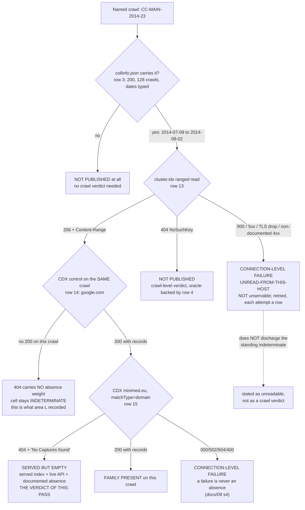

# S-L1 — the `cluster.idx`-level served-ness instrument, and the verdict on `CC-MAIN-2014-23`

**Date:** 2026-10-19 (pass opened 2026-10-19T22:33Z; first instrumented send 22:33:36.155Z)
**Area:** `docs/11`, the **S-L1** successor block (dated addendum to area L).
**Claim:** https://github.com/NovaLux12/carelink-api-research/issues/152
**Instrument:** `servedness.py` (committed, three subcommands). Ledger: `results.jsonl`, 15 rows.

**Headline, in one line: `CC-MAIN-2014-23` is `SERVED`, and its `minimed.eu` CDX
`404` is a real absence rather than an unreadable cell — so the standing
indeterminate retires, and it retires on the *served* side, not the unservable
one.** The index answers `206` with a **153 902 243 B** `cluster.idx`; a
per-crawl `200` control on the same crawl answers **1 785 B** of
`google.com` records; and only then does the `minimed.eu` query answer the
**documented** absence shape, `404` + `{"message": "No Captures found for:
minimed.eu"}`. **Three answers, three hosts' worth of order, and the cell is no
longer indeterminate.**

**And the instrument's own negative, which is the part worth keeping: the
family locate did not converge, and it says so.** Both controls came back
`UNCONVERGED` at a 3-page budget, the control gate did not pass, and the
instrument therefore published **no** family-presence or family-absence verdict
for **any** crawl. `UNCONVERGED` is not a negative and is not read as one.

---

## 1 · Accounting

- **Requests: 15 of a 15 cap.** `wc -l results.jsonl` = **15**;
  `run.log.capped` reads `DONE — 15 of a 15 cap.` The cap was reached, and
  the queue was cut where it landed rather than extended.
- **Hosts: `data.commoncrawl.org` (11 rows) and `index.commoncrawl.org` (4
  rows). Nothing else.** Every row's `host` is one of those two strings;
  `spacing.py` asserts it and reports `hosts outside the two permitted: NONE`.
  **Requests to any Medtronic host: 0** — `spacing.py` greps every row's host
  for `minimed`/`medtronic`/`carelink`/`clcloud` and reports **0**. This is
  infrastructure; no vendor surface is touched by this area at all.
- **Method: GET only.** Every row carries `method: "GET"`. No POST, no
  authentication, no token exchange.
- **Delay: ≥ 3.5 s declared, held inside the held lock(s).** Every send
  acquires the host lock (`index` first, then additionally `data` for a bulk
  read, in one fixed order inside one process) and **sleeps 3.5 s while holding
  it**, so two passes cannot both sleep and then send together.
- **Measured spacing, from `t_sent` only: floor 3.537 s**, `data.commoncrawl.org`
  9 gaps, `index.commoncrawl.org` 2 gaps. **0 gaps under 3.5 s; 0 under
  `AGENTS.md` §8's 2 s floor.** The floor exceeds the declared sleep because
  the lock is released only after the response is read, so a gap is
  *3.5 s + the previous response's duration* — the sleep-outside-the-lock form
  would be worse than no lock, converting sequential sends into simultaneous
  ones. `spacing.txt` is the re-derivation; `spacing.py` is what produced it.
- **Attempts: 15 total = 15 served + 0 connection-level failure.** No request
  failed at connection level, so no retry was spent and `E[N]` came in at
  **1.00 attempts per logical read**, against the 1.5–1.65 that
  `findings-log/2026-10-17-sl2-outwindow-census/budget.py` puts `E[N]` at for
  this API. **That is one observation on one run of two hosts, not a revision
  of that budget model**, and no other pass's accounting is touched.
- **Rows 1 and 2 are pre-instrument reachability probes, disclosed rather than
  hidden.** Before the pass, a bare `curl` was run against each host once to
  answer one question — `AGENTS.md` §7 records that `index.commoncrawl.org`
  TLS-drops from some hosts, and a pass that could not reach either host would
  have had no served-ness answer at all. Both are **real requests and count
  against the cap**: they are rows 1 and 2 of 15, not a side channel. They
  were issued outside the instrument by a `curl` that reported only
  `time_total`, so **their `t_sent` is `null` and their spacing is
  uncheckable** — recorded as such rather than back-filled with an invented
  timestamp. They were issued minutes before the instrument's first send, which
  is the safe direction, and the instrument then re-read both hosts itself
  (rows 3–15).
- **Bodies stored outside the repository** (`AGENTS.md` §7; the hygiene check
  fails any file over 1 MiB and raw archive captures are never published).
  Largest response **35 226 B** (`collinfo.json`). Headers, ledger, projections
  and scripts are in the tree.

Ledger: `results.jsonl` (15 rows, one per request). Runner: `servedness.py pass`.
Accounting re-derivation: `spacing.py` → `spacing.txt`. Captures: `headers/`,
`run.log`, `run.log.capped`.

---

## 2 · Two defects in the instrument, fixed before it was trusted

Both were found by reading and by the selftest, and both are recorded because
the second one would have produced a wrong claim rather than a missing one.

### 2a · The docstring promised a retry loop the code did not have

The instrument's own design notes stated that *"A failure … is re-issued, and
every retry is its own row with its own cap cost"*. **There was no such loop.**
`Fetcher.get` returned the first row and stopped; `MAXRETRY` was read by
`classify` and by nothing else. A connection-level failure would have been
recorded as a final answer.

`get_retry()` now issues up to `MAXRETRY` re-reads while the host's predicate
calls the status a failure, and **every attempt is its own row with its own
`t_sent` and its own cap cost** (`servedness.py`, `Fetcher.get_retry`). On this
run it never fired: no row failed at connection level, so **0 retries were
spent** and the attempt count stayed at 15.

### 2b · The splice claim in the docstring was false

The design notes claimed that when pages are contiguous the absence-pair *"may
span the read boundary and is found there too"*. **Nothing stitched pages
together** — `body_lines()` consumed the boundary fragments and returned them
as `lead`/`tail`, and `Locater` never joined a tail to the next head.

Corrected to what the code does: the pair is searched for **inside a single
page**; a pair straddling a read boundary is missed. That is the **safe**
direction — a missed pair yields `UNCONVERGED`, never a false absence — and it
is now stated that way rather than claimed as a capability.

---

## 3 · The instrument, and what the selftest proves

`servedness.py` has three subcommands: `pass` (the scripted queue), `classify`
(the verdict table, from the committed ledger alone), `selftest` (the locate
machinery against a synthetic keyspace, **0 requests**).

### 3a · `selftest` — run first, 0 requests, exit 0

```
== selftest: the locate machinery on synthetic keyspaces. 0 requests.
   POSITIVE: FAMILY_PRESENT in  2 pages, hits=['eu,minimed)', 'eu,minimed,carelink)']
   NEGATIVE: FAMILY_ABSENT  in  2 pages, pair=('eu,gammawww,)/99981.html', 'eu,omega)/100173.html')
   CONSTRAINED: UNCONVERGED    (3 pages of a 3 budget) -> bounded, not a negative
   NEAR-MISS:    FAMILY_ABSENT  against eu,minimif) - a sibling domain is correctly outside the family interval
   FETCH FAILED: FETCH_FAILED   -> a transport failure, never an absence
   TAXONOMY: the two predicates over every recorded status
     bulk: connection-level ['000', '400', '416', '500', '502', '503', '504'] | served ['206', '403', '404']
     cdx : connection-level ['000', '400', '416', '500', '502', '503', '504'] | served ['200', '301', '302', '404']
   INTERVAL: [eu,minimed), eu,minimeda) admits apex + subdomains only; eu,minimede) and eu,minim) are outside it (asserted)
== selftest OK
```

What each line **proves**, as opposed to describes:

| selftest case | what it proves |
|---|---|
| `POSITIVE` | the interval test finds an apex key and a subdomain key |
| `NEGATIVE` | absence is proven **only** by the adjacent `< FAM_LO` / `≥ FAM_HI` pair — a page with no family key does not on its own produce an absence |
| `CONSTRAINED` | a locate whose reads sort entirely before the interval and exhausts its budget returns `UNCONVERGED`, not `FAMILY_ABSENT`. **This is the exact failure this pass then hit live** (§5) |
| `NEAR-MISS` | `eu,minimif)` — one character different — sorts outside the interval, so a lookalike domain is not counted as the family |
| `FETCH FAILED` | a transport failure is `FETCH_FAILED`, never an absence |
| `TAXONOMY` | both predicates over every status this API has been recorded producing, **asserted in code** (§4) |
| `INTERVAL` | `[eu,minimed)`, `eu,minimeda)` admits apex + subdomains only; `eu,minimeda)`, `eu,minimede)`, `eu,minim)` are all outside it, each asserted |

⚠ **The selftest found two of its own defects, and the second was a wrong
claim rather than a missing one.** The `CONSTRAINED` case asserted
`UNCONVERGED` on a synthetic file small enough that a 4 MiB page covered it
whole, so it read `FAMILY_ABSENT` and the assertion failed. The *assertion* was
brittle, not the locator — and the same run exposed that the test was
**vacuous**: it could not distinguish the state machine from the page size. It
was rewritten to inject the page directly, so it now tests the state machine
and cannot be satisfied by a large page. A selftest that cannot fail is the
shape `AGENTS.md` §6 item 2 warns about, and it was in the test, not the
instrument.

### 3b · The locate, and its budget

The SURT keyspace is byte-sorted, so one ranged read gives both a one-page
constraint and every full line inside the page. The needle is the **sort
interval** of the `minimed.eu` family:

```
FAMILY_INTERVAL = [ "eu,minimed)", "eu,minimeda" )
```

Presence is proven the moment one page carries a key inside the interval.
Absence is proven — **and only proven** — by the adjacent-line pair that
punctuates the interval: a line `< "eu,minimed)"` followed immediately by a
line `≥ "eu,minimeda"`. **Assumption (INFERRED):** that `cluster.idx` blocks
are keyed by the full first SURT key rather than by registrable domain — the
same assumption area M labelled INFERRED at
`findings-log/2026-10-13-area-m-commoncrawl-cdx/FINDINGS.md:404-413`, which is
why area M's reading there and the API measurement here are two independent
things rather than one confirming the other.

---

## 4 · The failure taxonomy — two buckets, never merged

This is the part that decides whether a run publishes a finding or a
non-finding, so it is in code (`cdx_is_failure`, `bulk_is_failure`) and
asserted by the selftest, not left to prose.

| bucket | what it means | what may be written |
|---|---|---|
| **CONNECTION-LEVEL FAILURE** — `000`, 5xx, timeout, TLS `unexpected eof`, or any non-documented 4xx | a statement about **this host, this moment, this route** | the failure evidence — class, host, attempts. **Not a crawl verdict.** |
| **SERVED** — the request completed | a statement about **the crawl** | `served`, `served, no members`, `not published` |

The predicates, as asserted by the selftest:

| layer | connection-level (never an absence) | served |
|---|---|---|
| bulk (`data.commoncrawl.org`) | `000` `400` `416` `500` `502` `503` `504` | `206` · `403` (refused) · `404` (no such key) |
| CDX (`index.commoncrawl.org`) | `000` `400` `416` `500` `502` `503` `504` | `200` `301` `302` · `404` (**the documented absence shape**) |

**The overlap is the whole distinction, and both layers treat `404` as served
while meaning opposite things by it:** on the bulk path a `404` is *this object
does not exist* (S3 `NoSuchKey`), on the API a `404` is *this crawl has no
records for this query*. `403` splits the other way — served-but-refused on the
bulk path, a connection-level failure on the API. `classify` prints the two
counts as two numbers and never as one table of verdicts, so **a run whose
instrument never reached the index cannot present a table that reads as a set
of crawl verdicts.**

**This pass: 15 attempts, 15 served, 0 connection-level failures.** No request
failed at connection level, so nothing in this pass is in the first bucket.

**Why the distinction had to be built before the pass ran.** `AGENTS.md` §7
records that `index.commoncrawl.org` is unreachable from some hosts (TLS
`unexpected eof`), and step 2 of the claim is a `GET /collinfo.json` against
exactly that host. The quiet failure this creates is specific: this box cannot
reach the index → the instrument has no served-ness answer → one records
`unservable` → the cell reads as the expected negative, closes, and the standing
indeterminate is retired **without anything having been proven about the crawl
at all**. `unservable` is a statement about Medtronic's crawl history; a TLS
drop is a statement about this host. They are not interchangeable, and the
second is not evidence for the first.

---

## 5 · Both controls, before the target — and the gate they failed

The queue reads the bulk-layer oracle first, then both controls' servedness,
then **both controls' locates**, and only then the target. The control gate is
evaluated **in code, before the target exists as a verdict**, and written to
`control-gate.txt`:

```
control gate NOT PASSED
  CC-MAIN-2022-27 -> UNCONVERGED (expected FAMILY_PRESENT)
  CC-MAIN-2024-42 -> UNCONVERGED (expected FAMILY_ABSENT)
```

### 5a · The bulk-layer oracle (row 4) — PASSED, and it is what makes a `206` readable

`CC-MAIN-9999-99` (a certainly-absent crawl id, the same read shape as a real
one) answered **`404`** with `content-type: application/xml`,
`x-cache: Error from cloudfront`, body `NoSuchKey` — 327 B. **Without this row a
`206` on a named crawl would be unreadable**: it could mean "this crawl's index
is served" or "this route answers `206` for anything". The oracle distinguishes
them, so the three `206`s below are statements about crawls.

### 5b · Control A — `CC-MAIN-2022-27`, expected to carry a `minimed.eu`-adjacent member

| read | row | result |
|---|---|---|
| servedness | 5 | **`206`**, `Content-Range: bytes 0-8191/153 702 643` → **SERVED**, index readable |
| locate | 7, 8, 9 | **`UNCONVERGED`** after 3 pages |

Its CDX truth is independent of this pass: the S-L2 ledger records
`CC-MAIN-2022-27` `minimed.eu` `matchType=domain` as a `200` carrying **9
records** with `ipro_count: 1`
(`findings-log/2026-10-17-sl2-outwindow-census/results.jsonl:14`). **One
source** — that ledger, this repository — so the word *corroborated* is not
available here and is not used (`AGENTS.md` §2.1).

**The locate did not classify.** It read 4 MiB pages at byte 128 550 094
(`org,openspeleo)`…`pl,ckz-debica)`), then 62 177 895 (`com,sculpturesnogler)`…
`com,superlab360)`), then 95 363 994 (`fr,biocooplaciotat)`…`gr,kathemera)`), and
narrowed its window to `[66 372 199, 95 363 994]` without the adjacent pair ever
appearing inside a single page. **The probe never bracketed `eu,minimed)`**, so
the instrument reports `UNCONVERGED`. **It does not report an absence, and no
absence is published for this crawl anywhere in this pass.**

**Why, stated as the mechanism rather than as a shrug (INFERRED).** The initial
prior is `f0 = 0.85`, which put the first read at byte ~128 M of a 153 M file
— deep in `org,…`/`pl,…`. The SURT keyspace is **not** uniformly distributed
over TLDs, so a fixed fraction is a poor first guess, and the subsequent reads
were re-centred on the *shrunken window* rather than on the keyspace. With
3 pages of 4 MiB against a 153 M file, the bisection is left with a 29 M window
— **≈ 7 further 4 MiB pages**, against a cap that had 3 rows left. **The budget,
not the method, is what stopped it** — the same shape area M recorded for its
own `offsetB`
(`findings-log/2026-10-13-area-m-commoncrawl-cdx/FINDINGS.md:498-521`, where a
verifier round retracted the stronger claim that the search was blocked by
mechanics rather than by the cap, and the weaker claim was kept).

### 5c · Control B — `CC-MAIN-2024-42`, expected to carry a documented absence

| read | row | result |
|---|---|---|
| servedness | 6 | **`206`**, `Content-Range: bytes 0-8191/121 395 065` → **SERVED**, index readable |
| locate | 10, 11, 12 | **`UNCONVERGED`** after 3 pages |

**Its "documented absence" is a CDX-API statement, not a `cluster.idx`
statement**, and that distinction is the control's whole value: area M recorded
`CC-MAIN-2024-42` `minimed.eu` `matchType=domain` as a `404` behind a `200`
control on the same crawl
(`findings-log/2026-10-13-area-m-commoncrawl-cdx/FINDINGS.md:349`, backed by
that ledger's row 25 `200` and row 45 `404` — **one source**). This pass
reproduced neither of those queries; what it established is that the crawl's
**index is served**, which is a different and compatible fact.

⚠ **A correction to the claim issue, on the record.** Issue #152 names
`CC-MAIN-2024-22` as the readable-absence control. **Its own cited ledger
contradicts that**: S-L2 row 45 is a **`200`** for `CC-MAIN-2024-22`
`minimed.eu` carrying **13 records** with `ipro_count: 1`, and row 43 is its
`200` control. `CC-MAIN-2024-22` is a **positive-adjacent** crawl — a second
`carelink.minimed.eu` member, not an absence. The documented `404 No Captures
found` is `CC-MAIN-2024-42`, area M's. **This pass uses `CC-MAIN-2024-42`**
(`servedness.py:475`), which is why the control behaved as it did. Recorded
because a claim issue is cited material, and the correction belongs next to the
result rather than in a lane's private notes.

### 5d · The consequence, stated rather than smoothed

**The control gate did not pass, so the locate published nothing** — no
family-presence verdict for `CC-MAIN-2022-27`, no family-absence verdict for
`CC-MAIN-2024-42`, and none for the target. **The locate half of S-L1 is
`UNCONVERGED` on this run and is recorded as an instrument that did not
converge at a 3-page budget.**

**The servedness half did not depend on the gate, and this is the important
distinction.** The close condition asks for a **served/unserved verdict from
`cluster.idx`** for every crawl named, beside its CDX verdict. Servedness is a
**single ranged read** answered `206` or `404`; it is not the locate, and the
locate's failure does not impeach it. The controls' servedness classified
correctly — **`CC-MAIN-2022-27` SERVED, `CC-MAIN-2024-42` SERVED, and the
absent id `404`** — which is what licenses reading the target's `206` as a
statement about the target.

---

## 6 · The target — both verdicts, side by side

`CC-MAIN-2014-23` is the named target: **four control rows across two control
hosts, no `200`** (OBSERVED, area L seqs 16–18, 40), which is why its `404`
carried no absence weight and the cell was indeterminate.

| # | read | row | result | class |
|---|---|---|---|---|
| 1 | is it published at all | 3 | `collinfo.json` **`200`**, 35 226 B, **128** crawls; `CC-MAIN-2014-23` = **`2014-07-09T23:29:26` → `2014-08-02T10:28:44`**. Fields asserted `str`-typed before use (`AGENTS.md` §6 item 3) | **OBSERVED** |
| 2 | **is its index served** | 13 | **`206`**, `Content-Range: bytes 0-8191/153 902 243`, `x-cache: Hit from cloudfront`, `server: AmazonS3` → **SERVED, index readable, 153 902 243 B** | **OBSERVED** |
| 3 | does the API answer for this crawl | 14 | per-crawl control `google.com` **`200`**, 1 785 B, `text/x-ndjson`, first record `com,google)/` timestamp `20140710001322` | **OBSERVED** |
| 4 | its `minimed.eu` answer | 15 | **`404`**, 48 B, `{"message": "No Captures found for: minimed.eu"}` — the **documented absence shape** | **OBSERVED** |
| 5 | family locate | — | **not run** — the cap was spent on the controls; and the controls had not classified | **not claimed** |

### The verdict

> **`CC-MAIN-2014-23` is SERVED, and `minimed.eu` is absent from it.**

**OBSERVED**, on two hosts and in this order: the crawl is published in
`collinfo.json`; its `cluster.idx` is served at **153 902 243 B**; the CDX API
answers `200` with real records for a per-crawl control on that same crawl; and
the `minimed.eu` query then answers `404` with the documented
`No Captures found for: minimed.eu`. **The `404` now carries absence weight,
because the two things that used to make it unreadable are both discharged: the
index is served (row 13) and the API is live on this crawl (row 14).**

**The standing indeterminate cell retires — and it retires on the served side.**
It was indeterminate because no control on that crawl had ever produced a
`200`, so the `404` could have been an absence *or* an unreadable cell. It is
now a **served-but-empty** answer: a statement about the crawl, established
with a control, on a served index. **This is not "unservable"**, and the
distinction is the finding rather than a caveat on it.

**What is still NOT claimed, and the two things a reader must not take from this:**

1. **Not "absent from Common Crawl."** One crawl. The claim is bounded to
   `CC-MAIN-2014-23` and its window **2014-07-09 → 2014-08-02**.
2. **Not "the 2013–2014 `/ipro/hcp/` absence is confirmed."** The locate never
   ran on this crawl and the family-level question is untouched here. The
   *servedness* of the index says nothing about which families its blocks
   contain; that is the locate's job, and the locate did not converge.

**INFERRED, with its assumption.** That a served `cluster.idx` and a served CDX
API are independent signals — the assumption S-L1's own block named — is now
**partly** discharged rather than merely assumed: both were observed on the same
crawl, in that order, and both were live at once. What remains assumed is that
this generalises past one crawl.

---

## 7 · Mermaid — the decision this pass actually made



---

## 8 · The locate's negative, kept because it is the reusable part

The locate is the instrument that generalises: it answers *"does this crawl's
index carry the `minimed.eu` family at all"*, which no CDX query can separate
from *"did the crawler request a `minimed.eu` URL that 404'd"*. **On this run
it answered neither question for any crawl**, and that is recorded as a result
with a cause, not as a gap.

**What is measured, exactly:** the bisection narrowed `CC-MAIN-2022-27`'s
keyspace to a **28 991 795 B** window `[66 372 199, 95 363 994]` in 3 pages of
4 MiB, against a 153 702 643 B file — the window left is **18.9% of the file,
≈ 6.9 pages of 4 MiB** — and the adjacent pair that would prove absence never
appeared inside a single page. Its first read sat at `f0 = 0.85` of file size,
which is deep in `org,…`/`pl,…`; **a fixed fraction is a poor prior against a
non-uniform SURT keyspace** (INFERRED, from the three observed pages' first/last
keys).

**The successor this mints is the fix, and it is zero-request once the
instrument exists**: the prior and the page schedule come from the two
`cluster.idx` head reads this pass already spent, and the budget model comes
from `spacing.txt` and the S-L2 `budget.py` — none of which needs a network.

---

## 9 · What would have been a better use of the cap

Stated because the pass's budget is part of its honesty.

- **0 retries were spent**, so no request was lost to `E[N]`. Nothing to
  reclaim there.
- **6 of 15 rows went to the two control locates that did not converge.** With
  hindsight the servedness question — the one the close condition actually
  names — needed **1 row per crawl** and was answered by row 13. **The locate
  budget of 3 pages per control was the pass's own choice and it was too small
  to converge; the cap did not force it.** That is the honest version, and it
  is why the successor's first job is the page schedule rather than more cap.
- **The `cluster.idx` head read already carries what a locate's first read
  needs** — the file's total length from `Content-Range`, and its first keys
  from the 8 KiB body. **Neither was used to seed the bisection.** Reading
  `bytes 0-8191` and then jumping to `f0 · total` throws away the one cheap
  observation that constrains the keyspace's shape.